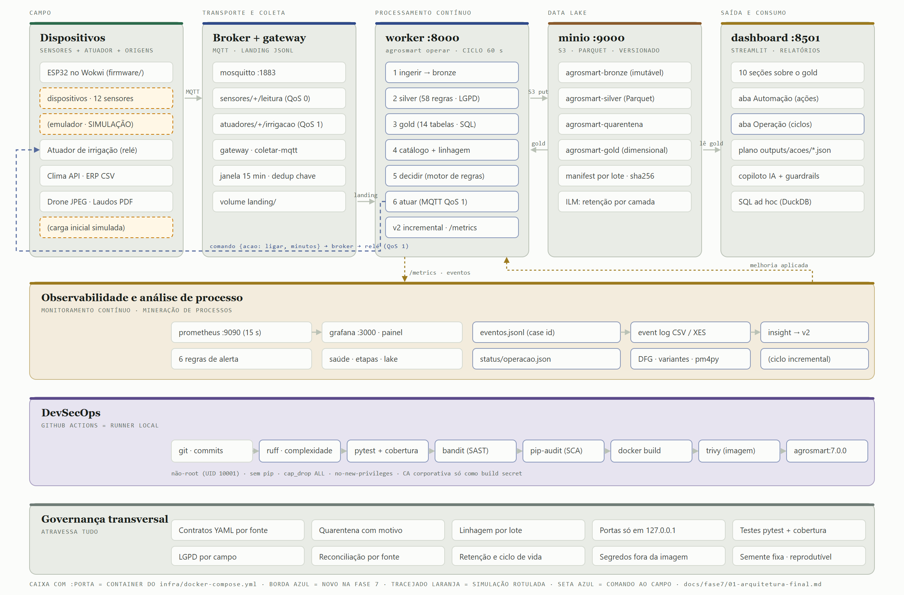
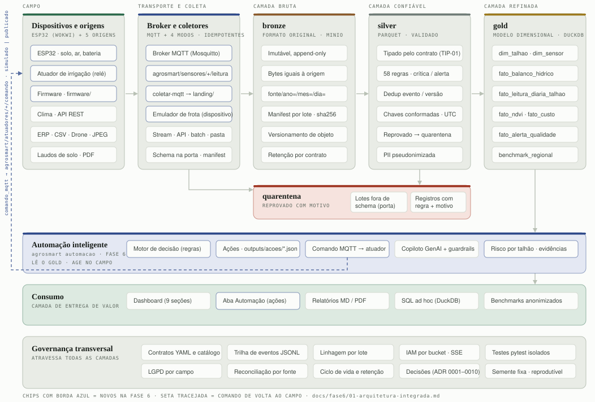

# AgroSmart — Fase 7 (entrega final)

Plataforma completa de dados e IA para decisão no campo: coleta IoT (ESP32 + MQTT), Data Lake em
camadas, automação que age no atuador de irrigação, dashboard — e, na Fase 7, **execução contínua
em containers**, **monitoramento** (Prometheus + Grafana + alertas), **esteira DevSecOps** e
**mineração de processos** sobre o próprio ciclo. As Fases 5 e 6 continuam documentadas abaixo.

> Entrega em grupo · PBL Fase 7 · Turma **4ESOA** · prazo 24/11/2026 · repositório: <https://github.com/LucasHenklain/AgroSmart-Fase-7>

## Fase 7 — em um comando

```bash
docker compose -f infra/docker-compose.yml up -d --build   # 9 serviços: lake, broker, gateway, worker, dashboard, monitoramento
```

| Abra | Para ver |
|---|---|
| <http://localhost:8501/?secao=operacao> | dashboard: gold, Automação e Operação |
| <http://localhost:3000> | Grafana · painel "AgroSmart · Operação da plataforma" |
| <http://localhost:9090/alerts> | Prometheus · 6 regras de alerta |
| <http://localhost:8000/status> | worker: saúde, último ciclo, métricas (`/metrics`, `/health`) |

Rede corporativa com inspeção TLS: `AGROSMART_CA_EXTRA=/caminho/ca.pem` antes do `up --build`
(a CA entra só como *build secret*). Sem Docker: `python -m pip install -e ".[dev,ia,app,iot]"` e
`agrosmart operar --ciclos 3` (worker no host; MinIO e Mosquitto continuam necessários, ou
`AGROSMART_BACKEND=filesystem`).



| Requisito (peso) | Onde está |
|---|---|
| 1. Arquitetura final (15 %) | `docs/fase7/01-arquitetura-final.md`, `docs/diagramas/arquitetura-fase7.{svg,png}` |
| 2. Execução da plataforma (20 %) | `docs/fase7/02-execucao-plataforma.md`, `infra/docker-compose.yml`, `src/agrosmart/operacao/`, `outputs/plataforma/`, `outputs/prints/fase7-02-*` |
| 3. Pipeline DevSecOps (20 %) | `docs/fase7/03-pipeline-devsecops.md`, `Dockerfile`, `.github/workflows/devsecops.yml`, `scripts/pipeline_local.py`, `outputs/pipeline/` |
| 4. Monitoramento e execução automatizada (10 %) | `docs/fase7/04-monitoramento.md`, `infra/monitoramento/`, `outputs/prints/fase7-04-*`, `outputs/prints/timelapse/` |
| 5. Análise de processo + demonstração (25 %) | `docs/fase7/05-analise-de-processos.md`, `src/agrosmart/mineracao/`, `outputs/processos/`, `data/exemplos/fase7/event_log_exemplo.csv`, `entrega/apresentacao-agrosmart-fase7-4ESOA.mp4` |
| 6. Pitch e visão de produto (10 %) | `docs/fase7/06-pitch-visao-produto.md`, `entrega/pitch/`, `entrega/pitch-agrosmart-fase7-4ESOA.mp4` |

Checklist da rubrica: [`entrega/CHECKLIST-RUBRICA-FASE7.md`](entrega/CHECKLIST-RUBRICA-FASE7.md) ·
PDFs em `docs/pdf/fase7/` · links dos vídeos em `entrega/LINK_VIDEO.txt`.

Comandos novos: `agrosmart operar` (worker contínuo, `--incremental`), `agrosmart status [--url]`,
`agrosmart processos` (mineração de processos), `python scripts/pipeline_local.py` (pipeline DevSecOps
local), `python scripts/injetar_falhas.py` (experimento de falhas), `python scripts/capturar_operacao.py`
(prints), `agrosmart empacotar --fase 7`.

## Equipe

| Integrante | RM |
|---|---|
| Lucas Dalmas | 551178 |
| Lucas Emanuel | 97881 |
| Kayque Moraes | 97592 |
| Lucas Henklain | 99350 |
| Vinicius Pinheiro | 99198 |

Zip da entrega: `lucasmoraeshenklaindasilva_99350_4ESOA_fase7_atividade.zip` (gerado por `agrosmart empacotar --fase 7`; `--fase 6` e `--fase 5` reproduzem as entregas anteriores).

## Fase 6 — o que foi entregue



| Requisito | Peso | Onde está |
|---|---|---|
| 1. Arquitetura integrada (diagrama + componentes) | 20 % | `docs/fase6/01-arquitetura-integrada.md`, `docs/diagramas/arquitetura-fase6.{svg,png}` (gerados por `scripts/gerar_diagrama_fase6.py`) |
| 2. Coleta de dados IoT (ESP32/Wokwi → MQTT → gateway → landing) | 20 % | `docs/fase6/02-coleta-iot.md`, `firmware/wokwi-esp32/`, `infra/docker-compose.yml` (Mosquitto), `src/agrosmart/ingestao/mqtt_gateway.py`, `src/agrosmart/simuladores/dispositivo_mqtt.py`, `data/exemplos/fase6/landing/` |
| 3. Processamento e preparação (landing → bronze → silver → gold) | 20 % | `docs/fase6/03-processamento.md`, `src/agrosmart/{ingestao,processamento,qualidade}/`, `data/exemplos/fase6/processado/*.csv` |
| 4. Automação inteligente (motor de decisão → ações → comando MQTT) | 20 % | `docs/fase6/04-*.md`, `src/agrosmart/automacao/`, `outputs/acoes/acoes_<data>.{json,md}` |
| 5. Dashboard analítico (indicadores, evolução, alertas e ações) | 20 % | `docs/fase6/05-dashboard.md`, `app/dashboard.py` (aba **Automação**), `outputs/prints/fase6-05-dashboard-*.png` |
| 6. Vídeo (3–5 min) | — | `entrega/roteiro-video-fase6.md`, `entrega/LINK_VIDEO.txt`, `entrega/apresentacao-agrosmart-fase6-4ESOA.mp4` |

Checklist da rubrica → artefato: [`entrega/CHECKLIST-RUBRICA-FASE6.md`](entrega/CHECKLIST-RUBRICA-FASE6.md).
PDFs dos documentos da Fase 6 em `docs/pdf/fase6/` (`python scripts/exportar_pdf.py`).

### O ciclo em oito comandos

```bash
docker compose -f infra/docker-compose.yml up -d     # MinIO (lake) + Mosquitto (broker MQTT, porta 1883)
agrosmart dispositivo --duracao-s 120                 # emula os 12 dispositivos publicando (ou o ESP32 no Wokwi)
agrosmart coletar-mqtt --duracao-s 120                # gateway: tópico → landing/sensores/<dia>/leituras_*.jsonl
agrosmart ingerir && agrosmart processar              # bronze → silver → gold → catálogo (inalterado desde a Fase 5)
agrosmart automacao                                   # plano de ações em outputs/acoes/ (status: simulado)
agrosmart automacao --publicar                        # ... e comando MQTT ao atuador de irrigação (status: publicado)
streamlit run app/dashboard.py                        # http://localhost:8501/?secao=automacao
agrosmart empacotar --nome "Nome Completo" --rm RM --turma 4ESOA --fase 6
```

## Rodando em três comandos

```bash
# 1. dependências (Python ≥ 3.11); o extra `iot` traz o paho-mqtt da coleta e da automação
python -m pip install -e ".[dev,ia,app,iot]"

# 2. infraestrutura (MinIO + Mosquitto em Docker) — ou pule e use o plano B abaixo
docker compose -f infra/docker-compose.yml up -d

# 3. o ambiente está pronto?
agrosmart doctor
```

Console do MinIO: <http://localhost:9001> (usuário `agrosmart`, senha `agrosmart123`).

**Plano B sem Docker:** copie `.env.example` para `.env` e troque
`AGROSMART_BACKEND=filesystem`. O lake passa a viver em `./datalake/` com a
mesma topologia de camadas; nenhuma outra linha muda. Para a coleta, qualquer
broker MQTT acessível serve (`--broker`, `--porta`).

## Mapa dos artefatos da Fase 5

| Entrega | Peso | Onde está |
|---|---|---|
| 1. Arquitetura de Data Lake | 25 % | `docs/01-arquitetura-datalake.md`, `docs/diagramas/arquitetura-datalake.svg`, `docs/adr/`, `infra/docker-compose.yml`, `app/dashboard.py` (consumo) |
| 2. Ingestão, administração e manutenção | 25 % | `docs/02-ingestao-e-manutencao.md`, `docs/runbook-operacao.md`, `contratos/`, `src/agrosmart/ingestao/`, `data/exemplos/`, `outputs/dq_report.json`, `outputs/prints/` |
| 3. IA generativa para apoio à decisão | 25 % | `docs/03-ia-generativa.md`, `src/agrosmart/ia/`, `outputs/relatorios/`, `outputs/avaliacao_ia.json` |
| 4. Modelo de negócio e inteligência de dados | 25 % | `docs/04-modelo-de-negocio.md`, `docs/diagramas/canvas-fase5.svg`, `entrega/roteiro-video.md` |

Checklist da Fase 5: [`entrega/CHECKLIST-RUBRICA.md`](entrega/CHECKLIST-RUBRICA.md).
Os documentos estão em Markdown e **também em PDF** em [`docs/pdf/`](docs/pdf/); os diagramas, em SVG e PNG em `docs/diagramas/` (gerados por `scripts/exportar_pdf.py`).

## Como o código está organizado

```
contratos/            um YAML por fonte: schema, ingestão, retenção e regras de qualidade
firmware/             ESP32 no Wokwi: sketch e diagrama do circuito (Fase 6)
infra/                docker-compose com MinIO (+ bootstrap dos buckets) e Mosquitto (broker MQTT)
src/agrosmart/
  config.py           onde o lake vive (minio | filesystem) e como é endereçado
  storage.py          acesso ao lake por (camada, chave) — mesmo código nos dois backends
  contratos.py        carga e validação cruzada dos contratos
  log.py              log de console + trilha de eventos JSONL
  simuladores/        uma trajetória agronômica → 6 fontes, com defeitos injetados;
                      dispositivo_mqtt.py emula os dispositivos publicando no broker (Fase 6)
  ingestao/           4 coletores landing → bronze; mqtt_gateway.py: broker → landing (Fase 6)
  qualidade/          regras dos contratos → silver ou quarentena
  processamento/      bronze → silver → gold, compactação e retenção
  catalogo/           inventário, dicionário de dados e linhagem
  ia/                 context pack → recomendação com guardrails → MD/PDF com proveniência
  automacao/          motor de decisão sobre o gold → plano de ações → comando MQTT (Fase 6)
  orquestracao.py     run --all e backfill por intervalo
  empacotar.py        zip da entrega no padrão exigido (--fase 5 | 6), testado
  pipeline.py         CLI
app/dashboard.py      camada de consumo (Streamlit) sobre o gold + aba Automação
scripts/              empacotar, exportar_pdf, capturar_dashboard, gerar_diagrama_fase6
landing/              onde as "origens" depositam o que produzem (simulador ou gateway MQTT)
data/exemplos/        amostras curadas que vão na entrega (não é o lake); fase6/ tem landing e processado
outputs/              simulacao, ingestao, dq_report, gold, catalogo, avaliacao_ia, run, coleta_mqtt,
                      acoes/ (planos da automação), relatórios, prints, logs
docs/                 documentos da Fase 5 + fase6/ + dicionário + runbook + ADRs + diagramas + pdf/
entrega/              roteiros dos vídeos, checklists das rubricas, link do vídeo, zip gerado
tests/                pytest — nunca toca o lake real
```

## Comandos

```
agrosmart doctor                 verifica config, dependências, contratos e o lake
agrosmart init                   cria diretórios e as camadas (buckets ou pastas)
agrosmart contratos              lista as fontes com tipo, LGPD, SLA e regras
agrosmart contratos sensores     schema e regras de uma fonte
agrosmart simular                gera 30 dias das 6 fontes em landing/ (determinístico)
agrosmart simular --dias 3       janela curta, para experimentar
agrosmart dispositivo            Fase 6: emula os 12 dispositivos de campo publicando por MQTT (--n, --intervalo-s, --duracao-s)
agrosmart coletar-mqtt           Fase 6: assina agrosmart/sensores/+/leitura e grava micro-batches JSONL na landing (--janela-min, --duracao-s)
agrosmart ingerir                landing → bronze, com manifest por lote e exemplos em data/exemplos
agrosmart ingerir --forcar       regrava lotes já ingeridos (nova versão)
agrosmart processar              bronze → silver (qualidade, LGPD) → gold (SQL) → catálogo + dicionário
agrosmart processar --camada silver --fonte sensores
agrosmart qualidade              relatório de qualidade da última execução (dq_report.json)
agrosmart catalogo               inventário do lake + docs/dicionario-de-dados.md regenerado
agrosmart manter                 compacta o silver e simula a retenção dos contratos
agrosmart manter --aplicar       ... e remove de fato o que passou da retenção
agrosmart sql "SELECT talhao_id, avg(fracao_agua_disponivel) FROM fato_balanco_hidrico GROUP BY 1"
agrosmart ia contexto TLH-03      o Context Pack: tudo que o copiloto pode saber sobre o talhão
agrosmart ia gerar                recomendações (3 casos × talhões) em outputs/relatorios/, MD + PDF + proveniência
agrosmart ia gerar --motor regras sem API: só o motor de regras (fallback e baseline)
agrosmart ia avaliar              casos × talhões × motores: guardrails, fallbacks, concordância
agrosmart automacao               Fase 6: lê o gold, decide por talhão e grava outputs/acoes/acoes_<data>.{json,md}
agrosmart automacao --publicar    ... e publica os comandos de irrigação no broker (QoS 1); --dry-run só mostra o plano
agrosmart run --all               tudo acima, na ordem, com resumo por etapa em outputs/run.json
agrosmart run --all --sem-simular origens reais: não gera landing (use com coletar-mqtt)
agrosmart run --from 2026-08-21 --to 2026-08-25   backfill: reprocessa só o intervalo a partir do bronze
agrosmart empacotar --nome "Nome Completo" --rm RM12345 --turma 1TDSA --fase 6   zip da entrega, testado (--fase 5 ainda funciona)
streamlit run app/dashboard.py    camada de consumo sobre o gold (seções Talhão … Benchmark, Automação)
python scripts/capturar_dashboard.py --prefixo fase6-05-dashboard   capturas de cada seção em outputs/prints/
python scripts/exportar_pdf.py    PDFs de docs/ e docs/fase6/ + PNG dos diagramas
```

## Princípios que orientam as decisões

- **Contrato antes de código.** Cada fonte tem um contrato YAML que gera coletor,
  regras de qualidade, catálogo e dicionário. Nada é escrito duas vezes — e foi o
  contrato que permitiu trocar o simulador por um gateway MQTT real sem tocar no lake.
- **Bronze é imutável.** O dado bruto nunca é alterado; é a única fonte da verdade
  para reprocessar o lake quando uma regra muda.
- **Dado ruim não é descartado — é quarentenado com o motivo.** Registro reprovado
  é evidência de problema na origem e precisa ser investigável.
- **A IA recomenda, o produtor decide; a automação age só com evidência.** Toda saída
  do copiloto aponta os dados que usou e é validada por guardrails; toda ação do motor
  de decisão cita as linhas do gold que a motivaram, e nada é publicado no campo sem
  `--publicar` explícito.
- **Reprodutível por quem corrige.** Semente fixa, Docker, um comando. Os prints
  da entrega podem ser refeitos por qualquer avaliador.

## Desenvolvimento

```bash
python -m pytest            # testes
ruff check src tests app    # lint
ruff format src tests app   # formatação
```

Cada subpacote tem um responsável (E1–E4) declarado no seu `__init__.py`.
Integração via pull request pequeno; um dono por pasta evita conflito de merge.
