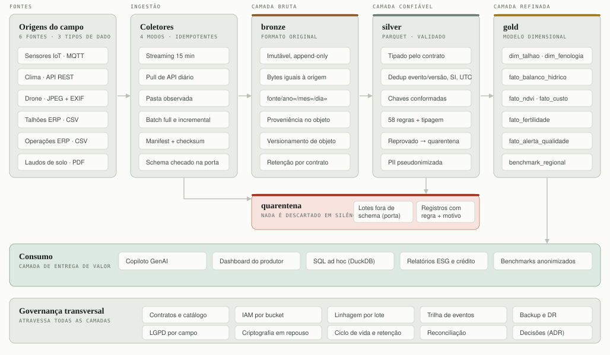
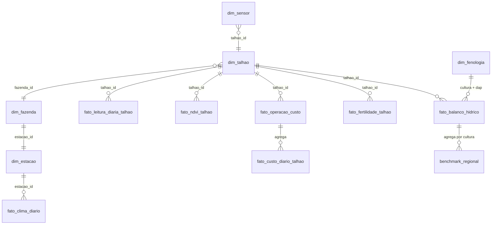

# Entrega 1 — Arquitetura de Dados com Data Lake

> Peso: 25 % · Artefatos: diagrama da arquitetura + explicação textual de cada camada
> Status: **implementado e verificado**. Tudo descrito aqui roda com `docker compose -f infra/docker-compose.yml up -d` e `agrosmart run --all`; a camada de consumo abre com `streamlit run app/dashboard.py`.

## 1. Visão geral



O AgroSmart organiza os dados do campo em um Data Lake de **três camadas de valor crescente** — bruta, confiável e refinada — mais uma **quarentena** para o que foi reprovado, e uma camada de consumo que serve o copiloto de IA, o dashboard, consultas SQL e produtos de dados. Seis fontes entram, de três naturezas:

| Fonte | Natureza | Formato bruto | Modo de ingestão | Volume em 30 dias |
|---|---|---|---|---|
| Sensores de solo e ar (12 dispositivos) | estruturado | JSONL | streaming, micro-batch de 15 min | 34.431 leituras em 2.892 lotes |
| Estações meteorológicas (2) | semiestruturado | JSON (envelope de API) | pull diário | 60 dias-estação |
| Imagens de drone e satélite | **não estruturado** | JPEG + sidecar JSON | pasta observada | 60 cenas |
| Cadastro de talhões (ERP) | estruturado | CSV, carga completa | batch diário | 31 snapshots × 6 talhões |
| Operações de campo (ERP) | estruturado | CSV, incremental | batch diário | 49 lançamentos |
| Laudos de análise de solo | **não estruturado** | PDF + sidecar JSON | pasta observada | 8 laudos |

O que atravessa todas as camadas: **um contrato por fonte** (`contratos/*.yaml`) que declara schema, ingestão, particionamento, deduplicação, retenção, marcação LGPD e regras de qualidade. Coletor, tipagem, qualidade, catálogo e dicionário são derivados dele ([ADR 0005](adr/0005-contratos-yaml-como-fonte-unica.md)).

## 2. Princípios que organizam a arquitetura

1. **O bronze é a verdade.** Bytes idênticos à origem, imutáveis, versionados. Qualquer regra pode mudar e o lake inteiro é reconstruível ([ADR 0006](adr/0006-bronze-imutavel-metadados-no-manifest.md)).
2. **Confiança é uma etapa, não um adjetivo.** O silver só recebe o que passou pelas regras do contrato; o resto vai para a quarentena com o id da regra e o motivo ([ADR 0004](adr/0004-quarentena-como-quarta-camada.md)).
3. **Nada se perde em silêncio.** `declarados = lidos = aprovados + quarentena + substituídos` fecha em toda fonte, a cada execução.
4. **Chaves conformadas.** `talhao_id`, `fazenda_id`, `sensor_id` e `estacao_id` significam a mesma coisa em todas as fontes; `erp_talhoes` é ingerido primeiro porque as demais checam integridade contra ele.
5. **Metadado gerado, nunca escrito à mão.** Catálogo, dicionário e linhagem saem do lake e dos contratos.
6. **Reprodutível em qualquer máquina.** Semente fixa, data de referência fixa, dois backends de armazenamento com a mesma chave lógica ([ADR 0001](adr/0001-object-store-s3-com-minio.md)).

## 3. As camadas

### 3.1 Bruta — `agrosmart-bronze`

**Função.** Preservar o dado exatamente como a origem o produziu, com proveniência suficiente para auditar e reprocessar.

| Aspecto | Como é |
|---|---|
| O que entra | Todo lote que passou pela **checagem de schema na porta** (cabeçalho do CSV, chaves do JSON, envelope da API, binário presente) |
| Formato | O original: JSONL, JSON, CSV, JPEG, PDF. Nenhuma transformação — testado byte a byte |
| Organização | `<fonte>/ano=AAAA/mes=MM/dia=DD/<arquivo original>`; binário e sidecar na mesma partição |
| Proveniência | Metadados no objeto (`batch-id`, `ingested-at`, `sha256`, `schema-version`) e um manifest por lote em `_manifests/<fonte>/<partição>/<batch_id>.json` |
| Idempotência | `batch_id` determinístico; conteúdo igual → lote pulado; conteúdo novo → nova versão do objeto e `versao + 1` no manifest |
| Invariantes | *append-only*; versionamento de bucket ligado; nunca lido pela camada de consumo |
| Retenção | declarada por contrato: 90 dias para sensores (depois frio), 365 para ERP, 1.825 para imagens, permanente para laudos |

### 3.2 Confiável — `agrosmart-silver`

**Função.** Transformar dado bruto em dado em que se pode confiar, sem ainda decidir *para quê* ele serve.

| Aspecto | Como é |
|---|---|
| O que entra | Registros que passaram por: tipagem pelo contrato (falha = `TIP-01`), todas as regras críticas, deduplicação pela chave natural |
| Transformações | tipos declarados; timestamps em UTC; unidades canônicas (L → m³, t → kg); tradução dos nomes da API de clima para o contrato; pseudonimização dos campos marcados `lgpd` (`OPE-014` → `OPE~5f3a9c1b2d`) |
| Deduplicação | `evento` (fatos imutáveis: repetição é duplicata → quarentena) ou `versao` (registros reenviados: fica a versão mais recente **válida**, anteriores em `_substituidos/`) — [ADR 0007](adr/0007-dedup-evento-versus-versao.md) |
| Formato | Parquet zstd, um arquivo por dia da **coluna de evento** do contrato, partição Hive `ano=/mes=/dia=`; compactável para um arquivo por mês ([ADR 0002](adr/0002-parquet-sem-formato-de-tabela.md)) |
| Colunas extras | `_batch_id`, `_ingested_at`, `_schema_version` (linhagem) e `_alertas` (ids das regras de alerta acionadas) |
| Tabelas | `erp_talhoes`, `clima_diario`, `erp_operacoes`, `imagens_ndvi_meta`, `laudos_solo`, `sensores_leitura` — uma por fonte, o binário fica no bronze e é referenciado por `arquivo_bruto` |
| Recomputo | por inteiro a cada execução ([ADR 0008](adr/0008-recomputo-total-do-silver.md)) |

### 3.3 Refinada — `agrosmart-gold`

**Função.** Responder perguntas de negócio e agronômicas sem exigir SQL complexo de quem consome. É o que o copiloto de IA lê.

Modelo dimensional com 14 tabelas, cada uma definida como uma consulta SQL documentada em `src/agrosmart/processamento/gold.py` ([ADR 0003](adr/0003-duckdb-e-polars-em-vez-de-spark.md)); o diagrama mostra as relações por chave (`fato_alerta_qualidade` não tem chave estrangeira — é alimentada pelo relatório de qualidade):



| Tabela | Grão | Para que serve |
|---|---|---|
| `dim_talhao`, `dim_fazenda`, `dim_estacao`, `dim_sensor` | uma entidade | dimensões conformadas; `dim_talhao` é a versão vigente e válida do cadastro |
| `dim_fenologia` | um estádio por cultura | Kc (FAO-56) por estádio; vem do conhecimento agronômico compartilhado (`agronomia.py`), não de uma fonte |
| `fato_clima_diario` | estação × dia | clima pronto para junção por fazenda |
| `fato_leitura_diaria_talhao` | talhão × dia | agregação dos sensores com **cobertura** (leituras / esperadas) e alertas |
| `fato_balanco_hidrico` | talhão × dia | **a tabela do copiloto**: Kc do estádio, ETc, chuva, irrigação lançada, umidade medida, fração de água disponível, déficit, `estresse_hidrico`, `recomenda_irrigar` (com trava: sequeiro nunca recomenda) |
| `fato_ndvi_talhao` | cena | NDVI com confiança pela nuvem e variação vs. cena anterior |
| `fato_operacao_custo`, `fato_custo_diario_talhao` | operação / talhão × dia × tipo | custo e custo por hectare |
| `fato_fertilidade_talhao` | laudo | V %, classe e **necessidade de calagem** |
| `fato_alerta_qualidade` | alerta | regras de alerta e frescor por entidade — o "alertas abertos" do Context Pack |
| `benchmark_regional` | cultura | agregado **sem identificador, pessoa ou coordenada**, com `publicavel = n_talhoes ≥ 3` (k-anonimato) — o produto de dados do degrau 3 do modelo de negócio |

O gold não depende de o silver estar completo: um dia sem clima (na quarentena) continua existindo no balanço hídrico, com `clima_disponivel = false` e a umidade medida válida. Uma tabela silver vazia produz gold vazio, não falha.

### 3.4 Quarentena — `agrosmart-quarentena`

**Função.** Guardar, com motivo, tudo que foi reprovado — para investigação, reconciliação e prova de que o mecanismo funciona.

- `_rejeitados/<fonte>/<batch_id>/` — lotes recusados na porta (schema divergente), com o arquivo original e `_motivo.json`.
- `<fonte>/ano=/mes=/dia=/` — registros reprovados pelo motor de qualidade, em Parquet, com `_regras_violadas` e `_motivo`, particionados pela **data em que entraram na quarentena** (ingestão) — é dela que a retenção de 30 dias conta.
- Versionamento ligado; retenção de 30 dias.

Na execução de referência, os **406 defeitos injetados** deliberadamente pela simulação foram **todos localizados** aqui (ou marcados com alerta no silver, quando a regra é de alerta) — `dq_report.json → defeitos_injetados.cobertura = 1.0`.

## 4. O caminho de um registro

Uma leitura do sensor `SNS-0302` às 09:15 de 28/08:

1. **Origem.** O gateway MQTT fecha o micro-batch das 09:15 e deposita `landing/sensores/20260828/leituras_20260828T0915Z.jsonl` (12 linhas, uma por sensor).
2. **Porta.** `ColetorStreaming` confere que toda linha é JSON válido e que nenhuma chave está fora do contrato `sensores.v1`.
3. **Bronze.** Bytes intocados em `sensores/ano=2026/mes=08/dia=28/leituras_20260828T0915Z.jsonl`; metadados no objeto; manifest em `_manifests/sensores/ano=2026/mes=08/dia=28/<batch_id>.json` com 12 registros declarados e checksum.
4. **Leitura.** A linha entra como texto, com `_batch_id`, `_ingested_at`, `_janela_fim` (09:30) do manifest.
5. **Tipagem.** `medido_em` vira timestamp UTC, `umidade_solo_pct` vira float; falha viraria `TIP-01`.
6. **Qualidade.** 12 regras de `sensores.v1`: intervalo, regex, integridade referencial contra `erp_talhoes`, não-futuro relativo ao fim da janela do lote… `bateria_pct = 12,4` aciona o alerta `SEN-10` — a leitura segue, marcada em `_alertas`.
7. **Deduplicação.** Se o gateway reenviar esta leitura no lote das 09:30, a repetição é duplicata (`evento`) → quarentena por `SEN-02`.
8. **Silver.** Parquet `sensores_leitura/ano=2026/mes=08/dia=28/sensores_leitura-20260828.parquet`, com a proveniência como colunas.
9. **Gold.** Entra na média do dia em `fato_leitura_diaria_talhao` e em `fato_balanco_hidrico` (talhão TLH-03, 28/08): fração de água disponível, déficit, `recomenda_irrigar`. O alerta `SEN-10` aparece em `fato_alerta_qualidade`.
10. **Consumo.** O copiloto lê o balanço e o alerta e recomenda irrigar **e** programar a troca da bateria do `SNS-0302` na mesma operação; o dashboard mostra a mesma leitura na cobertura diária do talhão e na situação do sensor — os dois leem o mesmo gold.

## 5. Governança transversal

| Preocupação | Como está resolvida | Onde ver |
|---|---|---|
| **Catálogo e dicionário** | gerados do lake e dos contratos: schema, contagens, partições, lotes, linhagem | `agrosmart catalogo` → `outputs/catalogo.json`, `docs/dicionario-de-dados.md` |
| **Linhagem** | cada linha do silver carrega `_batch_id`; o catálogo lista, por arquivo do silver, os lotes do bronze que o formaram e as tabelas gold que o consomem | `catalogo.json → fontes.*.linhagem` |
| **LGPD** | classificação por contrato e por campo (`identificador`, `localizacao`, `pessoal`); `responsavel_id` pseudonimizado no silver com sal fora do repositório; campos marcados **nunca** entram no `benchmark_regional`, e o grupo só é publicável com k ≥ 3 — testado | `contratos/*.yaml`, `test_benchmark_regional_sem_dado_pessoal` |
| **Segurança** | um bucket por camada permite políticas IAM distintas (coletores escrevem só no bronze; consumo lê só gold); credenciais e sal via variáveis de ambiente; MinIO/S3 com criptografia em repouso (SSE) habilitável por bucket | `infra/docker-compose.yml`, `.env.example` |
| **Observabilidade** | trilha JSONL de eventos por lote e por etapa; relatório de qualidade por fonte e regra; alertas de frescor por entidade (sensor atrasado, lacuna) | `outputs/logs/eventos.jsonl`, `outputs/dq_report.json` |
| **Ciclo de vida** | retenção por camada declarada no contrato e aplicada por `agrosmart manter`; regras de ciclo de vida no bucket; versionamento como rede de segurança | `contratos/*.yaml → retencao`, `manutencao.py` |
| **Reconciliação** | declarados (manifests) = lidos = aprovados + quarentena + substituídos, por fonte, a cada execução | `dq_report.json → fontes.*.reconciliacao_ok` |
| **Orquestração e reprocessamento** | `agrosmart run --all` encadeia as seis etapas com medição e parada na primeira falha; `run --from --to` reprocessa um intervalo a partir do bronze (partições do intervalo nas fontes de eventos, tabela inteira nas de versões) | `orquestracao.py`, `outputs/run.json`, ADR 0010 |
| **Consumo** | dashboard Streamlit que lê **só o gold** e os relatórios do copiloto — o produtor vê exatamente o que a IA leu; consultas SQL ad hoc pela CLI; `benchmark_regional` como produto de dados | `app/dashboard.py`, `agrosmart sql`, `outputs/prints/passo5-dashboard-*.png` |
| **Decisões** | dez ADRs com contexto, decisão, consequências e alternativas | `docs/adr/` |

## 6. Equivalência com uma implantação em nuvem

A arquitetura foi desenhada para que a migração seja troca de endpoint, não reescrita:

| Componente local | Papel | AWS | GCP | Azure |
|---|---|---|---|---|
| MinIO (4 buckets) | object store por camada | S3 | Cloud Storage | ADLS Gen2 |
| Coletores Python + manifest | ingestão idempotente | Lambda / Glue Jobs + Kinesis Firehose (streaming) | Cloud Functions + Pub/Sub | Functions + Event Hubs |
| Polars (silver) | tipagem, qualidade, dedup | Glue Jobs (Spark) ou Lambda | Dataflow | Synapse Spark |
| DuckDB (gold, SQL ad hoc) | SQL sobre Parquet | Athena + Glue Data Catalog | BigQuery (external tables) | Synapse Serverless |
| Parquet Hive-particionado | formato do silver/gold | mesmo | mesmo | mesmo |
| Contratos YAML | schema, regras, retenção | Glue Schema Registry + Glue Data Quality | Dataplex | Purview |
| `outputs/catalogo.json` | catálogo e linhagem | Glue Data Catalog + Lake Formation | Dataplex / Data Catalog | Purview |
| CLI `agrosmart run` | orquestração | Step Functions / MWAA | Cloud Composer | Data Factory |
| `eventos.jsonl` | trilha de eventos | CloudWatch Logs | Cloud Logging | Monitor |
| Ciclo de vida do bucket | retenção | S3 Lifecycle + Glacier | Storage lifecycle | Blob lifecycle |

## 7. O que não está nesta fase — e por quê

- **Formato de tabela transacional (Iceberg/Delta).** O recomputo total do silver dispensa transações no volume atual; a migração é aditiva ([ADR 0002](adr/0002-parquet-sem-formato-de-tabela.md)).
- **Processamento distribuído (Spark).** O volume cabe em memória por ordens de grandeza; os mesmos arquivos Parquet serão lidos por Spark ou Trino quando não couber ([ADR 0003](adr/0003-duckdb-e-polars-em-vez-de-spark.md)).
- **Streaming contínuo (Kafka).** A decisão agronômica é diária; o micro-batch de 15 min do gateway já é streaming para o produtor.
- **Autenticação de usuários e IAM real.** Fora do escopo da rubrica; a topologia de um bucket por camada já permite aplicá-los sem mudar o código.

## 8. Como reproduzir

```bash
docker compose -f infra/docker-compose.yml up -d     # MinIO + buckets + versionamento + ciclo de vida
agrosmart doctor                                       # ambiente pronto?
agrosmart simular                                      # 30 dias das 6 fontes em landing/
agrosmart ingerir                                      # landing → bronze (manifest por lote)
agrosmart processar                                    # bronze → silver → gold → catálogo + dicionário
agrosmart qualidade                                    # relatório de qualidade e reconciliação
agrosmart manter                                       # compactação do silver + simulação da retenção
agrosmart sql "SELECT talhao_id, dia, fracao_agua_disponivel, recomenda_irrigar FROM fato_balanco_hidrico WHERE talhao_id = 'TLH-03' ORDER BY dia DESC LIMIT 7"
```

Sem Docker: `AGROSMART_BACKEND=filesystem` no `.env` e os mesmos comandos — o lake vai para `./datalake/` com a mesma estrutura lógica.

## 9. Estado do lake de referência

Execução com semente `20260905`, janela 02/08 → 31/08/2026, backend MinIO (`outputs/prints/passo2-*.txt` e `passo3-*.txt`):

| Camada | Objetos | Conteúdo |
|---|---|---|
| **bronze** | 6.230 | 3.081 lotes das 6 fontes (34.794 registros, 8,6 MB) + 3.081 manifests + 60 JPEG + 8 PDF; 0 rejeitados na porta |
| **silver** | 9 (após compactação) | 6 tabelas Parquet — 34.208 registros aprovados — mais `_substituidos/` com 181 versões anteriores |
| **gold** | 14 | modelo dimensional completo; `fato_balanco_hidrico` com 186 linhas (6 talhões × 31 dias) |
| **quarentena** | 6 | 405 registros reprovados, com regra e motivo; 406 de 406 defeitos injetados localizados |

Tempos em notebook comum: simulação 15 s · ingestão 45 s (38 s são os 2.892 lotes de sensores, o problema dos arquivos pequenos) · silver + gold + catálogo 31 s · manutenção 4 s. A segunda ingestão da mesma landing leva 24 s e não grava nada — idempotência pelo checksum do manifest. O pipeline inteiro, em um comando (`agrosmart run --all`) sobre o lake já populado: 60 s, com as 18 saídas do copiloto (docs/02 §13).

A reconciliação fecha em toda fonte: `declarados nos manifests = lidos = aprovados + quarentena + substituídos`. O que ficou de fora do silver está na quarentena com o motivo; o que ficou de fora da quarentena está no silver com o alerta. Nada se perdeu no caminho — e é esse invariante, testado a cada execução, que faz da camada confiável uma camada confiável.
