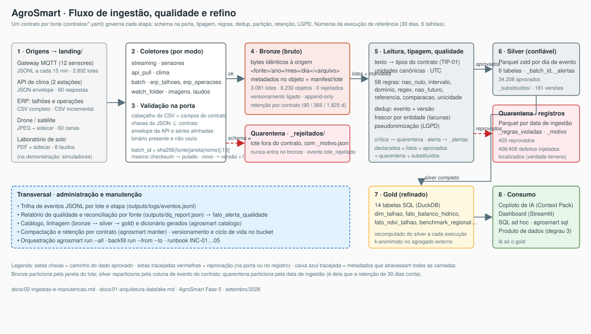
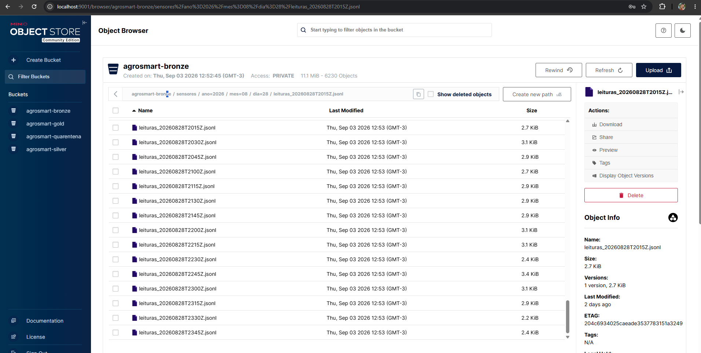
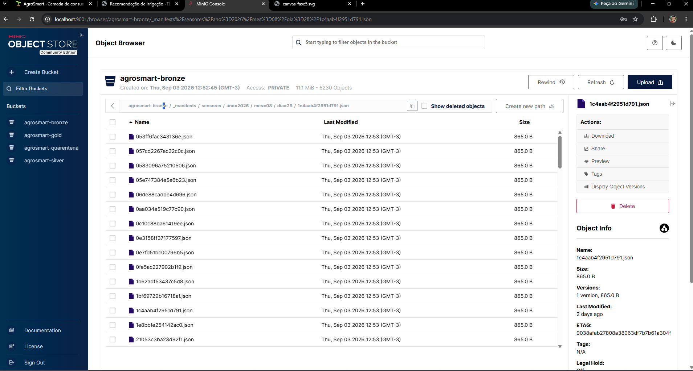
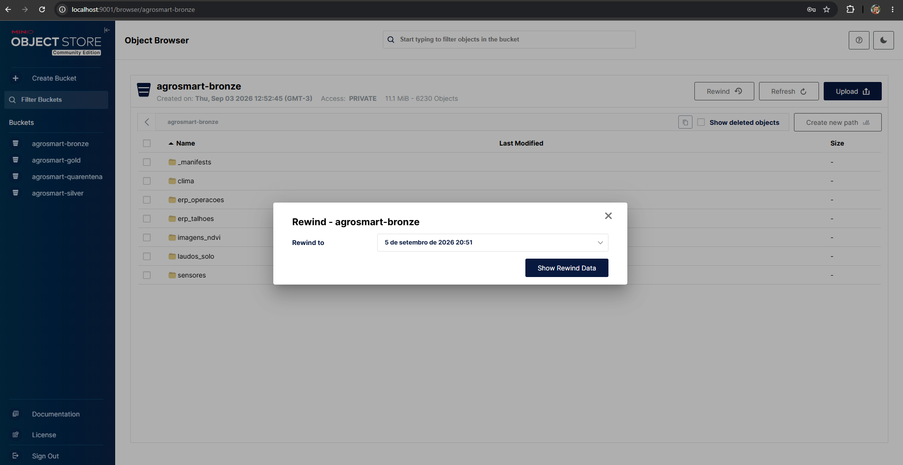

# Entrega 2 — Processo de Ingestão, Administração e Manutenção de Dados

> Peso: 25 % · Artefatos: diagrama/fluxo de ingestão + exemplos de dados ingeridos + documento de organização e manutenção
> Status: **implementado e verificado**: ingestão, qualidade, silver, gold, catálogo, manutenção, orquestração e backfill rodam de ponta a ponta contra o MinIO; números da execução de referência nas seções 8, 9 e 13.

## 1. Visão geral do fluxo



| # | Etapa | O que acontece | Onde está no código |
|---|---|---|---|
| 1 | **Produzir** | Os sistemas de origem depositam o que geram em `landing/` — gateway MQTT, API de clima, exportação do ERP, drone, laboratório. Na demonstração, os simuladores fazem esse papel. | `src/agrosmart/simuladores/` |
| 2 | **Coletar** | Um coletor por *modo de ingestão* descobre os lotes disponíveis. | `src/agrosmart/ingestao/{batch,streaming,api_pull,watch_folder}.py` |
| 3 | **Validar na porta** | O lote é conferido contra o **contrato** da fonte: cabeçalho do CSV, chaves do JSON, envelope da API, presença do binário. Divergência = lote rejeitado para a quarentena, com motivo. | `Coletor.validar_schema` |
| 4 | **Aterrissar** | Os bytes vão para o bronze **sem transformação**, com metadados de ingestão no objeto e um manifest por lote. | `Coletor._gravar` |
| 5 | **Validar registros** | Regras de qualidade do contrato, registro a registro: aprovado segue para o silver, reprovado vai para a quarentena. | `src/agrosmart/qualidade/` |
| 6 | **Refinar** | Silver → gold: junções, agregações, indicadores agronômicos. | `src/agrosmart/processamento/` |
| 7 | **Reconciliar e publicar** | Contagens origem × bronze × (silver + quarentena); catálogo e dicionário regenerados. | `src/agrosmart/catalogo/` |
| 8 | **Orquestrar** | As etapas 1–7 mais o copiloto em um comando, com medição por etapa e backfill por intervalo (seção 13). | `src/agrosmart/orquestracao.py` |

A trilha de tudo isso fica em `outputs/logs/eventos.jsonl` (seção 11).

## 2. Contratos de dados como fonte única da verdade

Cada fonte tem um arquivo `contratos/<fonte>.<versão>.yaml` que descreve **tudo** que o pipeline precisa saber sobre ela:

| Bloco | O que declara | Quem consome |
|---|---|---|
| `fonte`, `versao`, `tipo_dado`, `classificacao_lgpd` | Identidade, se é estruturada/semiestruturada/não estruturada, sensibilidade | catálogo, governança |
| `ingestao` | modo (`streaming`, `api_pull`, `watch_folder`, `batch`), origem, formato bruto, janela, SLA de frescor, campos derivados | coletores |
| `particionamento`, `chave_natural` | como o dado é organizado e o que identifica um registro | bronze (partição), silver (dedup) |
| `destino`, `retencao` | tabela silver, tabelas gold alimentadas, dias por camada | processamento, manutenção |
| `campos[]` | nome, tipo, unidade, obrigatoriedade, descrição, exemplo | coletores (schema na porta), silver (tipagem), dicionário |
| `qualidade[]` | regras com id, tipo, severidade e **justificativa obrigatória** | motor de qualidade, relatório |

O contrato é carregado por `agrosmart.contratos` com validação cruzada: regra que cita campo inexistente, chave natural fora do schema, `referencia` para tabela que nenhum contrato produz ou id de regra duplicado **impedem o pipeline de subir**. É melhor não rodar do que rodar com uma fonte sem regras.

Seis contratos estão ativos, ordenados topologicamente para a ingestão — `erp_talhoes` sempre primeiro, porque as outras fontes checam integridade referencial contra ele:

```
agrosmart contratos
```

```
  fonte              tipo              lgpd      ingestão             sla   campos  regras
  erp_talhoes.v1     estruturado       pessoal   batch           1440 min      15   8 crít · 2 alerta
  clima.v1           semiestruturado   publico   api_pull         360 min      12   5 crít · 3 alerta
  erp_operacoes.v1   estruturado       pessoal   batch           1440 min      11   8 crít · 1 alerta
  imagens_ndvi.v1    nao_estruturado   pessoal   watch_folder   10080 min      17   8 crít · 2 alerta
  laudos_solo.v1     nao_estruturado   pessoal   watch_folder   43200 min      17   8 crít · 1 alerta
  sensores.v1        estruturado       interno   streaming         30 min      11   8 crít · 4 alerta
```

Trecho de `contratos/sensores.v1.yaml` — uma regra crítica e uma de alerta, cada uma com a razão de existir:

```yaml
  - id: SEN-02
    regra: unicidade
    campos: [sensor_id, medido_em]
    severidade: critica
    justificativa: >
      O buffer offline do gateway reenvia leituras já entregues. Sem esta regra
      o balanço hídrico conta a mesma medição duas vezes.

  - id: SEN-10
    regra: intervalo
    campos: [bateria_pct]
    min: 15
    max: 100
    severidade: alerta
    justificativa: >
      Abaixo de 15% o dispositivo ainda mede corretamente, mas vai calar em
      poucos dias. O alerta vira ordem de manutenção preventiva.
```

## 3. Como os dados foram gerados

A simulação não sorteia números soltos por fonte. Ela roda **uma trajetória agronômica diária** (`simuladores/motor.py`) e cada fonte é uma *renderização* dessa trajetória no formato que o sistema de origem produziria. Por isso as seis fontes contam a mesma história: a chuva que a estação registra é a que molha o solo que o sensor mede; a irrigação que o ERP lança responde à umidade baixa; o NDVI que o drone vê cai depois de dias de estresse.

### 3.1 Cadastro fixo

Duas fazendas (Limeira e Campinas, SP), seis talhões e doze sensores, com culturas plausíveis para agosto no interior paulista:

| Talhão | Cultura | Sistema | Plantio | Papel na demonstração |
|---|---|---|---|---|
| TLH-01 Alto da Sede | milho (AG 8088) | pivô central | 14/06 | milho irrigado de inverno, em VT/R1 |
| TLH-02 Baixada do Córrego | milho (DKB 390) | pivô central | 05/07 | milho mais novo, de V8 a VT na janela (adubação de cobertura; na data de referência é o talhão que pede irrigação) |
| TLH-03 Várzea Norte | feijão (IPR Tangará) | aspersão | 20/07 | floração; abriga o sensor com bateria em falha |
| TLH-04 Espigão | trigo (TBIO Sonic) | aspersão | 10/05 | maturação; colheita adiada pelo produtor no meio da janela |
| TLH-05 Encosta do Café | café (Catuaí IAC 144) | gotejamento | 2021 | perene, pré-florada; adubação de agosto |
| TLH-06 Canavial da Estrada | cana (RB867515) | **sequeiro** | 10/2025 | o talhão para o qual recomendar irrigação é erro — a trava agronômica da IA |

### 3.2 Modelo físico

**Clima por estação** (`_simular_clima`). Tmin/Tmax partem de uma linha de base de inverno paulista com aquecimento gradual (+0,09 e +0,11 °C/dia) e recebem uma anomalia regional AR(1) (φ = 0,7) compartilhada pelas duas estações, mais ruído local. Chuva segue uma cadeia de Markov regional (seco→chuva 12 %, chuva→chuva 45 %) com lâmina Gamma(k = 1,6, θ = 8) mm; dia de chuva derruba Tmax em 3,5 °C e sobe a UR em 22 pontos. A evapotranspiração de referência é **Hargreaves-Samani**:

    ETo = 0,0023 · Ra · (Tmed + 17,8) · √(Tmax − Tmin)

com a radiação extraterrestre Ra pela equação 21 do FAO-56 a partir da latitude e do dia do ano.

**Balanço hídrico por talhão** (`_simular_talhoes_e_manejo`), na camada de 0–30 cm que o sensor representa:

    θ(d+1) = clamp( θ(d) + (0,8·chuva + irrigação − Kc·ETo) / 300 mm · 100 , PMP , CC )

O Kc vem do estádio fenológico da cultura (tabela FAO-56 simplificada; para o café, pelo mês). O que passa da capacidade de campo drena; a umidade nunca cai abaixo do ponto de murcha. A **fração de água disponível** FAD = (θ − PMP)/(CC − PMP) governa as decisões.

**Manejo** decorre do estado:
- **Irrigação** quando FAD < 0,50 e o talhão não é sequeiro — lâmina que repõe 85 % do déficit (máx. 30 mm), custo por mm·ha conforme o sistema.
- **Adubação de cobertura** no primeiro dia de estádios definidos por cultura (milho V8 e V12, feijão V4, trigo alongamento, café em agosto).
- **Pulverização preventiva** após 3 dias com UR > 80 % e Tmed entre 17 e 27 °C, respeitando 10 dias de intervalo.
- **Monitoramento fitossanitário** semanal em cada talhão (custo de mão de obra por hectare) — a operação recorrente que dá densidade ao custo por hectare.
- **Manutenção** quando um sensor cala: ordem de troca de bateria cinco dias depois.
- **NDVI** = NDVI potencial(estádio) × (1 − 0,045 × dias de estresse nos últimos 7), com estresse quando FAD < 0,35.

**Leituras intradiárias dos sensores** (a cada 15 min): θ interpolada entre o início e o fim do dia com queda diurna de 0,6 pontos e ruído σ = 0,25; temperatura do ar em cosseno com mínima às 5 h e máxima às 15 h; temperatura do solo com amplitude reduzida e 3 h de atraso; UR inversa à temperatura; condutividade crescente com a secagem; pH com deriva lenta; bateria com ciclo solar (±5 pontos) nos sensores solares.

### 3.3 Cenários operacionais (legítimos, não defeitos)

Geram **alertas** e histórias para a IA e o runbook, sem reprovar registro:

| Cenário | Mecanismo | Regra que o observa |
|---|---|---|
| Sensor com bateria em falha (`SNS-0302`) | não solar, descarga 2,9 %/dia a partir de 58 % → alerta em ~15 dias, **cala** quando < 5 %, ordem de manutenção 5 dias depois, volta com 100 % | SEN-10, SEN-12 → INC-01 |
| Sensor com sinal fraco (`SNS-0602`) | canavial distante do gateway, RSSI médio −90 dBm | SEN-11 |
| Leituras atrasadas (~3 %) | buffer offline do gateway entrega no lote de 1 a 3 intervalos depois, com o `medido_em` original | nenhuma — o silver precisa tolerar |
| Correções retroativas (~3 % das operações) | mesmo `operacao_id`, custo × 1,04, lançado 3 dias depois | nenhuma — dedup no silver pelo `extraido_em` mais recente |
| Mudança de cadastro | colheita do TLH-04 adiada em 5 dias a partir do 20º snapshot | nenhuma — snapshot mais recente vence |
| Cena de satélite nublada | dia de chuva → nuvem entre 35 e 80 % | IMG-07 (alerta): NDVI de baixa confiança |

### 3.4 Determinismo

Cada fonte tira seus números de um **fluxo próprio** de aleatoriedade derivado da semente global (`AGROSMART_SEED`) — `clima`, `sensores`, `defeitos.sensores`… Mudar o simulador de imagens não altera um byte das leituras de sensores. As imagens usam ruído por *hash* de coordenadas, e os PDFs são gerados por um escritor mínimo próprio (`agrosmart/pdf.py`, compartilhado com os relatórios do copiloto) porque as bibliotecas usuais carimbam data e identificadores aleatórios. Resultado, verificado por teste: **mesma semente → mesmos bytes em todos os arquivos**. O "hoje" do pipeline é `AGROSMART_DATA_REFERENCIA` (2026-09-01), não o relógio da máquina — os prints saem iguais em qualquer dia em que o avaliador rode.

## 4. Defeitos injetados

Uma fração pequena dos registros é deliberadamente defeituosa, e **cada defeito aponta para a regra que deve capturá-lo**. O registro completo — tipo, regra, chave do registro, arquivo — vai para `outputs/simulacao.json` e é a verdade-terreno do motor de qualidade: se um defeito crítico não aparecer na quarentena, o bug é do motor, não do dado.

| Tipo | Fonte | Regra alvo | Sev. | Simula | Volume |
|---|---|---|---|---|---|
| SEN-DUP | sensores | SEN-02 | crítica | gateway reenvia leitura já entregue (duplicata exata no lote seguinte) | 0,6 % |
| SEN-FUT | sensores | SEN-08 | crítica | relógio do dispositivo dois dias adiantado | 0,1 % |
| SEN-UMI | sensores | SEN-04 | crítica | sensor descalibrado, umidade > 100 % | 0,2 % |
| SEN-TLH | sensores | SEN-09 | crítica | dispositivo configurado com talhão inexistente | 0,1 % |
| SEN-ID | sensores | SEN-03 | crítica | dispositivo não homologado no tópico | 0,05 % |
| SEN-NUL | sensores | SEN-01 | crítica | falha de leitura, umidade ausente | 0,1 % |
| CLI-INV | clima | CLI-03 | crítica | parser trocou colunas: Tmin > Tmax | 2 |
| CLI-UR | clima | CLI-05 | crítica | UR acima de 100 % | 1 |
| CLI-DUP | clima | CLI-02 | crítica | API devolveu o dia anterior junto | 1 |
| OPR-CEN | erp_operacoes | OPR-06 | crítica | exportação em centavos (custo × 100) | 3 |
| OPR-UNI | erp_operacoes | OPR-04 | crítica | unidade fora do domínio ("litros") | 2 |
| OPR-TLH | erp_operacoes | OPR-07 | crítica | lançamento em talhão inexistente | 1 |
| OPR-FUT | erp_operacoes | OPR-08 | crítica | operação planejada lançada como executada | 1 |
| TLH-GEO | erp_talhoes | TLH-04/05 | crítica | latitude e longitude trocadas em um snapshot | 1 |
| IMG-NDV | imagens_ndvi | IMG-03 | crítica | ndvi_max acima de 1 | 1 |
| IMG-TRU | imagens_ndvi | IMG-10 | alerta | upload interrompido: arquivo com 1 KB | 1 |
| LAU-PH | laudos_solo | LAU-03 | crítica | extrator leu o campo errado: pH 11,2 | 1 |
| LAU-DAT | laudos_solo | LAU-06 | crítica | datas trocadas na extração | 1 |

Um registro carrega no máximo um defeito. Os defeitos de quantidade fixa são sorteados sem reposição sobre o conjunto de registros da fonte, o que garante exatamente a quantidade declarada (testado).

## 5. Coletores

### 5.1 Quatro modos, um protocolo

O coletor é escolhido pelo `ingestao.modo` do contrato, não pelo nome da fonte. Todos herdam de `ingestao.base.Coletor` e diferem só em *onde* estão os lotes e *como* validá-los.

| Modo | Fonte(s) | Lote | Janela | Validação na porta |
|---|---|---|---|---|
| `batch` | erp_talhoes (carga completa), erp_operacoes (incremental) | um CSV por dia de extração | talhões: instante da extração; operações: D-1 00h → extração | cabeçalho **exatamente** igual aos campos do contrato; toda linha com o mesmo número de campos |
| `streaming` | sensores | um JSONL por intervalo de 15 min do gateway — 96 por dia da janela, mais os 12 da madrugada da data de referência (as leituras existem até o "agora" do pipeline, 03h00) | [t, t+15 min) | cada linha é JSON válido; nenhuma chave fora do contrato (chave ausente = nulo, decide o silver) |
| `api_pull` | clima | uma resposta JSON por estação e dia | [D 00h, D+1 00h) | envelope com `daily`, `daily_units`, `estacao_id`, `fazenda_id`; séries obrigatórias presentes e alinhadas com `time` |
| `watch_folder` | imagens_ndvi, laudos_solo | sidecar JSON (principal) + binário (anexo) | instante da captura/coleta | chaves do sidecar ⊆ contrato menos derivados; obrigatórios presentes; binário existe e não está vazio |

Sequência de `Coletor.executar()` para cada lote:

1. `validar_schema` → falhou? **rejeitar**: origem e anexos vão para `quarentena/_rejeitados/<fonte>/<batch_id>/`, com `_motivo.json` e evento `lote_rejeitado`. Nada entra no bronze.
2. `batch_id = sha256(fonte | janela_inicio | janela_fim | nome_do_arquivo)[:16]` — determinístico.
3. Se já existe manifest para o `batch_id` com o **mesmo checksum** → **pular** (`lote_pulado`).
4. Se existe com checksum diferente → a origem reenviou conteúdo novo → **atualizar**: grava nova versão do objeto (o bronze é versionado) e `versao + 1` no manifest.
5. Senão → **gravar**: bytes intocados, metadados no objeto (`source`, `batch-id`, `ingested-at`, `sha256`, `schema-version`, `papel`), manifest em `_manifests/`.

### 5.2 O que o coletor **não** faz

Não converte tipos, não renomeia campos, não remove duplicatas, não avalia valores. Um `ndvi_max = 1,27` passa pela porta e é reprovado no silver por IMG-03; uma imagem truncada de 1 KB passa (existe, não está vazia) e é marcada pela IMG-10. A porta protege o *schema*; a *qualidade* é da camada seguinte. Misturar as duas coisas é o que torna pipelines impossíveis de depurar.

### 5.3 Manifest

Um por lote, em `bronze/_manifests/<fonte>/ano=…/mes=…/dia=…/<batch_id>.json`:

```json
{
  "batch_id": "5d2f8c1a9e3b7f04",
  "fonte": "sensores",
  "schema_version": "sensores.v1",
  "modo": "streaming",
  "coletor": "ColetorStreaming",
  "janela": {"inicio": "2026-08-28T09:15:00+00:00", "fim": "2026-08-28T09:30:00+00:00"},
  "particao": "2026-08-28",
  "origem": "sensores/20260828/leituras_20260828T0915Z.jsonl",
  "arquivos": [
    {"chave": "sensores/ano=2026/mes=08/dia=28/leituras_20260828T0915Z.jsonl",
     "nome": "leituras_20260828T0915Z.jsonl", "papel": "principal",
     "bytes": 3084, "checksum_sha256": "4f2a…9c1d"}
  ],
  "registros": 12,
  "bytes": 3084,
  "checksum_sha256": "b71e…03aa",
  "ingerido_em": "2026-09-03T02:41:17+00:00",
  "versao": 1,
  "versao_anterior_checksum": null
}
```

É o manifest que a **reconciliação** usa (registros declarados × registros no silver + quarentena), que a **linhagem** usa (de que lote veio cada partição do silver) e que a **idempotência** usa (checksum).

## 6. Organização do dado na camada bruta

```
agrosmart-bronze/
├── erp_talhoes/ano=2026/mes=08/dia=28/talhoes_20260828.csv
├── erp_operacoes/ano=2026/mes=08/dia=28/operacoes_20260828.csv
├── clima/ano=2026/mes=08/dia=27/EST-SP-014_20260827.json
├── sensores/ano=2026/mes=08/dia=28/leituras_20260828T0915Z.jsonl      (96 por dia)
├── imagens_ndvi/ano=2026/mes=08/dia=27/IMG-2026-0834.json
├── imagens_ndvi/ano=2026/mes=08/dia=27/IMG-2026-0834.jpg
├── laudos_solo/ano=2026/mes=07/dia=21/LAU-2026-00471.json
├── laudos_solo/ano=2026/mes=07/dia=21/LAU-2026-00471.pdf
└── _manifests/<fonte>/ano=…/mes=…/dia=…/<batch_id>.json

agrosmart-quarentena/
└── _rejeitados/<fonte>/<batch_id>/{arquivo original, _motivo.json}
```

Como isso aparece no console do MinIO (`http://localhost:9001`), no lake de referência:







Os três prints estão em `outputs/prints/passo2-minio-*.png`; o bucket tem 6.230 objetos e 11,1 MiB, como o `doctor` reporta.

Convenções:

- **Chave lógica idêntica nos dois backends** (MinIO e filesystem). Só o prefixo físico muda — é o que mantém o diagrama da Entrega 1 verdadeiro onde quer que o lake esteja rodando.
- **Partição Hive** (`ano=/mes=/dia=`) para que DuckDB e Spark leiam a partição como coluna sem parsear caminho.
- **O bronze particiona pela janela do lote**; o silver reparticiona pela coluna de evento do contrato. Um CSV incremental do ERP traz operações de vários dias — no bronze ele fica inteiro na partição da extração, e é o silver que espalha cada linha pelo seu dia.
- **Binário e sidecar na mesma partição**, referenciados pelo mesmo manifest. O binário nunca é copiado para outra camada; o silver guarda a chave (`arquivo_bruto`), o checksum e o tamanho.
- **Nomes de arquivo preservados** da origem: facilita a auditoria "de onde veio isto?" sem abrir o manifest.
- **Versionamento de objeto ligado** em bronze e quarentena (`infra/docker-compose.yml`): sobrescrita durante backfill nunca destrói a versão anterior.

## 7. Exemplos de dados ingeridos

`agrosmart ingerir` exporta, para cada fonte, um lote representativo em `data/exemplos/bronze/<fonte>/` — o arquivo **exatamente como está no lake**, ao lado do `_manifest.json` que o descreve:

```
data/exemplos/bronze/
├── clima/          EST-SP-014_20260802.json · _manifest.json
├── erp_operacoes/  operacoes_20260803.csv · _manifest.json
├── erp_talhoes/    talhoes_20260802.csv · _manifest.json
├── imagens_ndvi/   IMG-2026-0801.json · IMG-2026-0801.jpg · _manifest.json
├── laudos_solo/    LAU-2026-00471.json · LAU-2026-00471.pdf · _manifest.json
└── sensores/       leituras_20260802T0000Z.jsonl · _manifest.json
```

Um registro de sensor como chega do gateway (uma linha do JSONL):

```json
{"sensor_id":"SNS-0101","talhao_id":"TLH-01","medido_em":"2026-08-02T00:00:00Z",
 "umidade_solo_pct":26.8,"temperatura_solo_c":19.4,"temperatura_ar_c":16.9,
 "umidade_ar_pct":68.3,"condutividade_ds_m":1.16,"ph":6.12,"bateria_pct":86.7,"rssi_dbm":-73}
```

Repare que **não há `_batch_id` nem `_ingested_at` dentro do registro**: o bronze não altera os bytes da origem. Esses metadados vivem no objeto (S3 user metadata) e no manifest, e o silver os anexa como colunas ao ler cada lote. Um registro de clima, por contraste, chega no envelope da API (`daily.temperature_2m_max[…]`) e só ganha os nomes do contrato (`temp_max_c`) no silver — é isso que faz a fonte ser semiestruturada.

## 8. Números da execução de referência

Semente `20260905`, data de referência `2026-09-01`, janela **02/08 → 31/08/2026** (30 dias), 6 talhões, 12 sensores. Saídas completas em `outputs/simulacao.json`, `outputs/ingestao.json` e `outputs/prints/passo2-*.txt`. Reproduzível com `agrosmart simular && agrosmart ingerir`.

### 8.1 Landing gerada (`agrosmart simular`, 15 s)

| Fonte | Arquivos | Registros | Tamanho | Observação |
|---|---|---|---|---|
| erp_talhoes | 31 | 186 | 34 KB | um snapshot por dia + o da manhã da referência |
| clima | 60 | 60 | 58 KB | 2 estações × 30 dias |
| erp_operacoes | 30 | 49 | 9 KB | 15 irrigações, monitoramentos semanais, adubações, pulverizações, 1 manutenção, 2 correções retroativas |
| sensores | 2.892 | 34.431 | 8,1 MB | 96 lotes/dia × 30 dias + 12 lotes da madrugada da referência; 12 sensores menos os 5 dias do `SNS-0302` calado, mais duplicatas |
| imagens_ndvi | 120 | 60 | 314 KB | 24 cenas de drone + 36 de satélite, cada uma JPEG + sidecar |
| laudos_solo | 16 | 8 | 21 KB | 6 laudos 0–20 cm + 2 de 20–40 cm, cada um PDF + sidecar |
| **total** | **3.149** | **34.794** | **8,6 MB** | |

Chuva acumulada: 35,2 mm na estação de Limeira, 102,8 mm na de Campinas — o contraste faz os talhões da FAZ-01 irrigarem mais (353,5 mm de lâmina total no período) e o canavial de sequeiro da FAZ-02 sofrer menos do que sofreria.

### 8.2 Defeitos injetados: 406

| Fonte | Tipos | Ocorrências | Proporção |
|---|---|---|---|
| sensores | SEN-DUP 207 · SEN-UMI 75 · SEN-TLH 45 · SEN-FUT 29 · SEN-NUL 25 · SEN-ID 10 | 391 | 1,1 % das leituras |
| erp_operacoes | OPR-CEN 3 · OPR-UNI 2 · OPR-TLH 1 · OPR-FUT 1 | 7 | 7 de 49 |
| clima | CLI-INV 2 · CLI-UR 1 · CLI-DUP 1 | 4 | 4 de 60 |
| imagens_ndvi | IMG-NDV 1 · IMG-TRU 1 | 2 | 2 de 60 |
| laudos_solo | LAU-PH 1 · LAU-DAT 1 | 2 | 2 de 8 |
| erp_talhoes | TLH-GEO 1 | 1 | 1 de 186 |

Cada ocorrência está em `outputs/simulacao.json → defeitos[]` com tipo, regra alvo, chave do registro e arquivo. A seção 9.3 mostra a quarentena conferida contra essa lista: **406 de 406 localizados**.

### 8.3 Ingestão em lake limpo (`agrosmart ingerir`, 45 s, MinIO)

| Fonte | Modo | Lotes | Gravados | Rejeitados | Registros | Tempo |
|---|---|---|---|---|---|---|
| erp_talhoes | batch | 31 | 31 | 0 | 186 | 0,9 s |
| clima | api_pull | 60 | 60 | 0 | 60 | 0,9 s |
| erp_operacoes | batch | 30 | 30 | 0 | 49 | 0,6 s |
| imagens_ndvi | watch_folder | 60 | 60 | 0 | 60 | 2,8 s |
| laudos_solo | watch_folder | 8 | 8 | 0 | 8 | 0,3 s |
| sensores | streaming | 2.892 | 2.892 | 0 | 34.431 | 38,1 s |
| **total** | | **3.081** | **3.081** | **0** | **34.794** | |

Resultado no bucket: **6.230 objetos** no bronze (3.081 lotes + 3.081 manifests + 60 imagens + 8 PDFs anexos), 0 na quarentena. `doctor` confirma `bronze=6230`.

**O problema dos arquivos pequenos, medido.** Os sensores são 0,4 % dos registros por lote mas 94 % das chamadas ao object store: 2.892 lotes × (checar manifest + gravar objeto + gravar manifest). Em série, ~100 s; com 8 threads por coletor (`AGROSMART_PARALELISMO`), 38 s. É exatamente o custo que a **compactação** (seção 10) elimina para quem consome — 30 Parquet diários de sensores viram um por mês no silver.

### 8.4 Reexecução sobre o bronze já populado (`passo2-ingerir-reexecucao.txt`, 24 s)

Os mesmos 3.081 lotes: **0 gravados, 0 atualizados, 3.081 pulados** pelo checksum do manifest — nada foi duplicado, e a segunda passada custou metade do tempo porque só leu manifests. Quando o gerador de operações mudou entre duas execuções durante o desenvolvimento, os lotes afetados vieram **atualizados** (`versao: 2`, checksum anterior guardado, objeto antigo preservado pelo versionamento do bucket) — o comportamento desejado para uma origem que reexporta o dia com correção.

## 9. Qualidade e confiabilidade

### 9.1 Na porta (bronze)

- **Schema na porta** — lote fora do contrato nunca entra no bronze; vai para `quarentena/_rejeitados/` com motivo e evento. Testado com coluna a mais, coluna a menos, chave desconhecida no JSONL, série ausente na API e binário faltando.
- **Idempotência** — reingerir a landing inteira produz zero gravações e N `pulados`. O `batch_id` é função da janela e do nome, não do instante da execução.
- **Versionamento** — origem reenviada com conteúdo diferente vira `versao: 2` no manifest, com o checksum anterior registrado; o objeto anterior sobrevive no versionamento do bucket.
- **Bronze byte a byte igual à origem** — testado.

### 9.2 Registro a registro (silver) — `agrosmart processar` / `agrosmart qualidade`

O motor de qualidade (`src/agrosmart/qualidade/motor.py`) executa as **58 regras dos contratos** mais duas regras de sistema, em três etapas cuja ordem importa:

1. **Regras de valor sobre todos os registros** — `nao_nulo`, `intervalo`, `dominio`, `regex`, `nao_futuro` (relativo ao "agora" do pipeline ou ao fim da janela do lote, conforme o contrato), `referencia` (integridade contra o silver já processado da tabela referenciada), `comparacao`, e a regra de sistema `TIP-01` (valor incompatível com o tipo declarado). Severidade **crítica** reprova o registro; **alerta** o mantém, com o id em `_alertas`.
2. **Deduplicação só entre os aprovados**, conforme `dedup.estrategia` do contrato: `evento` (repetição = duplicata → quarentena pela regra de unicidade) ou `versao` (fica a mais recente por `campo_ordem`, anteriores contadas como *substituídas*). Como as regras rodaram antes, se a versão mais recente é defeituosa, a última versão **válida** é a que fica.
3. **Frescor por entidade** — para cada sensor/estação: atraso da última observação em relação ao instante de referência e **lacunas** entre observações consecutivas maiores que o SLA. É o que detecta o `SNS-0302` calado por cinco dias (INC-01).

Saída por fonte: silver (aprovados + `_alertas`, particionado pela data do evento), quarentena (`_regras_violadas`, `_motivo`, particionada pela data de ingestão — a retenção de 30 dias conta dela), `_substituidos/`, e o relatório `outputs/dq_report.json` com contagens por regra, alertas de frescor por entidade e a **reconciliação**: `declarados (manifests) = lidos = aprovados + quarentena + substituídos`.

Frescor respeita a natureza de cada fonte: em séries com instante (sensores) o atraso é medido do último evento; em séries diárias (clima) o dia D só conta como atrasado depois de D+1, e o espaçamento normal de um dia não é lacuna; em fontes de eventos esparsos (operações do ERP) só o frescor da tabela é avaliado — a ausência de operação num dia não é defeito. Lacunas são *opt-in* no contrato (`detectar_lacunas`).

### 9.3 Prova de que o motor funciona

Os simuladores registram cada defeito injetado com a regra que deve capturá-lo (seção 4). Ao fim do silver, `qualidade/verificacao.py` confere, defeito a defeito, se a chave está na quarentena (regra crítica) ou no silver com o alerta marcado (regra de alerta). Resultado em `dq_report.json → defeitos_injetados`; a suíte de testes exige cobertura de 100 %.

Este mecanismo já pegou um erro de **projeto de regra** durante o desenvolvimento: `OPR-06` tinha teto de R$ 500 mil e não capturava "custo em centavos" sobre operações de centenas de reais. O teto foi revisto para R$ 25 mil, com a limitação registrada na justificativa da regra: um teto por registro não pega ×100 em valores pequenos — isso exige custo por hectare, que depende do cadastro e vive no gold.

### 9.4 Números da execução de referência (`agrosmart processar`, 31 s)

| Fonte | Lidos | Aprovados | Quarentena | Substituídos | Com alerta | Quarentena por regra |
|---|---|---|---|---|---|---|
| erp_talhoes | 186 | 6 | 1 | 179 | 0 | TLH-04 1 · TLH-05 1 (o snapshot com lat/lon trocadas) |
| clima | 60 | 57 | 3 | 0 | 0 | CLI-03 2 · CLI-05 1 |
| erp_operacoes | 49 | 40 | 7 | 2 | 0 | OPR-06 3 · OPR-04 2 · OPR-07 1 · OPR-08 1 |
| imagens_ndvi | 60 | 59 | 1 | 0 | 9 | IMG-03 1 |
| laudos_solo | 8 | 6 | 2 | 0 | 0 | LAU-03 1 · LAU-06 1 |
| sensores | 34.431 | 34.040 | 391 | 0 | 673 | SEN-02 205 · SEN-04 76 · SEN-09 45 · SEN-08 29 · SEN-01 25 · SEN-03 11 |
| **total** | **34.794** | **34.208** | **405** | **181** | **682** | |

- **Reconciliação fecha em todas as fontes**: `declarados = lidos = aprovados + quarentena + substituídos`.
- **Substituídos**: 179 snapshots anteriores de talhões (30 dias × 6 talhões, menos os vigentes e o snapshot reprovado) e as 2 operações relançadas com custo corrigido — versões, não defeitos.
- **Duplicatas**: 205 leituras reenviadas pelo gateway reprovadas por `SEN-02`; as 2 restantes das 207 injetadas carregavam também outro defeito e caíram por ele.
- **Alertas em registros**: `SEN-10` (bateria < 15 %) em 399 leituras e `SEN-11` (sinal fraco) em 284 — os cenários do `SNS-0302` e do `SNS-0602`; `IMG-07` (nuvem > 30 %) em 9 cenas de satélite; `IMG-10` (arquivo truncado) em 1.
- **Alertas de frescor**: `SEN-12` lacuna de **7.215 min** (5 dias) no `SNS-0302`, de 20/08 23:45 a 26/08 00:00 — o INC-01 detectado pelo pipeline; `CLI-08` lacuna na estação `EST-SP-027` — o dia 10/08 está na quarentena (CLI-03), logo falta na série.
- **Defeitos injetados: 406 de 406 localizados** (cobertura 100 %).

Gold materializado em 1,6 s: 14 tabelas — `fato_balanco_hidrico` e `fato_leitura_diaria_talhao` com 186 linhas (6 talhões × 31 dias, contando a madrugada da referência), `fato_ndvi_talhao` 59, `fato_operacao_custo` 40, `fato_fertilidade_talhao` 6, `benchmark_regional` 5 (nenhum grupo publicável: no máximo 2 talhões por cultura, abaixo do k = 3), `fato_alerta_qualidade` com os alertas acima.

### 9.5 Manutenção na execução de referência (`agrosmart manter`, 4 s)

| Partição | Arquivos antes | Depois | Registros | Tamanho antes → depois |
|---|---|---|---|---|
| sensores_leitura/ano=2026/mes=08 | 30 | 1 | 33.898 | 667 KB → 456 KB |
| clima_diario/ano=2026/mes=08 | 30 | 1 | 57 | 174 KB → 8 KB |
| erp_operacoes/ano=2026/mes=08 | 25 | 1 | 40 | 147 KB → 7 KB |
| imagens_ndvi_meta/ano=2026/mes=08 | 9 | 1 | 59 | 83 KB → 14 KB |
| laudos_solo/ano=2026/mes=07 | 5 | 1 | 6 | 45 KB → 10 KB |

99 arquivos a menos, mesmos registros. Retenção simulada em 01/09/2026: 6.213 objetos avaliados, **0 além da retenção** — nada na janela tem mais de 30 dias de quarentena nem 90 de bronze.

## 10. Manutenção — `agrosmart manter`

| Rotina | O que faz | Onde está |
|---|---|---|
| **Compactação** | O silver é escrito com um Parquet por dia de evento (o que uma execução diária produziria). Para fontes de alta frequência isso é o problema clássico de *small files*: os sensores geram 30 arquivos por mês para uma tabela que cabe em um. `compactar` reescreve cada partição mensal em um único arquivo, preservando exatamente os registros (testado), e remove os diários. | `manutencao.compactar` |
| **Retenção por contrato** | Percorre as partições Hive de bronze, manifests, silver e quarentena; calcula a idade de cada partição em relação à data de referência; lista o que passou da retenção declarada no contrato (`retencao.bronze_dias` etc.; quarentena 30 dias). Só remove com `--aplicar`. No MinIO convive com as regras de ciclo de vida do bucket — a diferença é que aqui a regra sai do contrato. | `manutencao.aplicar_retencao` |
| **Versionamento** | Bronze e quarentena versionados no bucket: sobrescrita durante backfill nunca destrói a versão anterior. | `infra/docker-compose.yml` |
| **Recomputo** | Silver e gold são recomputados por inteiro; regra corrigida hoje vale para o histórico sem backfill especial. Quando a origem reenvia alguns dias, `run --from --to` reprocessa só esses lotes (§13). | ADR 0008, ADR 0010 |
| **Catálogo** | `agrosmart catalogo` regenera inventário, linhagem e o dicionário de dados a cada execução — não há documentação para ficar defasada. | `catalogo/` |

## 11. Observabilidade

Todo lote gera um evento em `outputs/logs/eventos.jsonl` — uma linha JSON, sem eco no console (seriam milhares); o console recebe o resumo por fonte.

```json
{"ocorrido_em": "2026-09-03T02:41:17+00:00", "etapa": "ingestao", "acao": "lote_gravado",
 "fonte": "sensores", "camada": "bronze", "batch_id": "5d2f8c1a9e3b7f04", "status": "ok",
 "mensagem": "leituras_20260828T0915Z.jsonl: versão 1",
 "metricas": {"registros": 12, "bytes": 3084, "particao": "2026-08-28"}}
```

Ações registradas: `lote_gravado`, `lote_atualizado`, `lote_pulado`, `lote_rejeitado` (status `erro`), e um `concluida` por execução com os totais. É a partir deste arquivo que se responde "quantos registros a fonte X ingeriu no dia D e quantos lotes foram rejeitados" sem reprocessar nada — e é o que alimenta a reconciliação do silver.

## 12. Runbook

Ver `runbook-operacao.md`: cinco incidentes com detecção, diagnóstico, correção e prevenção — INC-01 sensor mudo (validado com o cenário `SNS-0302`), INC-02 schema quebrado na origem, INC-03 lote duplicado ou reenviado, INC-04 quarentena crescendo, INC-05 backfill de um intervalo (validado na execução de referência, §13).

## 13. Orquestração e reprocessamento — `agrosmart run`

Tudo acima roda em um comando (`orquestracao.py`, ADR 0010): simular → ingerir → silver → gold → catálogo → copiloto, cada etapa medida, parada na primeira falha, resumo em `outputs/run.json` e evento `run` na trilha. Em produção, `run --all --sem-simular` é o alvo de um agendador.

**Execução de referência sobre o lake já populado** (`outputs/prints/passo5-run-all.txt`):

| Etapa | Duração | Resultado |
|---|---|---|
| simular | 9 s | 3.149 arquivos · 34.794 registros · 406 defeitos (idênticos aos de antes: semente fixa) |
| ingerir | 24 s | 3.081 lotes · **0 gravados · 0 atualizados · 3.081 pulados** — a landing regenerada é byte a byte igual ao bronze; idempotência total |
| silver | 21 s | 34.208 aprovados · 405 quarentena · 181 substituídos · reconciliação ok · 406/406 defeitos localizados |
| gold · catálogo · copiloto | 5 s | 14 tabelas · dicionário regenerado · 18/18 saídas aprovadas |
| **total** | **60 s** | |

**Backfill** `run --from 2026-08-21 --to 2026-08-25` — a janela do INC-01 (`outputs/prints/passo5-backfill.txt`): só os lotes do intervalo são lidos nas fontes de eventos (5.563 registros; 5 × 96 lotes de sensores), o ERP é recomputado por inteiro, e o relatório do intervalo vai para `outputs/dq_report_backfill_20260821_20260825.json` sem substituir o da execução completa. A prova de que nada se perdeu nem duplicou, medida com `agrosmart sql` antes e depois:

| Tabela silver | Linhas antes | Linhas depois | Chaves distintas depois |
|---|---|---|---|
| `sensores_leitura` | 34.040 | 34.040 | 34.040 |
| `clima_diario` | 57 | 57 | 57 |
| `imagens_ndvi_meta` | 59 | 59 | 59 |
| `laudos_solo` | 6 | 6 | 6 |

O detalhe que fez diferença: um evento pode chegar em lote de outro dia (chegada atrasada). Reescrever a partição do silver só com os lotes do intervalo perdia esse evento — o teste de backfill flagrou uma linha a menos. A solução (`mesclar_backfill`) substitui, em cada partição afetada, apenas as linhas cujo `_batch_id` pertence aos lotes reprocessados, e deduplica pela chave natural. Total do backfill: 38 s.

**Empacotamento** (`agrosmart empacotar`, `outputs/prints/passo5-empacotar.txt`): 242 arquivos, ~3,2 MB antes da compressão; nome validado no padrão `nomecompleto_rm_turma_fase5_atividade.zip`; o comando avisa o que ainda falta (hoje: o link do vídeo).
