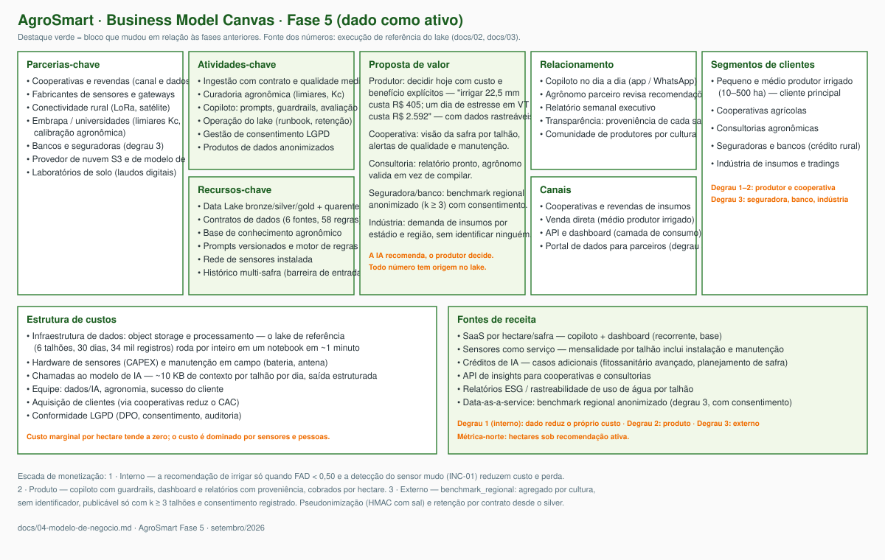

# Entrega 4 — Modelo de Negócio e Inteligência de Dados

> Peso: 25 % · Artefatos: Canvas atualizado (`diagramas/canvas-fase5.svg`) + vídeo de 2–3 min
> (`../entrega/roteiro-video.md` → `../entrega/LINK_VIDEO.txt`).
>
> Todo número citado aqui vem da execução de referência do lake (docs/02 §8, docs/03 §3) ou é
> marcado como **hipótese** a validar com clientes. Não misturamos os dois.

## 1. O que mudou: o dado virou o ativo

Nas fases anteriores o AgroSmart vendia **monitoramento**: sensores no campo, um painel com
gráficos, alertas quando um valor saía da faixa. O dado era subproduto do hardware — ficava em
planilhas, no ERP, no telefone do agrônomo. O produtor continuava decidindo no olho, só que com
mais gráficos.

A Fase 5 inverte a relação. Seis fontes (sensores, clima, ERP de talhões e operações, imagens,
laudos de solo) entram num Data Lake com **contrato, qualidade medida e proveniência**, e saem
como uma **recomendação com custo, benefício e origem de cada número**:

> *Irrigar 22,5 mm no TLH-02 custa R$ 404,55. O talhão está em VT, estádio crítico para água:
> cada dia de estresse custa 2,0 % do potencial — R$ 2.591,60.* (docs/03 §3.1)

Três consequências para o modelo:

1. **A proposta de valor muda de "ver" para "decidir".** O que se cobra é a decisão apoiada,
   não o gráfico. Isso desloca o preço do hardware para o serviço recorrente.
2. **O custo marginal por hectare tende a zero.** O lake de referência — 6 talhões, 30 dias,
   34.794 registros das 6 fontes — é simulado, ingerido, validado, agregado e transformado em
   18 recomendações num notebook, num único comando (`agrosmart run --all`, pouco mais de um
   minuto, `outputs/prints/passo5-run-all.txt`). Storage em object store custa centavos por
   gigabyte-mês; o custo real está em sensores e pessoas.
3. **Nasce um terceiro degrau de receita** que não existia: dado agregado e anonimizado para
   quem não é produtor (seguradora, banco, indústria) — e ele só existe porque a governança
   (pseudonimização, k-anonimato, retenção, consentimento) foi construída dentro do lake, não
   como anexo jurídico.

## 2. Business Model Canvas atualizado

| Bloco | Conteúdo | O que mudou |
|---|---|---|
| **Segmentos de clientes** | (a) pequeno e médio produtor **irrigado** de 10–500 ha — cliente principal; (b) cooperativas agrícolas; (c) consultorias agronômicas; (d) seguradoras e bancos de crédito rural; (e) indústria de insumos e tradings | (d) e (e) são novos: só o degrau 3 os alcança |
| **Proposta de valor** | Produtor: decidir irrigação, manejo e manutenção com custo e benefício explícitos e dados rastreáveis. Cooperativa: visão da safra por talhão, alertas de qualidade e manutenção da rede de sensores. Consultoria: relatório pronto para o agrônomo validar em vez de compilar. Seguradora/banco: benchmark regional anonimizado para precificar risco. Indústria: demanda de insumos por estádio e região | de "monitorar" para "decidir"; a confiança declarada em cada saída é parte do produto |
| **Canais** | cooperativas e revendas de insumos (principal — reduzem o CAC), venda direta ao médio produtor irrigado, dashboard e API (camada de consumo do lake), portal de dados para parceiros do degrau 3 | API e portal são a camada de consumo já desenhada em docs/01 |
| **Relacionamento** | copiloto no dia a dia (app/WhatsApp), agrônomo parceiro revisa recomendações, relatório executivo semanal, transparência (proveniência de cada saída), comunidade por cultura | proveniência como instrumento de relacionamento: o produtor pode ver por que a IA disse o que disse |
| **Fontes de receita** | ver §3 | recorrência por hectare-safra substitui a venda de hardware como receita principal |
| **Recursos-chave** | Data Lake (bronze/silver/gold/quarentena), contratos de dados (6 fontes, 58 regras), base de conhecimento agronômico (Kc, limiares, parâmetros econômicos), prompts versionados e motor de regras, rede de sensores instalada, **histórico multi-safra** | o histórico é a barreira de entrada: cada safra torna as recomendações melhores e o produto mais difícil de trocar |
| **Atividades-chave** | ingestão com contrato e qualidade medida; curadoria agronômica; desenvolvimento e avaliação do copiloto (guardrails, concordância); operação do lake (runbook, retenção, backfill); gestão de consentimento; produção de dados agregados | avaliação da IA e gestão de consentimento são atividades novas e permanentes |
| **Parcerias-chave** | cooperativas (canal e dados), fabricantes de sensores e gateways, conectividade rural (LoRa, satélite), Embrapa/universidades (calibração dos limiares), bancos e seguradoras (degrau 3), provedor de nuvem S3 e de modelo de IA, laboratórios de solo (laudos digitais) | laboratórios e provedor de IA entram como parceiros de dados e de tecnologia |
| **Estrutura de custos** | object storage e processamento (baixo e proporcional), hardware de sensores (CAPEX) e manutenção em campo, chamadas ao modelo de IA (~10 KB de contexto por talhão por dia, saída estruturada), equipe (dados/IA, agronomia, sucesso do cliente), aquisição de clientes, conformidade LGPD | o custo de IA é previsível porque o Context Pack é pequeno e a chamada é uma por talhão por caso por dia |

## 3. Escada de monetização de dados

| Degrau | O que é | Quem paga | Receita | Evidência no lake |
|---|---|---|---|---|
| **1 · Interno** | o dado reduz o próprio custo ou perda | ninguém — melhora a margem do produtor e a retenção do cliente | redução de custo (irrigação certa, insumo na hora certa), perda evitada (estresse detectado), manutenção preventiva | `fato_balanco_hidrico.recomenda_irrigar`; INC-01 do runbook: sensor com bateria a 12 % é apontado antes de calar |
| **2 · Produto** | o insight entregue ao cliente | produtor, cooperativa, consultoria | **SaaS por hectare-safra** (copiloto + dashboard); **sensores como serviço** (mensalidade por talhão com instalação e manutenção); **créditos de IA** para casos adicionais (fitossanitário avançado, planejamento de safra); **API de insights** para cooperativas e consultorias; **relatórios ESG** de uso de água por talhão | `outputs/relatorios/`, `app/dashboard.py`, `agrosmart ia gerar` |
| **3 · Externo** | dado agregado e anonimizado, com consentimento | seguradora, banco, indústria, trading | **data-as-a-service**: assinatura do benchmark regional por cultura e região; relatórios sob demanda | `benchmark_regional` no gold: agregado por cultura, sem identificador, `publicavel` só com k ≥ 3 |

**Hipóteses de preço a validar** (não são números do lake): SaaS na faixa de R$ 25–40 por
hectare-safra para o produtor irrigado; sensores como serviço na faixa de R$ 300–400 por talhão-mês;
benchmark por assinatura anual para o parceiro do degrau 3. O caso do TLH-02 dá a régua do
argumento de venda: um dia de estresse evitado (R$ 2.591,60) paga várias safras de assinatura
do talhão de 12,4 ha.

**Data Monetization Canvas (resumo).**

| Dimensão | Resposta |
|---|---|
| Ativo de dados | histórico por talhão de umidade, clima, operações, NDVI e solo, com qualidade medida e proveniência |
| Fonte de valor | decisão apoiada (degrau 2) e sinal agregado de risco/demanda (degrau 3) |
| Mecanismo | copiloto + dashboard; API; produto agregado |
| Quem captura | produtor (margem), AgroSmart (recorrência), parceiro (risco melhor precificado) |
| Barreiras | histórico multi-safra, rede instalada, confiança construída pela transparência |
| Riscos | conectividade rural, qualidade de origem (por isso a quarentena), dependência do provedor de IA (por isso o motor de regras como fallback), LGPD (por isso §4) |

## 4. LGPD e consentimento como parte do modelo

O degrau 3 **só existe** se a governança estiver no dado, não no contrato jurídico. O que já está
implementado e testado:

| Medida | Onde | Como verificar |
|---|---|---|
| Classificação de sensibilidade **por campo, no contrato** (`identificador`, `localizacao`, `pessoal`) | `contratos/*.yaml → campos[].lgpd` | `agrosmart contratos erp_operacoes` |
| Pseudonimização de pessoas no silver (HMAC com sal fora do repositório) | `responsavel_id` em `erp_operacoes` | `AGROSMART_SALT_PSEUDONIMIZACAO` no `.env`; o valor original não existe no silver nem no gold |
| Agregado externo **sem** identificador de talhão, fazenda, pessoa ou coordenada — por construção, na SQL | `benchmark_regional` | `test_benchmark_regional_sem_dado_pessoal` |
| **k-anonimato**: grupo publicável só com ≥ 3 talhões | coluna `publicavel` | na amostra de referência, com 6 talhões em 6 culturas, **nenhum** grupo é publicável — o produto externo precisa de escala, e o lake diz isso em vez de esconder |
| Retenção declarada por camada no contrato e aplicada | `agrosmart manter --aplicar` | docs/02 §9 |
| Bronze nunca lido pela camada de consumo; políticas por bucket | docs/01 §3, §5 | IAM por bucket em nuvem |

O que é **desenho para a próxima fase** (não implementado): um registro de consentimento no
lake — `consentimentos(produtor_id, finalidade, escopo, concedido_em, revogado_em, origem)` —
consultado pela SQL do `benchmark_regional` como filtro: só entram talhões cujo produtor
consentiu a finalidade "benchmark agregado", com revogação efetiva na próxima execução do gold.
Consentimento **explícito, granular por finalidade e revogável**, registrado como dado — não
como cláusula.

## 5. Métricas do negócio orientado a dados

| Camada | Métrica | Por que importa | De onde sai |
|---|---|---|---|
| **Norte** | hectares sob recomendação ativa | recorrência e cobertura ao mesmo tempo | `dim_talhao.area_ha` × talhões com relatório no período |
| Adoção | taxa de aceite das recomendações (executadas / emitidas, por caso) | a única métrica que diz se a IA está ajudando de verdade | cruzar `outputs/relatorios` com `erp_operacoes` (irrigação lançada após recomendação) — a instrumentar |
| Valor entregue | dias de estresse evitados; R$ de perda evitada; R$ de irrigação economizada | prova do degrau 1 para renovar o degrau 2 | `fato_balanco_hidrico` (estresse), `economia` do Context Pack |
| Qualidade como métrica de negócio | % de registros aprovados; frescor dentro do SLA; sensores em manutenção preventiva | dado ruim é churn adiado | `dq_report.json`: 34.208 aprovados de 34.794 lidos (98,3 %); `fato_alerta_qualidade` |
| Confiabilidade da IA | % de saídas aprovadas nos guardrails; fallbacks; concordância regras × modelo | risco reputacional controlado | `avaliacao_ia.json`: 18/18 aprovadas, 0 fallbacks na referência |
| Financeiras | receita por hectare, CAC por canal (cooperativa × direto), LTV por safra, churn por safra, % de consentimento para o degrau 3 | as clássicas, com o corte por safra em vez de por mês | CRM + faturamento (fora do lake) |

## 6. Vídeo

Roteiro com tempos, telas reais e texto falado em `../entrega/roteiro-video.md`. O arquivo do
vídeo vai em `../entrega/` e entra no zip; se a plataforma limitar o tamanho, o link fica em
`../entrega/LINK_VIDEO.txt` (`agrosmart empacotar` avisa quando não há nem um nem outro).
