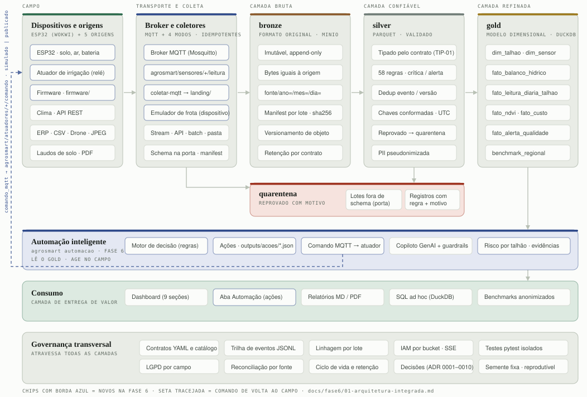

# Requisito 1 — Arquitetura integrada da solução

> Peso: 20 % · Artefatos: diagrama da arquitetura + breve descrição de cada componente
> Status: **implementado e verificado**. Tudo que está no diagrama roda nesta máquina: `docker compose -f infra/docker-compose.yml up -d` (MinIO + Mosquitto), `agrosmart dispositivo` ou o ESP32 no Wokwi, `agrosmart coletar-mqtt`, `agrosmart run --all --sem-simular`, `agrosmart automacao` e `streamlit run app/dashboard.py`.

## 1. Visão geral



A Fase 5 entregou um Data Lake em quatro camadas com um copiloto de IA que **recomenda**. A Fase 6 fecha o ciclo: o dado nasce em um dispositivo real (ESP32 no Wokwi, ou o emulador local que publica o mesmo payload), atravessa um broker MQTT e um gateway de verdade, passa pelas mesmas camadas bronze → silver → gold, e no fim um **motor de decisão** transforma os indicadores do gold em ações — irrigar, alertar, trocar bateria, inspecionar sensor — que voltam ao campo como comando MQTT para o atuador do talhão. O dashboard ganhou uma aba que mostra exatamente essas ações, com motivo, evidência e status.

O que **não** mudou é tão importante quanto o que mudou: o contrato `contratos/sensores.v1.yaml` continua sendo a fronteira. O gateway da Fase 6 produz na landing os mesmos arquivos JSONL de 15 min que o simulador da Fase 5 produzia; do `ColetorStreaming` em diante nenhuma linha foi alterada para receber dados de um dispositivo real. No diagrama, os chips com borda azul são os componentes novos; a seta tracejada é o comando que volta ao campo.

## 2. O caminho de uma leitura até a ação

1. **Dispositivo.** O ESP32 (`firmware/wokwi-esp32/sketch.ino`, ou `agrosmart dispositivo`, que publica o mesmo payload para os 12 sensores do catálogo) lê umidade e temperatura do solo, temperatura e umidade do ar, bateria e sinal, e publica um JSON em `agrosmart/sensores/<sensor_id>/leitura`.
2. **Broker.** O Mosquitto (`infra/docker-compose.yml`, porta 1883) entrega a mensagem a quem assinou o tópico. QoS 1 nos comandos; o broker é o único ponto de contato entre campo e plataforma.
3. **Gateway.** `agrosmart coletar-mqtt` (`src/agrosmart/ingestao/mqtt_gateway.py`) valida que a mensagem é um objeto JSON, descarta chaves fora do contrato (`luminosidade_lux`, roadmap v2), normaliza `medido_em` para UTC e grava a leitura no arquivo da **janela do instante medido** — `landing/sensores/20261008/leituras_20261008T1415Z.jsonl` — sem repetir a chave natural `(sensor_id, medido_em)` no mesmo arquivo. Resumo em `outputs/coleta_mqtt.json`.
4. **Ingestão.** `agrosmart ingerir` descobre os arquivos, confere o schema na porta, grava os bytes intocados no bronze com manifest por lote; arquivo reaberto pelo gateway (leitura atrasada) chega como nova versão do mesmo `batch_id`.
5. **Processamento.** `agrosmart processar`: tipagem pelo contrato, 12 regras `SEN-*`, deduplicação por evento, frescor por sensor, Parquet no silver, reprovados na quarentena com motivo, reconciliação; depois o gold em SQL (`fato_balanco_hidrico`, `fato_leitura_diaria_talhao`, `dim_sensor`, `fato_alerta_qualidade`…). Detalhes em `docs/fase6/03-processamento.md`.
6. **Decisão.** `agrosmart automacao` (`src/agrosmart/automacao/motor.py`) lê o gold, compara com os limiares de `agronomia.py` — os mesmos que o gold e o copiloto usam — e monta o plano: risco por talhão (`critico | atencao | normal`) e ações com prioridade, parâmetros, motivo e evidências (`tabela:chave:data`). Grava `outputs/acoes/acoes_<data>.json` e `.md`. O copiloto GenAI (`src/agrosmart/ia/`) explica cada talhão em linguagem natural, com guardrails; o plano não depende dele.
7. **Atuação.** Com `--publicar`, a ação `irrigar` vira o comando `{"acao": "ligar", "minutos": N}` em `agrosmart/atuadores/<talhao_id>/irrigacao` (QoS 1, `src/agrosmart/automacao/atuadores.py`); o status da ação passa de `simulado` para `publicado`. O firmware e o emulador assinam esse tópico, acionam o relé/LED e publicam o estado em `.../irrigacao/estado`.
8. **Consumo.** O dashboard (`app/dashboard.py`) mostra o mesmo gold que a automação leu e, na aba **Automação**, o JSON de ações mais recente: resumo por tipo e prioridade, risco por talhão, tabela de ações com motivo e status. Relatórios MD/PDF do copiloto e `agrosmart sql` continuam disponíveis.

## 3. Os componentes

| Componente | Responsabilidade | Tecnologia | Onde está no código | Fase |
|---|---|---|---|---|
| **Dispositivo de campo (ESP32)** | ler sensores de solo e ar, bateria e sinal; publicar a leitura por MQTT; receber o comando do atuador e acionar o relé/LED de irrigação | ESP32 no simulador Wokwi, C++/Arduino, PubSubClient | `firmware/wokwi-esp32/` (`sketch.ino`, `diagram.json`) · `docs/fase6/02-coleta-iot.md` | 6 |
| **Emulador de dispositivos** | publicar o mesmo payload do firmware para os 12 sensores do catálogo, com o modelo agronômico da Fase 5 (ciclo diário de umidade, temperatura e bateria), ~2 % de leituras atrasadas e ~0,5 % duplicadas; reagir ao comando de irrigação como o firmware | Python, paho-mqtt | `src/agrosmart/simuladores/dispositivo_mqtt.py` · `agrosmart dispositivo` | 6 |
| **Broker MQTT** | transporte publish/subscribe entre dispositivos, gateway e automação; tópicos `agrosmart/sensores/+/leitura` e `agrosmart/atuadores/+/irrigacao` | Eclipse Mosquitto em Docker (porta 1883) | `infra/docker-compose.yml` (serviço `mosquitto`), `infra/mosquitto/` | 6 |
| **Gateway MQTT → landing** | assinar o tópico, validar o JSON, manter só as chaves do contrato, agrupar pela janela do instante medido, não repetir chave natural no arquivo; resumo da coleta | Python, paho-mqtt | `src/agrosmart/ingestao/mqtt_gateway.py` · `agrosmart coletar-mqtt` · `outputs/coleta_mqtt.json` | 6 |
| **Demais origens** | clima (API REST), cadastro e operações do ERP (CSV), imagens de drone/satélite (JPEG + sidecar), laudos de solo (PDF + sidecar); na demonstração, os simuladores | Python | `src/agrosmart/simuladores/` · `landing/` | 5 |
| **Contratos de dados** | fonte única da verdade por origem: schema, modo de ingestão, partição, chave natural, dedup, retenção, LGPD e regras de qualidade com justificativa; validação cruzada ao carregar | YAML + Pydantic | `contratos/*.v1.yaml` · `src/agrosmart/contratos.py` | 5 |
| **Coletores** | landing → bronze por modo (`streaming`, `api_pull`, `batch`, `watch_folder`): schema na porta, `batch_id` determinístico, manifest, idempotência por checksum, versão em reenvio | Python | `src/agrosmart/ingestao/{base,streaming,api_pull,batch,watch_folder}.py` · `agrosmart ingerir` | 5 |
| **Armazenamento do lake** | acesso por `(camada, chave)` com a mesma chave lógica em dois backends; um bucket por camada, versionamento no bronze e na quarentena, ciclo de vida | MinIO (S3) em Docker ou filesystem; boto3 | `src/agrosmart/storage.py` · `src/agrosmart/config.py` · `infra/docker-compose.yml` | 5 |
| **Bronze** | dado bruto imutável, bytes iguais à origem, `fonte/ano=/mes=/dia=/`, metadados no objeto e manifest por lote | MinIO, formatos originais (JSONL, JSON, CSV, JPEG, PDF) | bucket `agrosmart-bronze` | 5 |
| **Leitura e tipagem** | bronze → DataFrame todo texto com proveniência do manifest; texto → tipos do contrato, falhas em `TIP-01` | Polars | `src/agrosmart/processamento/leitura.py` · `tipagem.py` | 5 |
| **Motor de qualidade** | regras do contrato registro a registro, deduplicação `evento`/`versao`, frescor e lacunas por entidade; verificação contra os defeitos injetados | Polars | `src/agrosmart/qualidade/motor.py` · `verificacao.py` | 5 |
| **Silver** | dado confiável: tipado, validado, deduplicado, UTC e SI, PII pseudonimizada, Parquet zstd por dia do evento; reconciliação por fonte | Parquet, Polars | `src/agrosmart/processamento/silver.py` · bucket `agrosmart-silver` · `outputs/dq_report.json` | 5 |
| **Quarentena** | reprovados com regra e motivo (Parquet por data de ingestão) e lotes rejeitados na porta (`_rejeitados/`); retenção de 30 dias | Parquet, MinIO | bucket `agrosmart-quarentena` · [ADR 0004](../adr/0004-quarentena-como-quarta-camada.md) | 5 |
| **Gold** | modelo dimensional com 14 tabelas definidas em SQL documentado; balanço hídrico, cobertura de sensores, NDVI, custos, fertilidade, alertas, benchmark anonimizado | DuckDB sobre Parquet | `src/agrosmart/processamento/gold.py` · bucket `agrosmart-gold` · `outputs/gold.json` | 5 |
| **Conhecimento agronômico** | limiares e parâmetros compartilhados (FAD de irrigação 0,50 e de estresse 0,35, Kc por estádio, bateria 15 %, RSSI −95 dBm, custos de referência) — um só lugar para simulador, gold, copiloto e automação | Python | `src/agrosmart/agronomia.py` | 5 |
| **Catálogo, dicionário e linhagem** | inventário do lake, linhagem bronze → silver → gold por lote, dicionário de dados gerado dos contratos e do gold | Python | `src/agrosmart/catalogo/__init__.py` · `outputs/catalogo.json` · `docs/dicionario-de-dados.md` | 5 |
| **Manutenção** | compactação mensal do silver, retenção por contrato (simulada ou aplicada) | Python | `src/agrosmart/processamento/manutencao.py` · `agrosmart manter` | 5 |
| **Orquestração e backfill** | `run --all` encadeia as etapas com medição e parada na primeira falha; `run --from --to` reprocessa um intervalo a partir do bronze | Python | `src/agrosmart/orquestracao.py` · `outputs/run.json` | 5 |
| **Motor de decisão** | ler o gold, classificar o risco de cada talhão e gerar ações determinísticas (`irrigar`, `alerta_fitossanitario`, `trocar_bateria`, `inspecionar_sensor`) com prioridade, parâmetros (lâmina, minutos, janela), motivo e evidências; plano em JSON e Markdown | Python, Polars, Pydantic | `src/agrosmart/automacao/motor.py` · `agrosmart automacao` · `outputs/acoes/acoes_<data>.{json,md}` · `docs/fase6/04` | 6 |
| **Atuadores** | publicar os comandos de irrigação no broker com QoS 1 e esperar a confirmação; dublê em memória para testes e `--dry-run` | paho-mqtt | `src/agrosmart/automacao/atuadores.py` | 6 |
| **Copiloto de IA generativa** | Context Pack do talhão → prompt versionado → saída estruturada → guardrails (aterramento numérico, trava do sequeiro) → fallback para o motor de regras; relatórios com proveniência. Na Fase 6, justifica as ações do plano | API Claude (opcional) + motor de regras | `src/agrosmart/ia/` · `agrosmart ia gerar` · `outputs/relatorios/` | 5 (6: justificativa das ações) |
| **Dashboard** | camada de consumo sobre o gold: talhão, água, vegetação, custos, copiloto, qualidade, sensores, benchmark e, na Fase 6, **Automação** (JSON de ações mais recente) | Streamlit + Altair | `app/dashboard.py` · `docs/fase6/05-dashboard.md` · `outputs/prints/fase6-05-dashboard-*.png` | 5 (6: aba Automação) |
| **Relatórios e SQL ad hoc** | MD/PDF do copiloto com proveniência; consultas livres sobre silver, gold e quarentena | DuckDB, gerador de PDF próprio | `src/agrosmart/ia/render.py` · `src/agrosmart/pdf.py` · `agrosmart sql` | 5 |
| **Trilha de eventos e logs** | um evento JSONL por lote e por etapa (ingestão, silver, gold, coleta MQTT, automação) | Python logging + Rich | `src/agrosmart/log.py` · `outputs/logs/eventos.jsonl` | 5 |
| **CLI e empacotamento** | um comando por etapa; `empacotar --fase 6` monta e testa o zip da entrega com firmware, ações e documentos da fase | Typer, zipfile | `src/agrosmart/pipeline.py` · `src/agrosmart/empacotar.py` · `scripts/empacotar.py` | 5 (6: `--fase`) |

## 4. Interfaces entre os blocos

| Interface | Formato | Quem produz → quem consome |
|---|---|---|
| Leitura do sensor | MQTT `agrosmart/sensores/<sensor_id>/leitura`, JSON com as chaves de `sensores.v1` (`sensor_id`, `talhao_id`, `medido_em` ISO-8601 UTC, `umidade_solo_pct`, `temperatura_solo_c`, `temperatura_ar_c`, `umidade_ar_pct`, `bateria_pct`, `rssi_dbm`…) | firmware / emulador → gateway |
| Comando ao atuador | MQTT `agrosmart/atuadores/<talhao_id>/irrigacao`, `{"acao": "ligar", "minutos": N}`, QoS 1; estado em `.../irrigacao/estado` | automação → firmware / emulador |
| Landing de sensores | `landing/sensores/<AAAAMMDD>/leituras_<AAAAMMDD>T<HHMM>Z.jsonl`, uma leitura por linha, janela de 15 min pelo instante medido | gateway (ou simulador) → `ColetorStreaming` |
| Bronze | `sensores/ano=/mes=/dia=/leituras_*.jsonl` + `_manifests/sensores/…/<batch_id>.json` | coletor → leitura do silver, catálogo |
| Silver / gold | Parquet particionado; tabelas registradas no DuckDB pelo nome do contrato / da `TabelaGold` | processamento → gold, automação, copiloto, dashboard, SQL |
| Plano de ações | `outputs/acoes/acoes_<data>.json` (`plano-acoes.v1`): `gerado_em`, `data_ref`, `fonte`, `resumo{talhoes, acoes, por_tipo, por_prioridade}`, `talhoes[{talhao_id, risco, indicadores}]`, `acoes[{id, talhao_id, sensor_id, tipo, prioridade, parametros, motivo, evidencias[], comando_mqtt|null, status}]` | automação → dashboard (aba Automação), atuadores |
| Configuração | `.env` (`AGROSMART_BACKEND`, endpoint e credenciais do MinIO, semente, data de referência, `ANTHROPIC_API_KEY` opcional); broker e porta por opção de linha de comando (`--broker localhost --porta 1883`) | operador → todos os comandos |

## 5. Governança transversal

A governança da Fase 5 (`docs/01-arquitetura-datalake.md` §5) vale inteira e ganhou dois pontos de observação: o gateway registra no `outputs/coleta_mqtt.json` quantas mensagens recebeu, gravou, descartou (e por quê) e quantas chaves extras ignorou; e cada execução da automação deixa evento na trilha com o plano gerado e os comandos publicados. O princípio de segurança para a atuação é o mesmo da IA — **nada age sem evidência**: toda ação cita as linhas do gold que a motivaram, e a publicação no broker só acontece com `--publicar` explícito; sem ele o plano é gravado com `status: simulado` e nada sai para o campo. A trava agronômica do sequeiro (nunca irrigar talhão sem sistema de irrigação) está no gold (`recomenda_irrigar`), no guardrail do copiloto e no motor de decisão — três camadas, um limiar.

## 6. O que mudou da Fase 5 para a Fase 6

| Bloco | Fase 5 | Fase 6 |
|---|---|---|
| Origem dos sensores | simulador escrevia a landing "como se fosse" o gateway | ESP32 no Wokwi ou emulador publicam por MQTT; gateway real escreve a landing |
| Transporte | nenhum (arquivos) | broker Mosquitto, tópicos de leitura e de atuador |
| Processamento | bronze → silver → gold | idêntico — o contrato é a fronteira |
| Inteligência | copiloto recomenda; o produtor decide | motor de decisão gera ações executáveis; copiloto explica; o produtor autoriza a publicação (`--publicar`) |
| Retorno ao campo | nenhum | comando MQTT ao atuador de irrigação, com confirmação (QoS 1) |
| Dashboard | 8 seções sobre o gold | + aba Automação (ações, risco, status) |
| Entrega | zip `fase5` | `empacotar --fase 6` inclui `firmware/`, `outputs/acoes/`, `docs/fase6/`, `data/exemplos/fase6/`, prints `fase6-*` |

## 7. Como reproduzir, ponta a ponta

```bash
docker compose -f infra/docker-compose.yml up -d            # MinIO (lake) + Mosquitto (broker)
agrosmart doctor                                              # ambiente, contratos e lake
agrosmart dispositivo --duracao-s 120                         # 12 dispositivos emulados publicando (ou o ESP32 no Wokwi)
agrosmart coletar-mqtt --duracao-s 120                        # gateway: tópico → landing/sensores (em outro terminal)
agrosmart ingerir && agrosmart processar                      # bronze → silver → gold → catálogo
agrosmart automacao                                           # plano em outputs/acoes/ (status: simulado)
agrosmart automacao --publicar                                # ... e comando MQTT ao atuador (status: publicado)
streamlit run app/dashboard.py                                # http://localhost:8501/?secao=automacao
```

Sem Docker: `AGROSMART_BACKEND=filesystem` no `.env` para o lake, e qualquer broker MQTT acessível (`--broker`, `--porta`) para a coleta.

## 8. Equivalência em nuvem

| Componente local | AWS | GCP | Azure |
|---|---|---|---|
| Mosquitto | IoT Core (broker MQTT gerenciado) | Pub/Sub via gateway MQTT | IoT Hub |
| `coletar-mqtt` → landing | IoT Rule → Kinesis Firehose → S3 | Dataflow → Cloud Storage | IoT Hub routing → Event Hubs → ADLS |
| MinIO, Polars, DuckDB, contratos | S3, Glue, Athena, Glue Schema Registry | Cloud Storage, Dataflow, BigQuery, Dataplex | ADLS Gen2, Synapse, Purview |
| `agrosmart automacao` + atuadores | Lambda agendado (EventBridge) publicando no IoT Core | Cloud Functions + Scheduler | Functions + IoT Hub direct methods |
| Dashboard Streamlit | ECS/App Runner ou QuickSight | Cloud Run ou Looker | App Service ou Power BI |

A migração é troca de endpoint e de credenciais, não reescrita: os coletores falam em `(camada, chave)`, o gateway e os atuadores falam MQTT padrão, e o motor de decisão lê Parquet.
