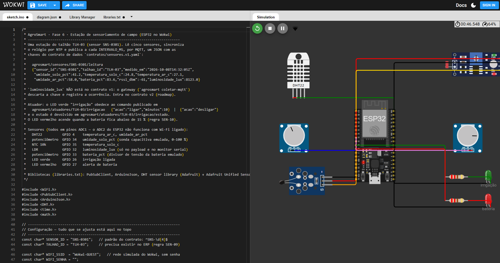

# Fase 6 · Requisito 2 — Coleta de dados do ambiente (IoT por MQTT)

> **Em uma frase:** a fonte `sensores` deixa de ser simulada por arquivo e passa a ser coletada
> de dispositivos reais por MQTT — um ESP32 simulado no Wokwi e um emulador local dos 12
> sensores do catálogo — sem mudar **uma linha** do pipeline a jusante. O contrato
> `contratos/sensores.v1.yaml` é a fronteira: o gateway produz exatamente os micro-batches
> JSONL que o `ColetorStreaming` da Fase 5 já lê.

| Artefato | Onde |
|---|---|
| Firmware ESP32 (Wokwi): sketch, circuito, bibliotecas, instruções | `firmware/wokwi-esp32/` |
| Captura da simulação (exigida pela entrega) | `firmware/wokwi-esp32/captura-wokwi.png` — ver [§2](#2-circuito) |
| Gateway MQTT → landing | `src/agrosmart/ingestao/mqtt_gateway.py` · `agrosmart coletar-mqtt` |
| Emulador dos dispositivos (par local do ESP32) | `src/agrosmart/simuladores/dispositivo_mqtt.py` · `agrosmart dispositivo` |
| Broker local | `infra/docker-compose.yml` (serviço `mosquitto`) · `infra/mosquitto/mosquitto.conf` |
| Testes (sem broker) | `tests/test_mqtt.py` — 18 testes |
| Evidências da demonstração | `outputs/prints/fase6-02-*.txt` |
| Exemplo de dados coletados | `data/exemplos/fase6/landing/sensores/*.jsonl` |

## 1. Sensores do dispositivo

A estação de campo é um ESP32 DevKit-C v4 simulado no [Wokwi](https://wokwi.com) — simulador
online com Wi-Fi real, escolhido no lugar do TinkerCad porque este não simula ESP32 nem rede
(ver [§10](#10-limitações-e-diferenças-para-o-tinkercad)). Cada estação identifica-se por
`sensor_id` (ex.: `SNS-0301`) e pelo talhão onde está (`TLH-03`), as mesmas chaves conformadas
com o ERP que o lake já usa.

| Sensor (Wokwi) | Pino ESP32 | Grandeza | Campo do contrato `sensores.v1` | Faixa / regra |
|---|---|---|---|---|
| DHT22 | GPIO 4 (digital) | temperatura do ar | `temperatura_ar_c` (°C, opcional) | −40 a 80 °C |
| DHT22 | GPIO 4 (digital) | umidade relativa do ar | `umidade_ar_pct` (%, opcional) | 0 a 100 % |
| Potenciômetro 1 — sonda capacitiva de umidade do solo (emulada) | GPIO 34 (ADC1) | umidade volumétrica a 20 cm | `umidade_solo_pct` (%, **obrigatório**) | 0 a 100 % — SEN-04 (crítica) |
| NTC 10 kΩ (β = 3950) | GPIO 35 (ADC1) | temperatura do solo a 20 cm | `temperatura_solo_c` (°C, **obrigatório**) | −10 a 70 °C — SEN-05 (crítica) |
| LDR (fotoresistor) | GPIO 32 (ADC1) | luminosidade | **`luminosidade_lux`** — fora do contrato v1 (roadmap v2) | 0 a 100 000 lx; só no payload e no monitor serial |
| Potenciômetro 2 — divisor de tensão da bateria (emulado) | GPIO 33 (ADC1) | carga da bateria | `bateria_pct` (%, **obrigatório**) | 15 a 100 % — SEN-10 (alerta) → LED vermelho abaixo de 15 % |
| Rádio Wi-Fi do ESP32 (`WiFi.RSSI()`) | — | intensidade do sinal | `rssi_dbm` (dBm, opcional) | −95 a 0 — SEN-11 (alerta) |
| Relógio sincronizado por NTP (`pool.ntp.org`) | — | instante da medição em UTC | `medido_em` (timestamp, **obrigatório**) | não-futuro — SEN-08 (crítica) |
| LED verde | GPIO 26 | atuador: irrigação ligada | — (comando em `agrosmart/atuadores/<talhão>/irrigacao`) | ligado por `{"acao":"ligar","minutos":N}` |
| LED vermelho | GPIO 27 | alerta de bateria | — | aceso quando `bateria_pct < 15` |

Os campos opcionais `ph` e `condutividade_ds_m` do contrato não são medidos pela estação (não
há sonda) e saem como `null` — chave presente, valor nulo, que é como o silver já tratava a
ausência. Só pinos ADC1 são usados: o ADC2 do ESP32 é desativado quando o Wi-Fi está ligado.

## 2. Circuito



> **Captura (08/10/2026 11:08):** gerada por `firmware/wokwi-esp32/capturar_wokwi.py`, que abre o
> wokwi.com no Edge via DevTools, carrega `sketch.ino` e `diagram.json`, instala as quatro bibliotecas
> pelo Library Manager e inicia a simulação — à esquerda o código, à direita o circuito completo com o
> cronômetro da simulação em andamento. A prova de que o ESP32 publicou está na §8b: o gateway desta
> máquina recebeu as leituras pelo broker público. Para refazer: `python firmware/wokwi-esp32/capturar_wokwi.py`.

Descrição do circuito (`firmware/wokwi-esp32/diagram.json`): o ESP32 alimenta todos os sensores
em 3,3 V. O DHT22 liga seu pino de dados ao GPIO 4. Os dois potenciômetros (10 kΩ) formam
divisores de tensão com o cursor nos GPIOs 34 (umidade do solo) e 33 (bateria). O NTC vem no
módulo do Wokwi com divisor interno de 10 kΩ e saída no GPIO 35; o firmware converte a tensão em
°C pela equação β. O LDR vem no módulo com saída analógica no GPIO 32, convertida em lux pela
curva do fotoresistor (γ = 0,7, 50 kΩ a 10 lx). Os LEDs verde (GPIO 26) e vermelho (GPIO 27)
têm resistor de 220 Ω em série ao GND. O monitor serial (115200 bps) mostra a mesma linha JSON
que vai para o broker.

## 3. Fluxo: dispositivo → broker → gateway → landing → bronze → silver

```
  ESP32 (Wokwi)  ─┐                                     agrosmart coletar-mqtt
  SNS-0301/TLH-03 │  publish                            ┌──────────────────────────┐
                  ├──────► broker MQTT ──── subscribe ──►│ gateway                  │
  agrosmart       │  agrosmart/sensores/<id>/leitura    │  · JSON válido?          │
  dispositivo     │                                     │  · só chaves do contrato │
  (12 emulados)  ─┘  broker.hivemq.com:1883 (Wokwi)     │  · medido_em → UTC       │
                     localhost:1883 mosquitto (local)   │  · janela por medido_em  │
        ▲                                               │  · dedup (sensor, instante)│
        │ subscribe agrosmart/atuadores/<talhão>/irrigacao └───────────┬────────────┘
        │ {"acao":"ligar","minutos":N}  ← agrosmart automacao (req. 3)  │ append
        │                                                               ▼
        │                     landing/sensores/<AAAAMMDD>/leituras_<AAAAMMDD>T<HHMM>Z.jsonl
        │                                                               │
        │                               agrosmart ingerir  (ColetorStreaming, sem mudança)
        │                                                               ▼
        │                               bronze/sensores/ano=/mes=/dia=/…  +  _manifests/
        │                                                               │
        │                               agrosmart processar --camada silver (regras SEN-01…12)
        │                                                               ▼
        └──────────── gold → copiloto / automação ◄──── silver/sensores_leitura/
```

Tópicos:

| Tópico | Sentido | Payload |
|---|---|---|
| `agrosmart/sensores/<sensor_id>/leitura` | dispositivo → lake | leitura (abaixo), QoS 1, a cada 5 s na demo (15 min em campo) |
| `agrosmart/atuadores/<talhao_id>/irrigacao` | lake → dispositivo | `{"acao":"ligar","minutos":10}` ou `{"acao":"desligar"}` |
| `agrosmart/atuadores/<talhao_id>/irrigacao/estado` | dispositivo → lake | `{"talhao_id":"TLH-03","irrigacao":"ligada","ate":"…Z",…}` |

O gateway é um consumidor MQTT que materializa micro-batches — o mesmo padrão de um Kinesis
Firehose ou de um bridge MQTT→S3. Ele **não interpreta valores**: umidade de 130 % passa pela
porta e é a regra SEN-04 do silver que a reprova. A porta protege o schema; a qualidade é da
camada seguinte (o mesmo princípio dos coletores da Fase 5, `docs/02-ingestao-e-manutencao.md` §5.2).

## 4. Payload de exemplo

O que o firmware publica (e imprime no serial), com `luminosidade_lux` fora do contrato:

```json
{"sensor_id":"SNS-0301","talhao_id":"TLH-03","medido_em":"2026-10-08T13:14:01Z",
 "umidade_solo_pct":30.3,"temperatura_solo_c":26.0,"temperatura_ar_c":30.4,"umidade_ar_pct":42.2,
 "bateria_pct":89.0,"rssi_dbm":-67,"luminosidade_lux":41230.0}
```

O que o gateway grava na landing — **as 11 chaves do contrato, na ordem do contrato**, igual ao
simulador da Fase 5; a chave extra é descartada e contada, e os opcionais não medidos saem nulos:

```json
{"sensor_id":"SNS-0301","talhao_id":"TLH-03","medido_em":"2026-10-08T13:14:01Z","umidade_solo_pct":30.3,"temperatura_solo_c":26.0,"temperatura_ar_c":30.4,"umidade_ar_pct":42.2,"condutividade_ds_m":null,"ph":null,"bateria_pct":89.0,"rssi_dbm":-67}
```

## 5. O gateway (`agrosmart coletar-mqtt`)

```
python -m agrosmart coletar-mqtt --broker localhost --porta 1883 \
    --topico "agrosmart/sensores/+/leitura" --janela-min 15 --duracao-s 900 --saida landing/sensores
```

| Responsabilidade | Como |
|---|---|
| Validar na porta | mensagem que não é um objeto JSON ou não tem `medido_em` ISO-8601 é descartada e contada por motivo (`json_invalido`, `nao_objeto`, `sem_instante`) |
| Manter só o contrato | lê `sensores.v1` via `agrosmart.contratos` e projeta o payload em `campos_de_origem`; chaves extras são descartadas, avisadas uma vez no log e contadas no resumo |
| Normalizar o instante | `medido_em` com qualquer fuso vira `AAAA-MM-DDTHH:MM:SSZ` (UTC) — é ele que define a janela |
| Janelar pelo evento | a leitura cai no arquivo da janela do **instante medido**, não do instante de chegada: leitura atrasada do buffer do gateway de campo reabre a janela certa |
| Idempotência | reabrir uma janela faz *append*; as chaves `(sensor_id, medido_em)` já no arquivo são carregadas antes e a repetição é contada como duplicata, não gravada — vale entre reinícios do processo |
| Layout da Fase 5 | `landing/sensores/<AAAAMMDD>/leituras_<AAAAMMDD>T<HHMM>Z.jsonl`, uma linha por leitura, `\n`, JSON compacto |
| Trilha | eventos `coleta_iot/janela_aberta`, `janela_reaberta` e `concluida` em `outputs/logs/eventos.jsonl`; resumo em `outputs/coleta_mqtt.json` |
| Encerramento | `--duracao-s` ou Ctrl+C; desconecta limpo e imprime recebidas, gravadas, duplicatas, descartadas, chaves extras, arquivos |

Com `--janela-min 15` a janela é a do contrato; a demonstração usa `--janela-min 1` só para
encher vários arquivos em 100 s. Reingerir um arquivo reaberto gera **nova versão** do lote no
bronze (checksum diferente, `versao + 1`) — exatamente o mecanismo da Fase 5.

## 6. O emulador (`agrosmart dispositivo`)

```
python -m agrosmart dispositivo --broker localhost --n 12 --intervalo-s 5 --duracao-s 90 --seed 1
```

Publica, para os 12 sensores do catálogo (`SNS-0101`…`SNS-0602`, dois por talhão), o mesmo
payload do firmware, com valores do modelo agronômico dos simuladores da Fase 5: o estado do
último dia da trajetória (umidade, clima, bateria) e o mesmo ciclo diário. Como o gateway de
campo tem buffer offline, ~2 % das leituras saem atrasadas (um a três ciclos depois, com o
`medido_em` original) e ~0,5 % saem duplicadas — é o que exercita a reabertura de janela e a
deduplicação. Assina `agrosmart/atuadores/+/irrigacao`, registra "irrigação ligada/desligada",
publica o estado e deixa a umidade do talhão subir enquanto a irrigação está ligada. É o par
local do ESP32: a demonstração completa roda sem internet nem placa.

## 7. Exemplo de dados gerados

Dez leituras reais da demonstração (`landing/sensores/20261008/leituras_20261008T1314Z.jsonl`,
copiado para `data/exemplos/fase6/landing/sensores/`):

```jsonl
{"sensor_id":"SNS-0101","talhao_id":"TLH-01","medido_em":"2026-10-08T13:14:01Z","umidade_solo_pct":25.8,"temperatura_solo_c":25.8,"temperatura_ar_c":29.7,"umidade_ar_pct":42.1,"condutividade_ds_m":null,"ph":null,"bateria_pct":92.0,"rssi_dbm":-66}
{"sensor_id":"SNS-0102","talhao_id":"TLH-01","medido_em":"2026-10-08T13:14:01Z","umidade_solo_pct":25.4,"temperatura_solo_c":25.9,"temperatura_ar_c":30.1,"umidade_ar_pct":43.2,"condutividade_ds_m":null,"ph":null,"bateria_pct":94.0,"rssi_dbm":-82}
{"sensor_id":"SNS-0201","talhao_id":"TLH-02","medido_em":"2026-10-08T13:14:01Z","umidade_solo_pct":21.4,"temperatura_solo_c":26.1,"temperatura_ar_c":30.1,"umidade_ar_pct":43.9,"condutividade_ds_m":null,"ph":null,"bateria_pct":95.0,"rssi_dbm":-74}
{"sensor_id":"SNS-0202","talhao_id":"TLH-02","medido_em":"2026-10-08T13:14:01Z","umidade_solo_pct":21.2,"temperatura_solo_c":26.0,"temperatura_ar_c":30.7,"umidade_ar_pct":40.7,"condutividade_ds_m":null,"ph":null,"bateria_pct":88.0,"rssi_dbm":-67}
{"sensor_id":"SNS-0301","talhao_id":"TLH-03","medido_em":"2026-10-08T13:14:01Z","umidade_solo_pct":30.3,"temperatura_solo_c":26.0,"temperatura_ar_c":30.4,"umidade_ar_pct":42.2,"condutividade_ds_m":null,"ph":null,"bateria_pct":89.0,"rssi_dbm":-67}
{"sensor_id":"SNS-0302","talhao_id":"TLH-03","medido_em":"2026-10-08T13:14:01Z","umidade_solo_pct":29.9,"temperatura_solo_c":25.9,"temperatura_ar_c":29.8,"umidade_ar_pct":44.2,"condutividade_ds_m":null,"ph":null,"bateria_pct":93.9,"rssi_dbm":-70}
{"sensor_id":"SNS-0401","talhao_id":"TLH-04","medido_em":"2026-10-08T13:14:01Z","umidade_solo_pct":28.4,"temperatura_solo_c":25.6,"temperatura_ar_c":29.5,"umidade_ar_pct":44.9,"condutividade_ds_m":null,"ph":null,"bateria_pct":92.0,"rssi_dbm":-81}
{"sensor_id":"SNS-0402","talhao_id":"TLH-04","medido_em":"2026-10-08T13:14:01Z","umidade_solo_pct":28.2,"temperatura_solo_c":25.9,"temperatura_ar_c":29.5,"umidade_ar_pct":47.0,"condutividade_ds_m":null,"ph":null,"bateria_pct":94.0,"rssi_dbm":-80}
{"sensor_id":"SNS-0501","talhao_id":"TLH-05","medido_em":"2026-10-08T13:14:01Z","umidade_solo_pct":29.1,"temperatura_solo_c":25.8,"temperatura_ar_c":28.8,"umidade_ar_pct":48.4,"condutividade_ds_m":null,"ph":null,"bateria_pct":95.0,"rssi_dbm":-70}
{"sensor_id":"SNS-0502","talhao_id":"TLH-05","medido_em":"2026-10-08T13:14:01Z","umidade_solo_pct":29.2,"temperatura_solo_c":26.2,"temperatura_ar_c":29.2,"umidade_ar_pct":44.9,"condutividade_ds_m":null,"ph":null,"bateria_pct":88.0,"rssi_dbm":-72}
```

## 8. Demonstração de ponta a ponta (local, 08/10/2026)

Broker mosquitto em Docker; emulador por 90 s (`--intervalo-s 5`) e gateway por 100 s
(`--janela-min 1`) em paralelo; dois comandos de irrigação publicados no meio; depois `ingerir`
e `processar --camada silver --fonte sensores` **sem nenhuma alteração** nesses comandos.

| Etapa | Resultado | Evidência |
|---|---|---|
| Broker | `agrosmart-mosquitto` em `healthy` na porta 1883 | `fase6-02-mosquitto-up.txt`, `fase6-02-mosquitto-log.txt` |
| Emulador | 12 dispositivos · 18 ciclos · **216 publicadas** (1 atrasada pelo buffer, 1 duplicada) · **2 comandos** recebidos: "irrigação ligada em TLH-03 por 2 min" e "desligada"; um comando para `TLH-99` (talhão inexistente) foi ignorado com aviso | `fase6-02-dispositivo.txt` |
| Gateway | **216 recebidas · 215 gravadas · 1 duplicata ignorada · 0 descartadas** · `luminosidade_lux` descartada 216× · 12 sensores · **3 arquivos** (12 + 144 + 59 linhas) · 0 reconexões | `fase6-02-coletar-mqtt.txt`, `outputs/coleta_mqtt.json` |
| Landing | `landing/sensores/20261008/leituras_20261008T13{13,14,15}Z.jsonl`, 215 linhas, 11 chaves na ordem do contrato | `fase6-02-landing-arvore.txt`, `data/exemplos/fase6/` |
| Ingestão (Fase 5) | `ColetorStreaming`: **3 lotes gravados · 215 registros · 0 rejeitados** · bronze com 6 236 objetos | `fase6-02-ingerir.txt` |
| Silver (Fase 5) | `sensores_leitura`: 34 646 lidos (34 431 da Fase 5 + **215 reais**) · 34 255 aprovados · 391 quarentena — exatamente os 391 defeitos injetados pela simulação (cobertura 100 %), ou seja, **nenhuma leitura real reprovada** · reconciliação fecha | `fase6-02-processar-silver.txt`, `outputs/dq_report.json` |

Efeito colateral esperado e instrutivo: a regra SEN-12 (frescor, `detectar_lacunas`) passou a
apontar **uma lacuna de 53 909 min (37 dias) em cada um dos 12 sensores** — entre o fim da série
simulada (01/09/2026 02:45) e a primeira leitura real (08/10/2026 13:13). O lake não mente: a
origem simulada parou e a real começou um mês depois. Numa operação contínua a lacuna não existe,
e `AGROSMART_DATA_REFERENCIA` passaria a acompanhar o relógio.

## 8b. Evidência com o ESP32 de verdade no circuito: Wokwi → broker público → gateway (08/10/2026)

Além do emulador, o firmware foi executado no Wokwi e as leituras atravessaram a internet até o
gateway desta máquina, sem nenhum componente simulado em Python no caminho:

| Execução | Firmware | Resultado do gateway (`broker.hivemq.com`, `--janela-min 1`) |
|---|---|---|
| 1 · 10:31, 45 s | biblioteca DHTesp | 7 recebidas · 7 gravadas · 0 duplicadas · 0 descartadas · `luminosidade_lux` descartada 7× · `temperatura_ar_c`/`umidade_ar_pct` vieram `null` (a DHTesp não leu o DHT22 do Wokwi) |
| 2 · 11:05–11:08 | DHT sensor library (Adafruit) + Adafruit Unified Sensor; potenciômetros em 420 e 860 | leituras completas: `umidade_solo_pct` 41,1 · `temperatura_solo_c` 24,8 · `temperatura_ar_c` 27,1 · `umidade_ar_pct` 58 · `bateria_pct` 84,1 · `rssi_dbm` −77 a −90; arquivos `leituras_20261008T1405Z/1406Z/1408Z.jsonl` |

Evidências: `outputs/prints/fase6-02-wokwi-hivemq.txt` (resumo e as linhas gravadas) e
`data/exemplos/fase6/landing/sensores/wokwi_hivemq/*.jsonl`. A troca de biblioteca ficou registrada
no `sketch.ino` e no `libraries.txt`. Os valores batem com o circuito da captura: DHT22 em 27,1 °C /
58 %, sonda de solo a 41 % do curso, bateria a 84 %.

## 9. Como rodar

**Com o ESP32 no Wokwi (internet, broker público):** siga `firmware/wokwi-esp32/README.md` (novo
projeto ESP32 em wokwi.com, colar `sketch.ino` e `diagram.json`, instalar as bibliotecas de
`libraries.txt` pelo Library Manager — o editor web não lê o arquivo sozinho — e ▶). Ou deixe o script
fazer tudo e ainda salvar a captura: `python firmware/wokwi-esp32/capturar_wokwi.py`. Na máquina
de desenvolvimento, aponte o gateway para o mesmo broker:

```bash
python -m agrosmart coletar-mqtt --broker broker.hivemq.com --janela-min 15 --duracao-s 120
python -m agrosmart ingerir --fonte sensores
python -m agrosmart processar --camada silver --fonte sensores
```

**Só local (sem internet, sem placa):**

```bash
docker compose -f infra/docker-compose.yml up -d mosquitto
python -m agrosmart dispositivo --broker localhost --n 12 --intervalo-s 5 --duracao-s 90   # terminal 1
python -m agrosmart coletar-mqtt --broker localhost --janela-min 1 --duracao-s 100          # terminal 2
python -m agrosmart ingerir --fonte sensores
python -m agrosmart processar --camada silver --fonte sensores
```

Para ligar a irrigação durante a demonstração: `agrosmart automacao --publicar` (requisito 3) ou
`mosquitto_pub -t agrosmart/atuadores/TLH-03/irrigacao -m '{"acao":"ligar","minutos":2}'`.
`agrosmart simular` continua existindo como alternativa (e apaga `landing/sensores` — use
`--manter` para preservar o que o gateway coletou). Testes: `python -m pytest -q tests/test_mqtt.py`.

## 10. Limitações e diferenças para o TinkerCad

* **Por que Wokwi e não TinkerCad.** O TinkerCad Circuits simula Arduino Uno/Mega sem rede; não há
  ESP32, Wi-Fi nem MQTT, então o requisito "coleta de dados do ambiente" ficaria restrito ao monitor
  serial. O Wokwi simula o ESP32 com pilha Wi-Fi real (`Wokwi-GUEST`) e permite publicar num broker
  de verdade — o mesmo gateway recebe a leitura simulada e a de um ESP32 físico sem distinção.
  O preço: o circuito do Wokwi é esquemático (sem *breadboard* 3D) e os sensores analógicos são
  idealizados (potenciômetro no lugar da sonda capacitiva, que em campo exige calibração seco/água).
* **Broker público, tópico aberto.** `broker.hivemq.com` não tem autenticação: qualquer um pode
  publicar em `agrosmart/sensores/#`. É isso que a regra SEN-03 (padrão de `sensor_id`) e SEN-09
  (talhão existente) interceptam; para a demonstração fechada usa-se o mosquitto local. Em campo:
  TLS (8883), usuário/senha por dispositivo e ACL por tópico.
* **Relógio.** O dispositivo depende do NTP; sem sincronização ele não publica (senão SEN-08
  reprovaria tudo). Em campo o RTC com bateria cobre a queda da rede.
* **Buffer offline** está no emulador (atraso/duplicata) e no gateway (reabertura idempotente), mas
  o firmware não armazena leituras em flash quando o broker cai — roadmap, junto com *deep sleep*
  de 15 min.
* **Contrato v2 (roadmap):** `luminosidade_lux` (já publicado pelo dispositivo e descartado pelo
  gateway — a demonstração mostra a porta funcionando), `ph` e `condutividade_ds_m` com sondas reais,
  e o estado do atuador como fonte própria.
* **Data de referência fixa.** O pipeline da Fase 5 compara frescor com `AGROSMART_DATA_REFERENCIA`
  (01/09/2026) para ser reprodutível; com coleta real contínua a referência passa a ser o relógio.
