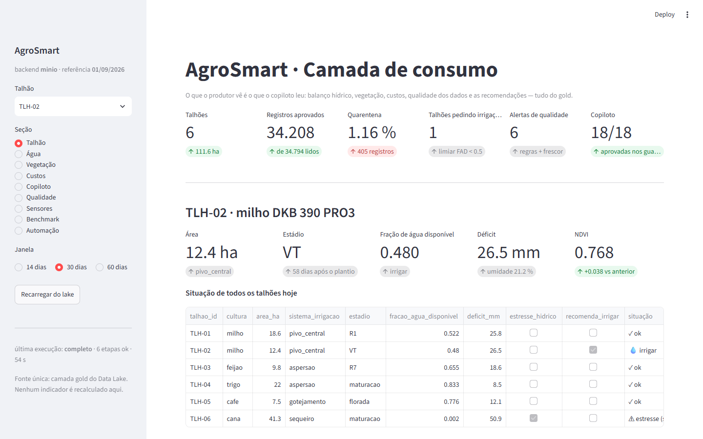
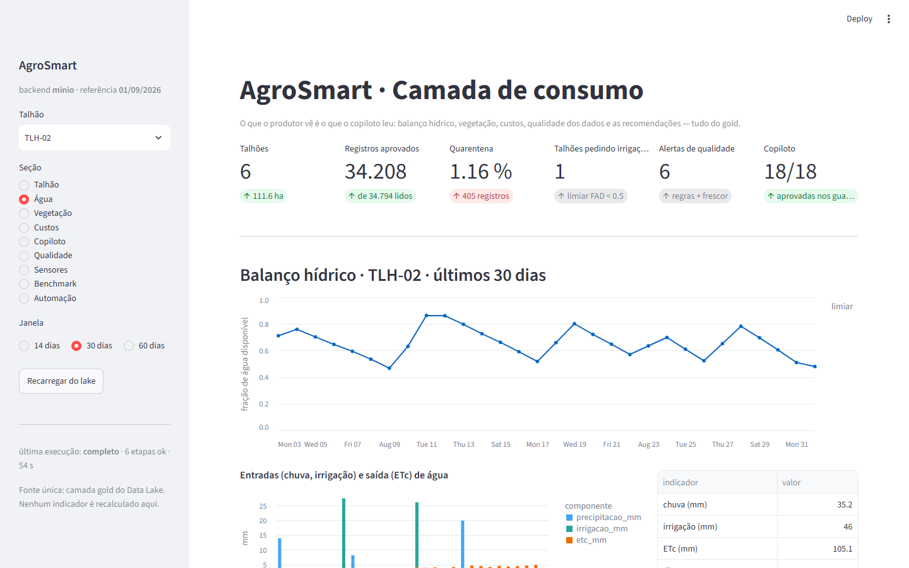
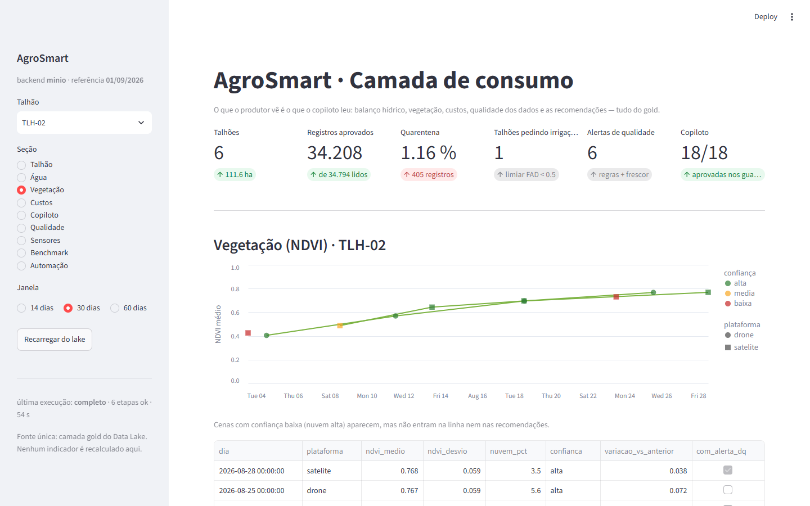
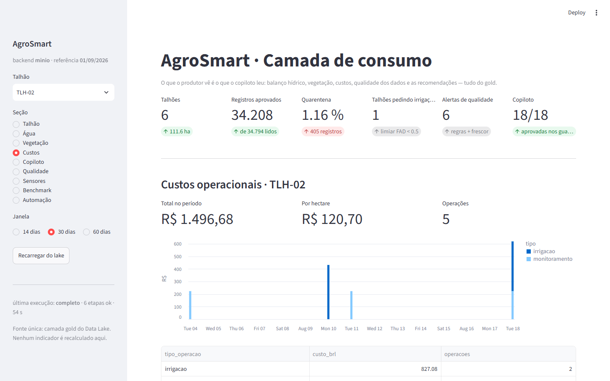
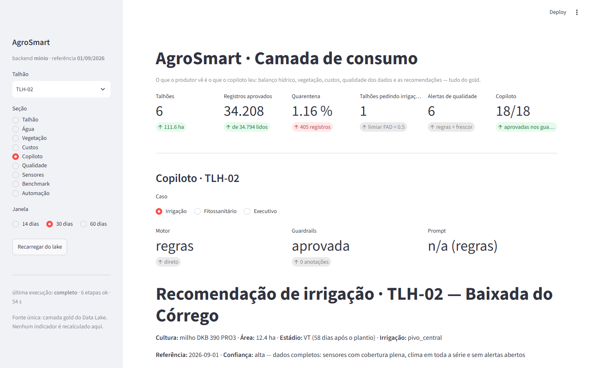
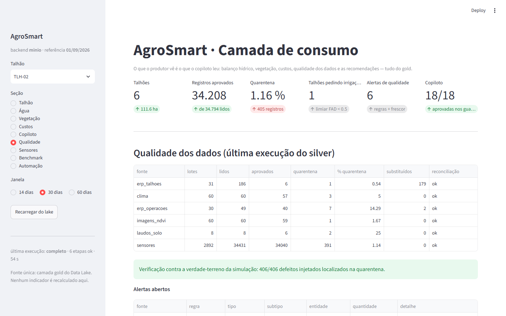
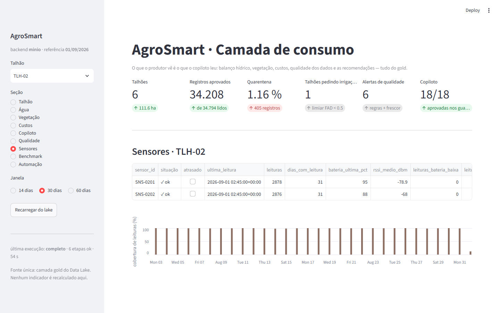
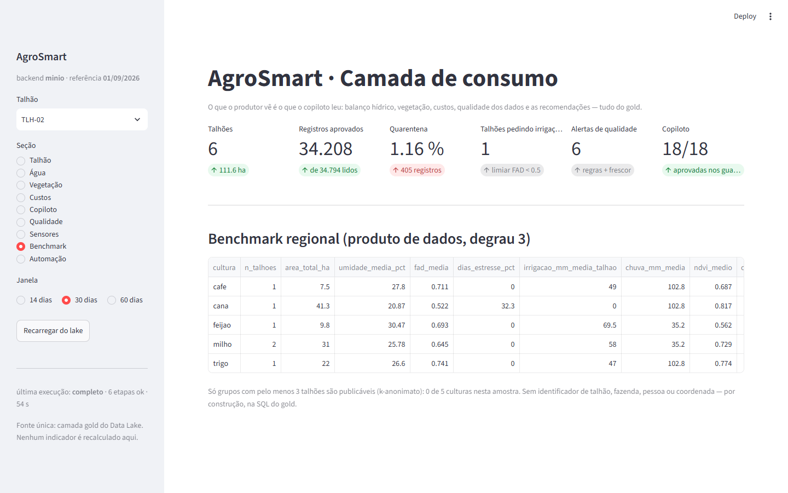
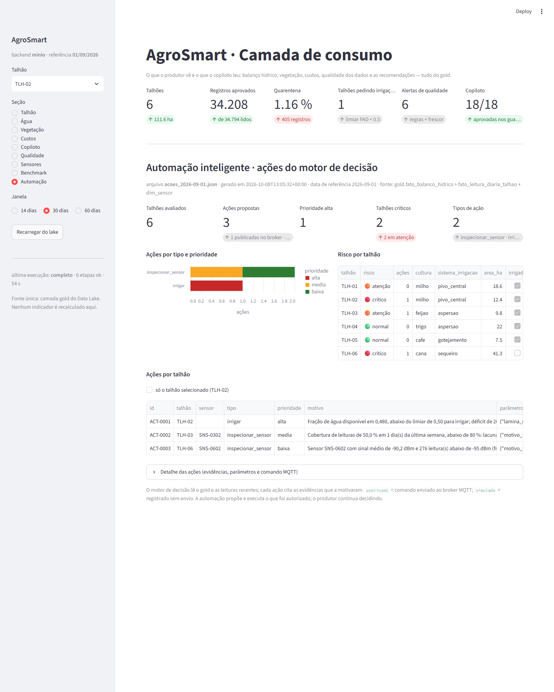

# Requisito 5 — Dashboard analítico

> Peso: 20 % · Artefatos: capturas de tela + arquivo do dashboard + descrição dos indicadores
> Status: **implementado e verificado**. `streamlit run app/dashboard.py` abre a camada de consumo sobre o gold; cada seção tem link direto (`?talhao=TLH-02&secao=agua`). Capturas em `outputs/prints/fase6-05-dashboard-*.png`, feitas por `scripts/capturar_dashboard.py --prefixo fase6-05-dashboard`.

## 1. O que o dashboard é — e o que não é

`app/dashboard.py` lê **só o gold** (mais os relatórios e JSONs de `outputs/`) pelo mesmo `Armazenamento` do pipeline — funciona em MinIO e em filesystem sem mudar uma linha. Não recalcula indicador nenhum: a fração de água disponível que aparece na tela é a mesma linha de `fato_balanco_hidrico` que o copiloto leu e que o motor de automação usou para decidir. É o que torna as três coisas — painel, recomendação e ação — comparáveis e auditáveis.

Barra lateral: talhão, seção, janela (14/30/60 dias), botão "Recarregar do lake" (limpa o cache de 5 min) e o resumo da última execução (`outputs/run.json`). Cabeçalho, igual em todas as seções: **Talhões** (e área total), **Registros aprovados** (de quantos lidos), **Quarentena** (% e quantidade), **Talhões pedindo irrigação** hoje (limiar FAD < 0,50), **Alertas de qualidade** (regras + frescor) e **Copiloto** (saídas aprovadas nos guardrails / execuções).

Na Fase 6 a seção **Automação** foi acrescentada sem alterar as oito existentes.

## 2. Indicadores por seção

### 2.1 Talhão — indicadores do ambiente, hoje



| Indicador | O que mede | Origem no gold |
|---|---|---|
| Área · sistema de irrigação | hectares e pivô / aspersão / gotejamento / sequeiro | `dim_talhao` |
| Estádio · dias após o plantio | estádio fenológico vigente (Kc) | `fato_balanco_hidrico.estadio`, `dap` |
| Fração de água disponível | (θ − PMP)/(CC − PMP), 0–1, com a situação: `ok` ≥ 0,50 · `irrigar` < 0,50 · `estresse` < 0,35 | `fracao_agua_disponivel` |
| Déficit · umidade | lâmina para voltar à capacidade de campo (0–30 cm) e umidade média medida | `deficit_mm`, `umidade_media_pct` |
| NDVI · variação | último índice de vegetação e a diferença para a cena anterior da mesma plataforma | `fato_ndvi_talhao` |
| Situação de todos os talhões hoje | tabela com estádio, FAD, déficit, `estresse_hidrico`, `recomenda_irrigar` e um rótulo: `💧 irrigar`, `⚠ estresse (sequeiro)`, `✓ ok` | `dim_talhao` + `fato_balanco_hidrico` |

Na referência (01/09/2026): TLH-02 com FAD 0,480 pede irrigação; TLH-06 (cana de sequeiro) está em estresse com FAD 0,002 — e **não** recebe recomendação de irrigar, por construção (a trava do sequeiro está na SQL do gold).

### 2.2 Água — evolução no tempo



- **Linha da fração de água disponível** por dia, com os limiares tracejados de irrigação (0,50) e estresse (0,35); tooltip com umidade, déficit e estádio.
- **Barras de entradas e saída de água**: chuva, irrigação lançada no ERP e ETc (Kc × ETo) por dia.
- **Resumo da janela**: chuva, irrigação e ETc acumuladas, dias em estresse, dias sem clima (dia da estação ausente ou em quarentena — `clima_disponivel = false`).
- Série completa expansível.

### 2.3 Vegetação (NDVI)



Pontos por cena (drone ou satélite) coloridos pela **confiança** (alta < 10 % de nuvem, média < 30 %, baixa); a linha liga só as cenas confiáveis — as nubladas aparecem, mas não entram na tendência nem nas recomendações. Tabela com NDVI médio, desvio (desuniformidade), nuvem, variação e se a cena acionou alerta de qualidade (`IMG-07`, `IMG-10`).

### 2.4 Custos



Total no período, custo por hectare e número de operações; barras por dia e tipo de operação; tabela por tipo. Fonte: `fato_custo_diario_talhao` (o responsável já chega pseudonimizado do silver).

### 2.5 Copiloto — recomendações da IA



O relatório mais recente do talhão para o caso escolhido (irrigação, fitossanitário, executivo), com a proveniência ao lado: **motor** usado (Claude ou regras, com ou sem fallback), **guardrails** (aprovada/rejeitada e anotações), **versão do prompt**. Abaixo, a avaliação da última execução por motor (execuções, aprovadas, ajustes, fallbacks, confiança). É a seção "recomendações" da rubrica; as ações executáveis estão em 2.9.

### 2.6 Qualidade — alertas dos dados



Tabela por fonte (lotes, lidos, aprovados, quarentena e %, substituídos, reconciliação) do último `dq_report.json`; a verificação contra a verdade-terreno (406/406 defeitos injetados localizados); e os **alertas abertos** de `fato_alerta_qualidade` — regras de alerta acionadas por fonte e frescor por entidade (sensor atrasado, lacuna na série).

### 2.7 Sensores — indicadores do ambiente de medição



| Indicador | O que mede | Origem |
|---|---|---|
| Situação por sensor | `🔋 trocar bateria` (bateria < 15 %), `📶 sinal fraco` (RSSI médio < −95 dBm ou > 5 % de leituras fracas), `✓ ok` | `dim_sensor` + limiares de `agronomia.py` |
| Atrasado | última leitura há mais de 1 h do "agora" do pipeline | `dim_sensor.ultima_leitura` |
| Leituras, dias com leitura, bateria, RSSI, leituras com bateria baixa / sinal fraco | inventário do que cada dispositivo publicou | `dim_sensor` |
| **Cobertura diária de leituras** (barras) | `n_leituras / (sensores × 96)` por dia — é o gráfico que mostra o INC-01: o TLH-03 fica em 50 % enquanto o `SNS-0302` esteve calado (21–25/08) | `fato_leitura_diaria_talhao.cobertura_pct` |

### 2.8 Benchmark regional



O produto de dados externo: agregado por cultura sem identificador de talhão, fazenda, pessoa ou coordenada, com a coluna `publicavel` (k-anonimato, n ≥ 3). Nesta amostra nenhum grupo é publicável e o painel diz isso em vez de esconder.

### 2.9 Automação — ações do motor de decisão (nova na Fase 6)



A seção lê o arquivo `acoes_<data>.json` **mais recente** de `outputs/acoes/` (gerado por `agrosmart automacao`, esquema `plano-acoes.v1`, ver `docs/fase6/04`). Se a pasta não existe ou está vazia, mostra um aviso com o comando a rodar — sem quebrar o resto do painel.

| Elemento | O que mostra | Campo do JSON |
|---|---|---|
| Cabeçalho | arquivo, instante de geração, data de referência e fonte (tabelas do gold lidas) | `gerado_em`, `data_ref`, `fonte` |
| Talhões avaliados · Ações propostas | totais; quantas ações foram **publicadas** no broker e quantas ficaram **simuladas** | `resumo.talhoes`, `resumo.acoes`, `acoes[].status` |
| Prioridade alta · Talhões críticos · Tipos de ação | contagens por prioridade e por risco; os tipos que viraram ação (`irrigar`, `alerta_fitossanitario`, `trocar_bateria`, `inspecionar_sensor`) | `resumo.por_prioridade`, `talhoes[].risco`, `acoes[].tipo` |
| Ações por tipo e prioridade | barras empilhadas (alta vermelho, média amarelo, baixa verde) | `acoes[]` |
| Risco por talhão | tabela com `🔴 crítico` / `🟠 atenção` / `🟢 normal`, número de ações e os indicadores que o motor usou (FAD, déficit, cobertura mínima em 7 dias, situação hídrica, cultura, sistema) | `talhoes[].risco`, `talhoes[].indicadores` |
| Ações por talhão | tabela ordenada por prioridade: id, talhão, sensor, tipo, prioridade, **motivo**, parâmetros (lâmina, minutos, janela…), tópico do comando MQTT, **status** (`simulado` / `publicado`), número de evidências; caixa "só o talhão selecionado" | `acoes[]` |
| Detalhe das ações (expansível) | o JSON das ações visíveis: evidências (`tabela:chave:data`), parâmetros e `comando_mqtt` completo | `acoes[]` |

Leitura da captura (`outputs/acoes/acoes_2026-09-01.json`, plano da data de referência 01/09/2026): 6 talhões avaliados, 3 ações — `irrigar` TLH-02 (prioridade alta, FAD 0,480 < 0,50, comando em `agrosmart/atuadores/TLH-02/irrigacao`, **publicado** no broker com `--publicar`), `inspecionar_sensor` SNS-0302 no TLH-03 (média: cobertura de 50 % em um dia da semana) e `inspecionar_sensor` SNS-0602 no TLH-06 (baixa: sinal médio −90 dBm), ambas `simulado` porque não têm atuador; TLH-02 e TLH-06 críticos, TLH-01 e TLH-03 em atenção, TLH-04 e TLH-05 normais.

## 3. Como capturar as telas

```bash
streamlit run app/dashboard.py --server.headless true          # terminal 1
python scripts/capturar_dashboard.py --prefixo fase6-05-dashboard                      # terminal 2: as 9 seções
python scripts/capturar_dashboard.py --prefixo fase6-05-dashboard --secoes automacao --altura 1800
```

O script usa o Chromium do Playwright ou, na falta dele, o Microsoft Edge da máquina (`channel="msedge"`); viewport de 1440 px de largura; `--altura` maior para seções que rolam (a Automação, com a tabela de ações). Cada seção é uma página (`?talhao=&secao=`), então não há clique a automatizar.

## 4. Sobre a captura da aba Automação

A captura usa o arquivo oficial `outputs/acoes/acoes_2026-09-01.json`, gravado por `agrosmart automacao --publicar` sobre o gold de referência (por isso a ação de irrigar aparece como `publicado`). O plano é determinístico: o mesmo gold e a mesma data de referência produzem o mesmo JSON, fora `gerado_em` — a primeira versão desta captura, feita antes da execução oficial com um plano gerado em `dry-run` pelo próprio motor, tinha exatamente as mesmas três ações. Para capturar a seção sem gravar nada em `outputs/` (um plano de teste, por exemplo), a variável de ambiente `AGROSMART_DIR_ACOES` aponta o dashboard para outra pasta; sem ela, a seção lê `outputs/acoes/`.
