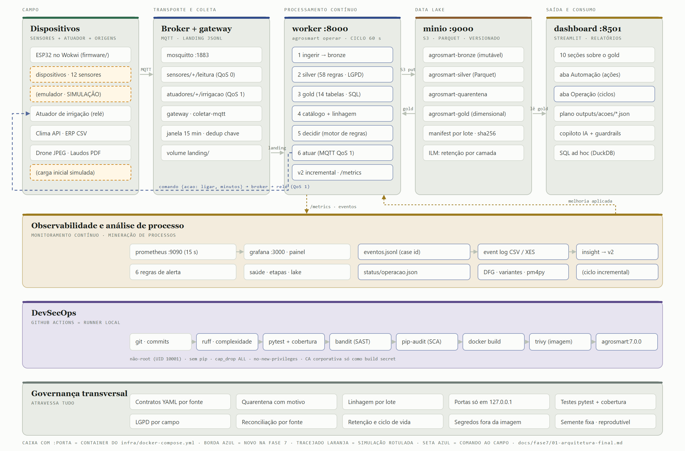

# Requisito 1 — Arquitetura final da solução

> Peso: 15 % · Artefatos: diagrama da arquitetura final, descrição dos componentes, explicação do fluxo
> Status: **implementado e em execução**. Tudo no diagrama sobe com um comando
> (`docker compose -f infra/docker-compose.yml up -d --build`) e foi executado nesta máquina:
> evidências em `docs/fase7/02-execucao-plataforma.md` e `outputs/prints/fase7-*`.

## 1. Visão geral

(SVG vetorial em `docs/diagramas/arquitetura-fase7.svg`, gerado por `scripts/gerar_diagrama_fase7.py`.)

A Fase 6 fechou o ciclo sensor → lake → decisão → atuador, mas cada passo era um comando
rodado à mão. A Fase 7 transforma esse ciclo em **plataforma**: uma imagem Docker única
(`Dockerfile` multi-stage, usuário sem privilégio) assume quatro papéis — emulador de campo,
gateway MQTT, *worker* que roda o ciclo sozinho a cada 60 s e dashboard — ao lado do Data Lake
(MinIO), do broker (Mosquitto) e de uma pilha de monitoramento (Prometheus + Grafana com
regras de alerta). Cada ciclo do worker é um **caso** num event log, e a mineração de processos
sobre esse log apontou o gargalo que motivou a versão incremental do ciclo (v2). Uma esteira
DevSecOps (GitHub Actions, com o mesmo pipeline executável localmente) garante lint, testes,
análise estática, auditoria de dependências, build e scan da imagem antes de qualquer entrega.

O diagrama tem cinco colunas na ordem do dado — **entrada → transporte → processamento →
armazenamento → saída** — e três faixas transversais: observabilidade (onde a operação é
medida e o processo é minerado), DevSecOps (como a imagem é produzida) e governança.

## 2. Fluxo de dados completo

### Entrada
1. **Dispositivos de campo** publicam uma leitura JSON a cada 5 s em
   `agrosmart/sensores/<sensor_id>/leitura`. Duas origens com o mesmo payload (`contratos/sensores.v1.yaml`):
   o ESP32 no Wokwi (`firmware/wokwi-esp32/`, Fase 6) e o container `dispositivos`, que emula
   os 12 sensores do catálogo — **simulação rotulada**, com ~2 % de leituras atrasadas e
   ~0,5 % duplicadas para exercitar a qualidade.
2. **Origens batch** (clima via API, ERP em CSV, imagens de drone, laudos de solo em PDF) entram
   pela landing nos modos `api_pull`, `batch` e `watch_folder`. Na primeira subida, com o gold
   vazio, o worker faz uma **carga inicial** que simula 30 dias dessas seis fontes (caso
   `carga-…` no event log).

### Transporte e coleta
3. O **Mosquitto** (`:1883`) entrega as leituras ao **gateway** (`agrosmart coletar-mqtt`), que
   valida o JSON, descarta chaves fora do contrato, normaliza `medido_em` para UTC e grava a leitura
   no micro-batch JSONL da janela de 15 min em `landing/sensores/<dia>/` (volume Docker
   compartilhado com o worker), sem repetir a chave natural `(sensor_id, medido_em)`.

### Processamento (worker, um caso por ciclo)
4. **ingerir** — landing → bronze no MinIO: bytes intocados, manifest por lote, idempotência por
   checksum; arquivo da janela que cresceu vira nova versão do lote.
5. **silver** — tipagem pelo contrato, 58 regras de qualidade (críticas → quarentena com motivo,
   alertas → marcadas), deduplicação, pseudonimização de PII, Parquet por dia do evento,
   reconciliação lidos = aprovados + quarentena.
6. **gold** — 14 tabelas dimensionais em SQL (DuckDB): balanço hídrico, leitura diária por talhão,
   NDVI, custos, fertilidade, alertas de qualidade, benchmark anonimizado.
7. **catálogo** — inventário, linhagem por lote e dicionário de dados.
8. **decidir** — o motor de regras (`src/agrosmart/automacao/motor.py`) lê o gold e classifica o risco
   de cada talhão, gerando ações com prioridade, parâmetros e evidências (`outputs/acoes/acoes_<data>.{json,md}`).
9. **atuar** — cada ação `irrigar` vira `{"acao": "ligar", "minutos": N}` em
   `agrosmart/atuadores/<talhao>/irrigacao` com QoS 1; o atuador (firmware/emulador) liga a
   irrigação e publica o estado. O plano é regravado com `status: publicado`.

Na **v2 (incremental)**, a melhoria derivada da mineração de processos (`docs/fase7/05`): se a
ingestão não grava lote novo, silver/gold/catálogo são pulados; se grava, o silver reprocessa
só o intervalo de datas dos lotes novos, em vez dos 30+ dias de histórico.

### Saída
10. **Dashboard** (`:8501`, Streamlit) — dez seções sobre o gold: talhão, água, vegetação, custos,
    copiloto, qualidade, sensores, benchmark, **Automação** (plano e status das ações) e
    **Operação** (saúde do worker, últimos ciclos, participação de cada etapa no tempo de ciclo).
11. **Alertas** — operacionais (Prometheus: worker fora, ciclo falhando, landing parada, lake fora,
    quarentena alta) e agronômicos (ações de alta prioridade no plano, alertas de qualidade no gold).
12. **Relatórios** — plano de ações em JSON/Markdown, relatórios do copiloto em MD/PDF com
    proveniência, `outputs/run.json` por ciclo, `outputs/status/operacao.json`.

### Observação e melhoria contínua
13. O worker expõe `/health`, `/metrics` (formato Prometheus) e `/status` na porta 8000; o
    Prometheus coleta a cada 15 s e avalia 6 regras de alerta; o Grafana mostra o painel
    **AgroSmart · Operação da plataforma** (provisionado como código).
14. Cada evento vai para `outputs/logs/eventos.jsonl` com `execucao_id` (case id), atividade,
    timestamp em ms, status, recurso e versão do processo. `agrosmart processos` transforma a
    trilha em event log (CSV/XES), descobre o processo (DFG, Inductive/Heuristics Miner via pm4py),
    mede gargalos, variantes, retrabalho e conformidade e compara v1 × v2.

## 3. Componentes

| Componente | Container / porta | Responsabilidade | Tecnologia | Onde está |
|---|---|---|---|---|
| ESP32 no Wokwi | — (nuvem Wokwi + HiveMQ) | sensor real simulado em hardware virtual; recebe comando de irrigação | C++/Arduino, PubSubClient | `firmware/wokwi-esp32/` |
| Emulador de campo (**simulação**) | `dispositivos` | 12 sensores publicando o payload do firmware; reage ao comando de irrigação | Python, paho-mqtt | `src/agrosmart/simuladores/dispositivo_mqtt.py` |
| Broker MQTT | `mosquitto` · 1883 | publish/subscribe entre campo e plataforma | Eclipse Mosquitto 2 | `infra/mosquitto/` |
| Gateway MQTT → landing | `gateway` | validar, normalizar e agrupar leituras em micro-batches JSONL | Python, paho-mqtt | `src/agrosmart/ingestao/mqtt_gateway.py` |
| Worker (orquestração contínua) | `worker` · 8000 | ciclo ingerir → silver → gold → catálogo → decidir → atuar a cada 60 s; carga inicial; retentativa no ciclo seguinte; `/health`, `/metrics`, `/status` | Python, `http.server` | `src/agrosmart/operacao/`, `src/agrosmart/orquestracao.py` |
| Contratos de dados | (no código) | schema, ingestão, qualidade, retenção e LGPD por fonte | YAML + Pydantic | `contratos/`, `src/agrosmart/contratos.py` |
| Data Lake | `minio` · 9000/9001 (+ `bootstrap`) | buckets bronze/silver/gold/quarentena, versionamento, ciclo de vida, métricas | MinIO (S3) | `infra/docker-compose.yml`, `src/agrosmart/storage.py` |
| Qualidade e silver | (worker) | 58 regras, dedup, quarentena, PII, reconciliação | Polars, Parquet | `src/agrosmart/qualidade/`, `src/agrosmart/processamento/silver.py` |
| Gold | (worker) | modelo dimensional em SQL | DuckDB | `src/agrosmart/processamento/gold.py` |
| Motor de decisão e atuadores | (worker) | risco por talhão, ações com evidência, comando MQTT QoS 1 | Python | `src/agrosmart/automacao/` |
| Copiloto de IA | (CLI/dashboard) | explicação em linguagem natural com guardrails; motor de regras sem chave de API | Claude API opcional | `src/agrosmart/ia/` |
| Dashboard | `dashboard` · 8501 | consumo do gold, Automação, Operação | Streamlit, Altair | `app/dashboard.py` |
| Prometheus | `prometheus` · 9090 | coleta de métricas do worker e do MinIO, 6 regras de alerta | Prometheus 3.5 | `infra/monitoramento/prometheus.yml`, `alertas.yml` |
| Grafana | `grafana` · 3000 | painel de operação provisionado como código | Grafana 12.1 | `infra/monitoramento/grafana/`, `scripts/gerar_painel_grafana.py` |
| Trilha de eventos | (volume `outputs`) | um evento JSON por etapa/lote, com case id | JSONL | `src/agrosmart/log.py` |
| Mineração de processos | (CLI) | event log CSV/XES, DFG, variantes, gargalos, conformidade, v1 × v2 | pm4py, pandas | `src/agrosmart/mineracao/`, `outputs/processos/` |
| Esteira DevSecOps | GitHub Actions / runner local | ruff, pytest + cobertura, bandit, pip-audit, build, trivy | Docker, Python | `.github/workflows/devsecops.yml`, `scripts/pipeline_local.py` |
| Empacotador | (CLI) | zip da entrega validado | Python | `src/agrosmart/empacotar.py` |

## 4. Integração entre serviços

| De → para | Interface | Garantia |
|---|---|---|
| dispositivos/ESP32 → mosquitto | MQTT `agrosmart/sensores/<id>/leitura`, JSON `sensores.v1` | QoS 0 (leitura periódica; perda pontual vira lacuna detectada por SEN-12) |
| mosquitto → gateway | assinatura `agrosmart/sensores/+/leitura` | reconexão automática; dedup por chave natural |
| gateway → worker | volume Docker `landing` (JSONL por janela de 15 min) | arquivo reaberto = nova versão do lote no bronze |
| worker ↔ minio | S3 (boto3) `http://minio:9000`, um bucket por camada | idempotência por checksum, versionamento no bronze |
| worker → mosquitto → atuador | MQTT `agrosmart/atuadores/<talhão>/irrigacao`, QoS 1 | confirmação do broker; falha marca a etapa `atuar` como erro |
| worker → dashboard | gold no MinIO + volume `outputs` (acoes, status, eventos) | dashboard só lê; nada é recalculado |
| prometheus → worker/minio | HTTP `/metrics` a cada 15 s (rede interna do compose) | `up == 0` dispara `WorkerFora`/`LakeFora` |
| grafana → prometheus | datasource provisionado | painel versionado em JSON |
| eventos.jsonl → mineração | CSV/XES (case id, atividade, timestamp, lifecycle) | determinístico, reexecutável |

Portas publicadas só em `127.0.0.1` (exceto MinIO e Mosquitto, que mantêm o comportamento da
Fase 6 para o ESP32 e o console); os serviços conversam pela rede interna do compose pelo nome.

## 5. Decisões de arquitetura da Fase 7

- **Uma imagem, vários papéis.** `agrosmart:7.0.0` roda CLI, gateway, worker e dashboard: um único
  artefato para escanear, versionar e implantar. O papel vem do `command` no compose.
- **Worker em vez de cron.** O ciclo é um loop com intervalo fixo, estado em memória exposto por
  HTTP e retentativa natural (o ciclo seguinte). Um agendador externo (cron, Airflow) não daria
  saúde, métricas e case id sem infraestrutura extra.
- **Métricas sem biblioteca.** O formato texto do Prometheus é escrito à mão
  (`src/agrosmart/operacao/metricas.py`): menos uma dependência na imagem e no scan.
- **Event log nativo.** Em vez de reconstruir casos a partir de logs soltos, a trilha já nasce com
  `execucao_id`, `etapa_iniciada`/`etapa_concluida` e milissegundos — pronta para mineração.
- **Simulação rotulada.** O emulador de campo e a carga inicial são simulação e aparecem como tal no
  diagrama, no compose (`labels`) e no event log (`tipo_caso`). Tudo o mais é execução real.

## 6. Equivalência em nuvem

| Local | AWS | Azure | GCP |
|---|---|---|---|
| `docker compose` | ECS Fargate / EKS | Container Apps / AKS | Cloud Run / GKE |
| Mosquitto | IoT Core | IoT Hub | Pub/Sub + gateway MQTT |
| MinIO | S3 | ADLS Gen2 | Cloud Storage |
| worker | ECS service ou Step Functions + Lambda | Container Apps job | Cloud Run job + Scheduler |
| Prometheus + Grafana | Managed Prometheus + Managed Grafana | Azure Monitor + Managed Grafana | Managed Prometheus + Grafana |
| GitHub Actions | igual (+ ECR) | igual (+ ACR) | igual (+ Artifact Registry) |
