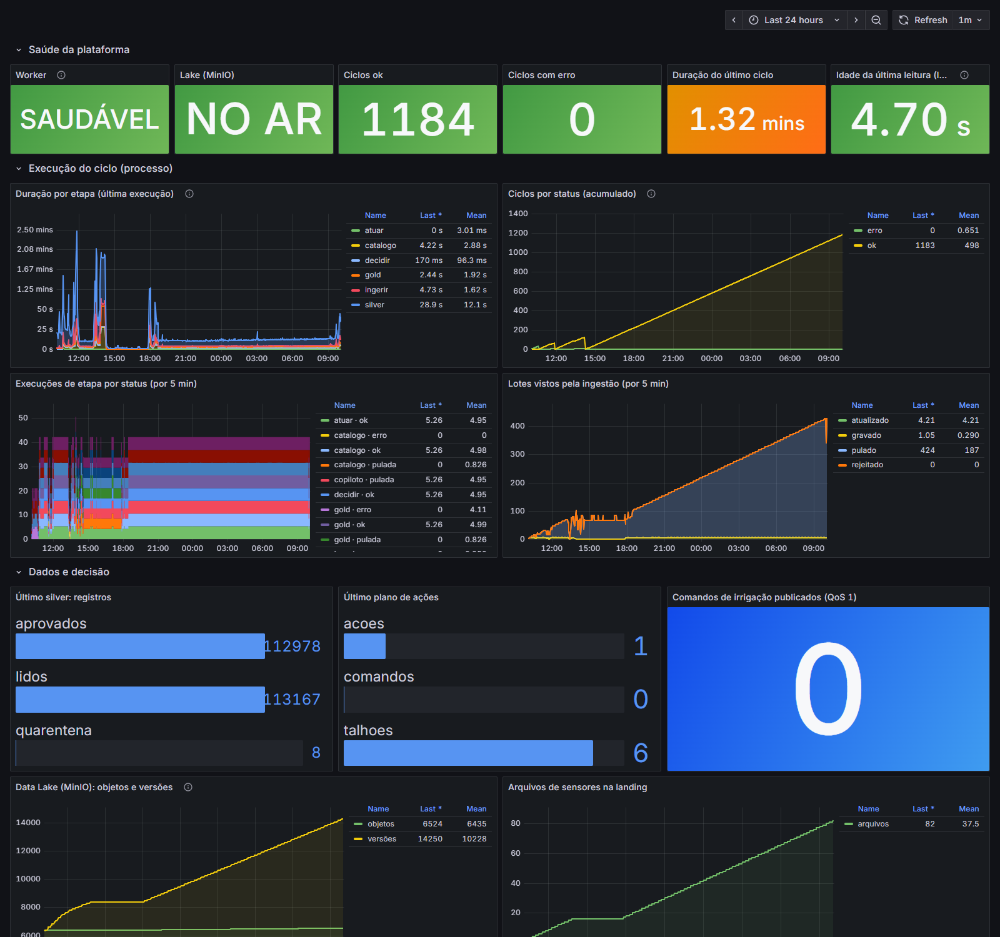

# Requisito 4 — Monitoramento e execução automatizada

> Peso: 10 % · Artefatos: prints/logs do sistema rodando, descrição do monitoramento, como acompanhar
> Status: **implementado e observado em operação real** (≈ 24 h contínuas, alertas disparados e resolvidos).

## 1. Execução automatizada

| Mecanismo | Como funciona | Onde |
|---|---|---|
| **Worker contínuo** | `agrosmart operar` roda o ciclo a cada `AGROSMART_INTERVALO_S` (60 s); se um ciclo passar do intervalo, o próximo começa logo em seguida | `src/agrosmart/operacao/worker.py` |
| **Carga inicial automática** | gold vazio na subida → simula 30 dias das seis fontes uma vez | idem (`carga_inicial=auto`) |
| **Autocura** | ciclo que falha não derruba o serviço: a etapa é registrada com erro e o próximo ciclo tenta de novo | `_caso()` no worker |
| **Reinício pelo Docker** | `restart: unless-stopped` em todos os serviços; `init: true` (tini) repassa SIGTERM e recolhe processos | `infra/docker-compose.yml` |
| **Healthcheck** | Docker chama `/health` do worker a cada 15 s e `/_stcore/health` do dashboard; MinIO e Mosquitto têm o seu | idem |
| **Encerramento limpo** | SIGTERM → termina o ciclo atual, grava o status, para o servidor HTTP | `worker.py` |

## 2. O que é monitorado

**Endpoints do worker** (`:8000`):

| Rota | Conteúdo | Quem usa |
|---|---|---|
| `/health` | 200 `{"status":"ok"}` se o último ciclo terminou bem e é recente (≤ 3 intervalos + 300 s); 503 caso contrário | healthcheck do Docker, balanceador |
| `/metrics` | formato texto do Prometheus | Prometheus (a cada 15 s) |
| `/status` | JSON completo: fase, saúde, ciclos, duração por etapa, último ciclo com erro, lotes, silver, plano, landing | `agrosmart status --url`, pessoas |

**Métricas expostas** (`src/agrosmart/operacao/metricas.py`):

| Métrica | Tipo | Responde |
|---|---|---|
| `agrosmart_worker_saudavel` | gauge | a plataforma está de pé? |
| `agrosmart_ciclos_total{status}` | counter | quantos ciclos ok/erro? |
| `agrosmart_ultimo_ciclo_duracao_segundos`, `agrosmart_ciclo_duracao_segundos_soma` | gauge/counter | quanto dura o ciclo? |
| `agrosmart_ultimo_sucesso_timestamp_seconds` | gauge | há quanto tempo não há ciclo bom? |
| `agrosmart_etapa_duracao_segundos{etapa}` | gauge | qual etapa é o gargalo agora? |
| `agrosmart_etapa_execucoes_total{etapa,status}` | counter | qual etapa falha / é pulada? |
| `agrosmart_lotes_ingeridos_total{status}` | counter | o dado está chegando? |
| `agrosmart_silver_registros{resultado}` | gauge | qualidade: lidos, aprovados, quarentena |
| `agrosmart_plano_acoes{tipo}` | gauge | quantas ações e comandos o último plano gerou |
| `agrosmart_comandos_publicados_total` | counter | a plataforma está agindo no campo? |
| `agrosmart_landing_sensores{medida}` | gauge | arquivos e **idade da última leitura** (sinal de vida do gateway e dos dispositivos) |
| `minio_cluster_*`, `up{job="minio"}` | MinIO | o lake está no ar e crescendo? |

## 3. Alertas (Prometheus, `infra/monitoramento/alertas.yml`)

| Alerta | Condição | Severidade | O que fazer |
|---|---|---|---|
| `WorkerFora` | `up{job="agrosmart-worker"} == 0` por 1 min | crítica | `docker compose logs --tail 100 worker` |
| `CicloFalhando` | último ciclo com erro por 1 min | alta | `agrosmart status --url …` mostra etapa e erro |
| `SemCicloBemSucedido` | nenhum ciclo ok há > 10 min | alta | conferir MinIO e Mosquitto |
| `LandingParada` | última leitura de sensor com > 5 min por 2 min | média | gateway, dispositivos ou broker parados |
| `QuarentenaAlta` | > 5 % do último silver em quarentena por 5 min | média | `agrosmart qualidade` |
| `LakeFora` | `up{job="minio"} == 0` por 1 min | crítica | `docker compose up -d minio` |

**Disparos reais observados** (não simulados no Prometheus — as falhas foram provocadas na infraestrutura):

| Quando (UTC) | Alerta | Origem | Evidência |
|---|---|---|---|
| 17/11 16:19 | `LakeFora` (firing) | experimento: MinIO parado 150 s | consulta à API `/api/v1/alerts` durante o experimento; `fase7-05-injecao-falhas-v2.txt` |
| 17/11 17:18 → 20:48 | `LandingParada` (firing) | demonstração: gateway parado | `fase7-04-alerta-prometheus-alertas.png`, `fase7-04-alerta-grafana-operacao.png`, `fase7-04-demonstracao-alerta.txt` |
| 17/11 15:50 → 17:16 (implantação da correção) | `SemCicloBemSucedido` (**falso positivo**) | bug: `/metrics` formatava o epoch com `{:g}` e perdia precisão (1794932319 → 1.79493e+09) | corrigido em `metricas.py::_valor`, teste de regressão em `tests/test_operacao.py` |

O falso positivo é um resultado do monitoramento, não uma falha dele: o alerta disparou com o worker
saudável, a investigação no Prometheus mostrou o valor arredondado, e a correção virou teste.

## 4. Painéis

**Grafana — "AgroSmart · Operação da plataforma"** (provisionado como código por
`scripts/gerar_painel_grafana.py` → `infra/monitoramento/grafana/dashboards/agrosmart-operacao.json`):

- **Saúde**: worker (SAUDÁVEL/DEGRADADO), lake (NO AR/FORA), ciclos ok e com erro, duração do último
  ciclo, idade da última leitura.
- **Execução do ciclo**: duração por etapa empilhada (o topo é o lead time; a faixa maior é o gargalo),
  ciclos por status, execuções de etapa por status, lotes vistos pela ingestão.
- **Dados e decisão**: último silver (lidos/aprovados/quarentena), último plano, comandos publicados,
  objetos e versões no MinIO, arquivos na landing.
- **Alertas disparados agora** (tabela de `ALERTS{alertstate="firing"}`).

Leitura do print de 24 h: 1.184 ciclos ok e 0 com erro desde a última subida do worker; os picos de
duração à esquerda são o período v1 (ciclo completo) e os experimentos de falha; depois da troca para a
v2 a duração cai e fica estável; a curva "pulado" dos lotes cresce linearmente porque a ingestão relista
toda a landing a cada ciclo — oportunidade de *watermark* registrada em `docs/fase7/05` §7.

**Dashboard Streamlit — seção Operação** (`?secao=operacao`): a mesma informação para quem não usa
Grafana — saúde do worker, últimos ciclos com resultado, barras de duração por etapa e participação de
cada etapa no tempo de ciclo, lidas da trilha de eventos (`fase7-04-dashboard-operacao.png`).

**Timelapse**: `outputs/prints/timelapse/` tem 41 capturas do painel, uma por minuto, durante o
experimento de falhas da v1 (a queda do MinIO aparece como degrau em "ciclos com erro").

## 5. Como acompanhar o sistema (runbook curto)

| Pergunta | Comando / tela |
|---|---|
| Está tudo de pé? | `docker compose -f infra/docker-compose.yml ps` (procure `healthy`) · Grafana, linha "Saúde" |
| O ciclo está rodando bem? | `agrosmart status --url http://localhost:8000/status` (sai com código 1 se degradado) |
| Por que o último ciclo falhou? | `/status` → `ultimo_ciclo.etapas[].erro` · `docker compose logs --tail 50 worker` |
| Os sensores estão chegando? | painel "Idade da última leitura" · `docker compose logs --tail 20 gateway` |
| O que a plataforma decidiu hoje? | dashboard `?secao=automacao` · `outputs/acoes/acoes_<data>.md` (volume `outputs`) |
| Qual etapa está lenta? | painel "Duração por etapa" · dashboard `?secao=operacao` |
| Há alerta ativo? | <http://localhost:9090/alerts> · tabela de alertas no Grafana |
| Quero a análise de processo atualizada | `docker cp agrosmart-worker:/app/outputs/logs/eventos.jsonl outputs/plataforma/` e `agrosmart processos` |

Logs estruturados: cada etapa e lote vira uma linha JSON em `outputs/logs/eventos.jsonl` (no volume
`agrosmart-outputs`), com `execucao_id`, etapa, ação, status, métricas e milissegundos — a mesma trilha
alimenta o dashboard de Operação e a mineração de processos.

## 6. Limites conhecidos

- Prometheus avalia os alertas, mas não há Alertmanager configurado para notificar (e-mail/Telegram): em
  produção, um receiver por severidade. O painel e a página de alertas são o canal da demonstração.
- Mosquitto não expõe métricas; a saúde do transporte é inferida pela idade da landing (`LandingParada`).
- Retenção do Prometheus: 7 dias (`--storage.tsdb.retention.time=7d`).
