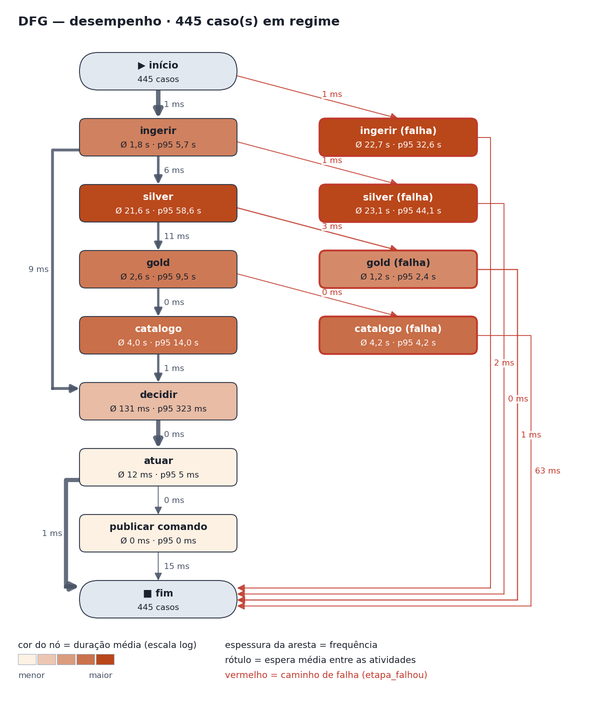
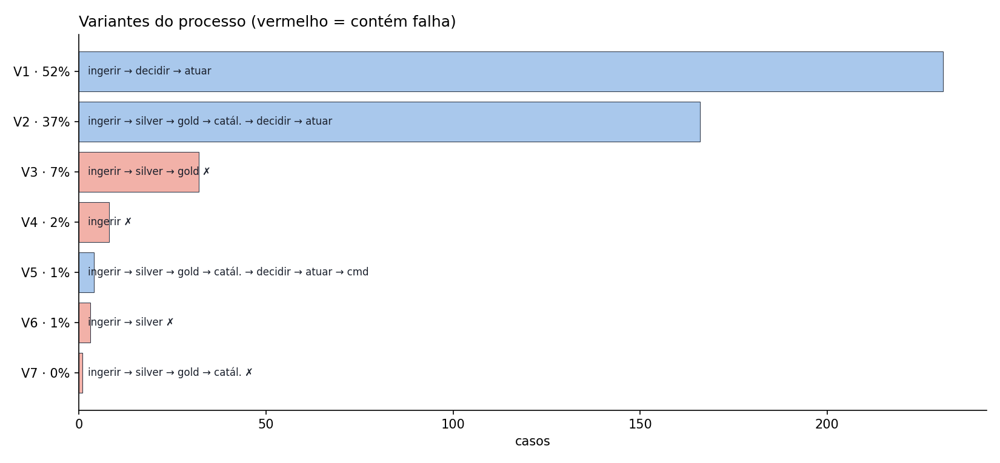
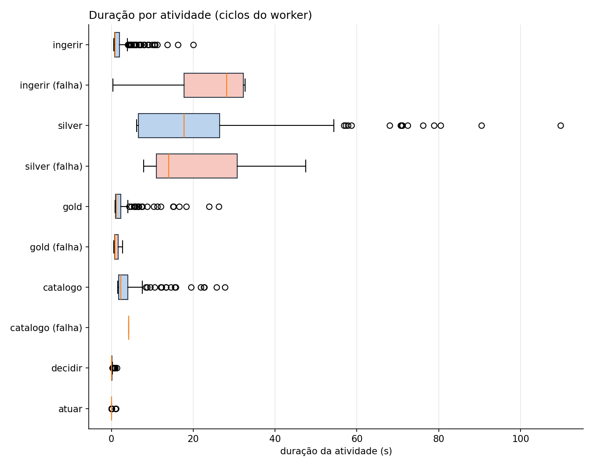
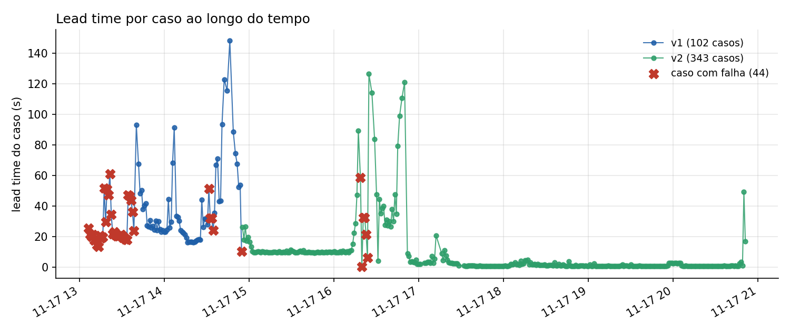

# Requisito 5 — Análise de processo (mineração de processos) e demonstração final

> Peso: 25 % · Artefatos: exemplo de event log, representação do processo, análise com insights, vídeo final
> Status: **executado sobre dados reais da plataforma em operação**. Todos os números abaixo vêm de
> `outputs/processos/metricas.json` e `outputs/processos/comparacao_justa_v1_v2.json`, gerados por
> `python scripts/minerar_processos.py --eventos outputs/plataforma/eventos.jsonl` sobre a trilha
> exportada do container `agrosmart-worker` em 17/11/2026.

## 1. O processo analisado

O processo de negócio é o **ciclo de decisão** da plataforma: a cada 60 s o worker transforma as
leituras que chegaram do campo em uma decisão de manejo e, quando preciso, em um comando para o
atuador de irrigação.

```
entrada (MQTT → landing) → ingerir → silver → gold → catálogo → decidir → atuar → [publicar comando]
```

| Elemento de mineração | No AgroSmart |
|---|---|
| **Caso** (*case id*) | um ciclo do worker: `execucao_id = ciclo-<AAAAMMDDTHHMMSS>-<hex>` |
| **Atividade** | etapa do pipeline (`ingerir`, `silver`, `gold`, `catalogo`, `decidir`, `atuar`) e a atividade de domínio `publicar comando`; etapa que falhou vira `<etapa> (falha)` |
| **Timestamp** | `etapa_iniciada` (start) e `etapa_concluida`/`etapa_falhou` (complete), em milissegundos UTC |
| **Recurso** | `origem` (worker) |
| **Atributos do caso** | `versao_processo` (v1 completo, v2 incremental), `tipo_caso`, status final |
| **Atributos do evento** | lotes gravados/atualizados/pulados, registros lidos/aprovados/quarentena, ações, comandos, mensagem de erro |

A instrumentação foi feita **para** a mineração: `src/agrosmart/log.py` carimba cada evento com o
`execucao_id` aberto pelo worker, e `src/agrosmart/orquestracao.py` emite início e fim de cada etapa.
Assim o event log não é reconstruído por heurística a partir de logs soltos — ele nasce pronto.

## 2. Os dados

| Item | Valor |
|---|---|
| Janela observada | 17/11/2026, 13:06 → 20:51 UTC (7,75 h de operação contínua) |
| Eventos na trilha | 13.733 (18 sem `execucao_id`, anteriores à instrumentação, ignorados) |
| Casos | **445** ciclos (102 na v1, 343 na v2) · 401 ok, 44 com falha |
| Instâncias de atividade | 1.831 |
| Throughput | 57,4 casos/hora · intervalo mediano entre inícios 60,0 s |

O que gerou variação **real** nesses dados (registrado em `outputs/prints/`):

| Período (UTC) | Acontecimento | Natureza |
|---|---|---|
| 13:06 – 13:40 | 32 ciclos falham no `gold` (33 afetados até a recuperação): o pip resolveu o DuckDB 2.x na imagem e `fetch_arrow_table()` deixou de existir | **incidente real** (deriva de dependência), corrigido em `src/agrosmart/compat.py` |
| 14:32 – 14:35 | MinIO parado por 150 s | experimento controlado (`fase7-05-injecao-falhas-v1.txt`) |
| 14:39 – 14:42 | Mosquitto parado por 150 s | experimento controlado |
| 14:55 | worker passa de **v1 (completo)** para **v2 (incremental)** | a melhoria (§6) |
| 16:19 – 16:22 | MinIO parado por 150 s | experimento controlado (`fase7-05-injecao-falhas-v2.txt`) |
| 16:28 – 16:31 | Mosquitto parado por 150 s | experimento controlado |
| 16:49 – 20:48 | gateway parado para demonstrar o alerta `LandingParada` | demonstração rotulada (`fase7-04-demonstracao-alerta.txt`) |
| todo o período | outro projeto na mesma máquina (`oracle-free`) usando até 127 % de CPU | ruído do ambiente, observado com `docker stats` |

**Exemplo de event log** (recorte de 3 casos, um com falha): `data/exemplos/fase7/event_log_exemplo.csv`.
Event log completo: `outputs/processos/event_log.csv` (padrão pm4py: `case:concept:name`,
`concept:name`, `lifecycle:transition`, `time:timestamp`, `org:resource`), `event_log.xes` (IEEE XES,
abre no ProM, Disco, Celonis) e `event_log_intervalos.csv` (uma linha por atividade com início, fim e duração).

```csv
case:concept:name,concept:name,lifecycle:transition,time:timestamp,org:resource,case:versao_processo,...
ciclo-20261117T130617-9ae9,ingerir,start,2026-11-17T13:06:17.054+00:00,worker,v1,...
ciclo-20261117T130617-9ae9,ingerir,complete,2026-11-17T13:06:19.268+00:00,worker,v1,...
ciclo-20261117T130617-9ae9,silver,start,2026-11-17T13:06:19.667+00:00,worker,v1,...
ciclo-20261117T130617-9ae9,gold (falha),start,2026-11-17T13:06:40.844+00:00,worker,v1,...
```

## 3. Representação do processo descoberto

**DFG (Directly-Follows Graph) de desempenho** — cor = duração média da atividade, rótulo da aresta =
espera média, vermelho = caminho de falha:



DFG de frequência: `outputs/processos/dfg_frequencia.svg`. O atalho `ingerir → decidir` (231 casos) é o
ciclo incremental pulando silver/gold/catálogo quando não há lote novo.

**Inductive Miner** (pm4py 2.7) — árvore de processo, garantidamente *sound*:

```
X( 'ingerir (falha)',
   ->( 'ingerir',
       X( 'silver (falha)',
          ->( X(tau,'silver'),
              X( 'gold (falha)',
                 ->( X(tau,'gold'),
                     X( 'catalogo (falha)',
                        ->( X(tau,'catalogo'), 'decidir', 'atuar', X(tau,'publicar comando') ))))))))
```

Leitura: o processo é uma sequência em que **cada etapa de dados pode desviar para a falha e encerrar o
caso** (`X` = escolha exclusiva), e silver/gold/catálogo são **opcionais** (`tau`) — o atalho da v2. Rede
de Petri equivalente: 10 lugares, 11 transições visíveis, 6 silenciosas; BPMN com 16 gateways exclusivos.

**Heuristics Miner** confirma as dependências fortes (≥ 0,99): `decidir → atuar`, `ingerir → decidir`,
`ingerir → silver`, `silver → gold`, `gold → catálogo`, `catálogo → decidir`; e `silver → gold (falha)`
com 0,970 — a falha mais recorrente.

**Conformidade (token replay)** contra o modelo do caminho feliz (descoberto só com os casos ok):
fitness **0,985** e **90,1 %** dos casos conformes. Os desvios são exatamente os caminhos de falha
(`silver → gold (falha)` 32×, `início → ingerir (falha)` 8×, …) — não há "atalhos" fora do desenho.

## 4. Variantes



| Variante | Casos | % | Lead time médio | Versões | Interpretação |
|---|---|---|---|---|---|
| V1 `ingerir → decidir → atuar` | 231 | 51,9 % | 1,8 s | v2 | ciclo incremental sem lote novo (gateway parado na demonstração) |
| V2 `ingerir → silver → gold → catálogo → decidir → atuar` | 166 | 37,3 % | 28,6 s | v1: 60 · v2: 106 | caminho feliz completo |
| V3 `ingerir → silver → gold (falha)` | 32 | 7,2 % | 27,7 s | v1 | incidente DuckDB 2.x |
| V4 `ingerir (falha)` | 8 | 1,8 % | 22,8 s | v1: 3 · v2: 5 | MinIO fora do ar |
| V5 caminho feliz + `publicar comando` | 4 | 0,9 % | 1,1 min | v1 | irrigação do TLH-02 comandada |
| V6 `ingerir → silver (falha)` | 3 | 0,7 % | 28,6 s | v1 | MinIO caiu no meio do silver |
| V7 `… → catálogo (falha)` | 1 | 0,2 % | 58,6 s | v2 | MinIO caiu no meio do catálogo |

## 5. Gargalos, variação, falhas e retrabalho



| Atividade | n | Média | Mediana | p95 | % do lead time |
|---|---|---|---|---|---|
| **silver** | 203 | 21,6 s | 17,8 s | 58,6 s | **66,0 %** |
| ingerir | 437 | 1,8 s | 0,9 s | 5,7 s | 11,7 % |
| catálogo | 170 | 4,0 s | 2,3 s | 14,0 s | 10,3 % |
| gold | 171 | 2,6 s | 1,3 s | 9,5 s | 6,6 % |
| decidir | 401 | 131 ms | 85 ms | 323 ms | 0,8 % |
| atuar | 401 | 12 ms | 1 ms | 5 ms | 0,1 % |

Tempo entre atividades (espera/orquestração): 0,1 % do lead time — o processo não tem fila interna; o
custo está **dentro** das atividades.



| Achado | Evidência | Causa |
|---|---|---|
| **Gargalo: silver** | 66,0 % do lead time; v1 lia a mediana de 44.549 registros por ciclo | reprocessava todo o histórico (30+ dias) a cada 60 s para incorporar alguns minutos de leituras |
| **Retrabalho de processamento (v1)** | todo ciclo v1 refez silver, gold e catálogo, inclusive quando a ingestão só **pulou** lotes já existentes | ausência de detecção de "nada mudou" |
| **Variação alta** | lead time CV 1,52 (média 14,9 s, mediana 4,9 s, p95 57,6 s, máx. 2,5 min) | mistura de variantes + contenção de CPU: quando o host está carregado, **todas** as etapas sobem juntas (ex.: gold 1 s → 24 s e catálogo 1,6 s → 22 s entre 16:09 e 16:18, com o volume do silver crescendo só 5 %) |
| **Falha mais frequente: gold** | 32/203 (15,8 %), `AttributeError … fetch_arrow_table` | deriva de dependência entre host (DuckDB 1.3) e imagem (DuckDB 2.0) |
| **Falhas de infraestrutura** | ingerir 8/445 (1,8 %), silver 3, catálogo 1 — `EndpointConnectionError` | MinIO fora do ar (experimentos) |
| **MTTR** | 4 incidentes, MTTR 11,7 min; MinIO: 3,7 min (v1) e 7,1 min (v2) da 1ª falha ao 1º ciclo ok | recuperação só no ciclo seguinte; o MinIO leva ~1 min para ficar saudável depois de religado |
| **Retrabalho na atuação** | 2 de 4 comandos (50 %) repetiram o comando vigente do TLH-02 sem mudar o payload (335 min de irrigação reenviados) | o plano é regenerado a cada ciclo e não sabe o que já foi comandado |
| **Falha silenciosa** | durante a queda do Mosquitto, **nenhum** ciclo falhou | `atuar` só conecta quando há comando pendente; o ciclo decidiu sobre dado cada vez mais velho. Só o alerta `LandingParada` (idade da landing) denuncia — por isso ele existe |

## 6. Melhoria aplicada e o antes × depois

**Diagnóstico → mudança.** Como o silver dominava o lead time e reprocessava dados que não mudaram, o
ciclo ganhou o modo **incremental** (v2, `agrosmart operar --incremental`, padrão no compose):

1. a ingestão passou a devolver `datas_novas` — os dias das partições que receberam lote gravado ou
   atualizado (`src/agrosmart/ingestao/__init__.py`);
2. sem lote novo, silver, gold e catálogo são **pulados** (o resultado seria idêntico — o bronze não mudou);
3. com lote novo, o silver reprocessa **só o intervalo** dessas datas (o mesmo mecanismo do backfill
   da Fase 5), e o gold é recomputado a partir do silver.

**Resultado medido** (comparação justa: só casos ok, sem o incidente do DuckDB, que caiu todo no v1):

| Indicador | v1 (completo) | v2 (incremental) | Δ |
|---|---|---|---|
| Casos | 102 (64 ok com silver) | 343 (106 ok com silver, 231 sem lote novo) | — |
| Lead time mediano, ciclo **com** lote novo | 30,3 s | **10,3 s** | **−66 %** |
| Silver mediano | 24,3 s | **6,6 s** | −73 % |
| Registros lidos pelo silver (mediana) | 44.549 | 23.012 | −48 % |
| Lead time mediano, ciclo **sem** lote novo | (não existia: sempre ~30 s) | **1,0 s** | — |
| Lead time mediano, todos os casos ok | 30,3 s | 2,0 s | −93 % (inflado pelo período sem lote novo) |
| Sucesso, sem o incidente DuckDB | 91,4 % | 98,3 % | +6,9 p.p. (mesmos experimentos de queda nos dois) |
| p95, ciclo com lote novo | 93,3 s | 87,9 s | ≈ igual (contenção do host domina a cauda) |
| Etapas por caso | 4,79 | 3,90 | −19 % |

Leitura honesta: a v2 **elimina** o trabalho quando nada muda e **reduz em dois terços** o ciclo quando
há dado novo. A cauda (p95) não melhorou porque, nos picos de CPU do host, todas as etapas desaceleram
juntas — isso não é resolvido por código do ciclo, e sim por recursos dedicados (limites de CPU no compose
ou máquina própria). O gargalo **continua** sendo o silver, agora por outro motivo: a partição de hoje
cresce ~144 leituras por minuto (12 sensores a cada 5 s), então o reprocessamento do dia fica mais caro ao
longo do dia (23 mil linhas no fim da tarde).

## 7. Insights e oportunidades (próximas melhorias, priorizadas)

| # | Oportunidade | Ataca | Esforço | Ganho esperado |
|---|---|---|---|---|
| 1 | **Partição horária / watermark** no silver de sensores: reprocessar só a hora (ou o micro-batch) que mudou | gargalo remanescente (silver v2) | médio | silver de segundos constantes ao longo do dia |
| 2 | **Lock de dependências** (`pip-compile`/hash) usado no build da imagem e nos testes | incidente DuckDB (15,8 % de falha do gold) | baixo | elimina a classe "deriva de versão"; o pipeline já audita as dependências |
| 3 | **Retentativa com backoff dentro da etapa** + *health-check* do MinIO antes do ciclo | MTTR 11,7 min, falhas de ingerir | baixo | recuperação em segundos em quedas curtas |
| 4 | **Idempotência da atuação**: não republicar comando igual ao vigente do talhão (estado retido no broker ou chave por talhão) | 50 % dos comandos repetidos | baixo | menos tráfego e nenhum risco de reiniciar a irrigação |
| 5 | **Decidir sobre dado fresco**: `decidir` registrar a idade da última leitura e rebaixar a confiança/segurar a ação acima de N min | falha silenciosa na queda do broker | baixo | a plataforma para de agir "às cegas" |
| 6 | **Limites de CPU/memória** por serviço no compose e worker em máquina dedicada | variação (CV 1,52) e p95 | baixo | cauda previsível |
| 7 | Reduzir o intervalo do worker para 30 s quando o p95 permitir | throughput / tempo até a decisão | baixo | decisão mais próxima do tempo real |

## 8. Como reproduzir

```bash
docker compose -f infra/docker-compose.yml up -d --build              # plataforma (worker v2 por padrão)
AGROSMART_WORKER_MODO=--completo docker compose -f infra/docker-compose.yml up -d worker   # para observar a v1
python scripts/injetar_falhas.py --rotulo teste --atraso 300           # quedas controladas (opcional)
docker cp agrosmart-worker:/app/outputs/logs/eventos.jsonl outputs/plataforma/eventos.jsonl
python scripts/minerar_processos.py --eventos outputs/plataforma/eventos.jsonl   # ou: agrosmart processos
```

Saída em `outputs/processos/`: `relatorio.md` (relatório gerado automaticamente, com todas as tabelas),
`metricas.json`, `event_log.{csv,xes}`, `event_log_intervalos.csv`, `dfg_{frequencia,desempenho}.{svg,png}`,
`duracao_atividades.png`, `lead_time_casos.png`, `variantes.png`, `comparacao_justa_v1_v2.json`. O código
está em `src/agrosmart/mineracao/` (pm4py quando instalado; DFG, variantes e métricas também em pandas
puro como fallback) e é coberto por `tests/test_mineracao.py`.

## 9. Demonstração final (vídeo)

O vídeo final (`entrega/apresentacao-agrosmart-fase7-4ESOA.mp4`, roteiro em
`entrega/video_fase7/roteiro.json`) mostra as telas reais gravadas da plataforma rodando: containers,
Grafana, alertas do Prometheus, dashboard (Automação e Operação), o pipeline DevSecOps e esta análise de
processo, com o fluxo entrada → processamento → saída explicado ponta a ponta.
