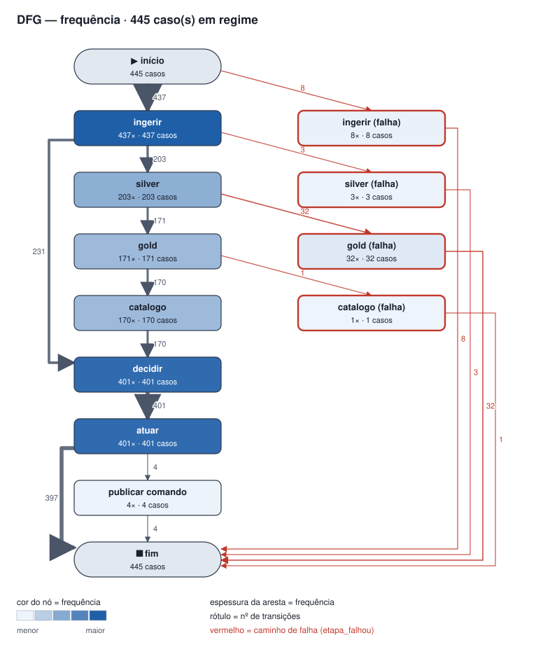
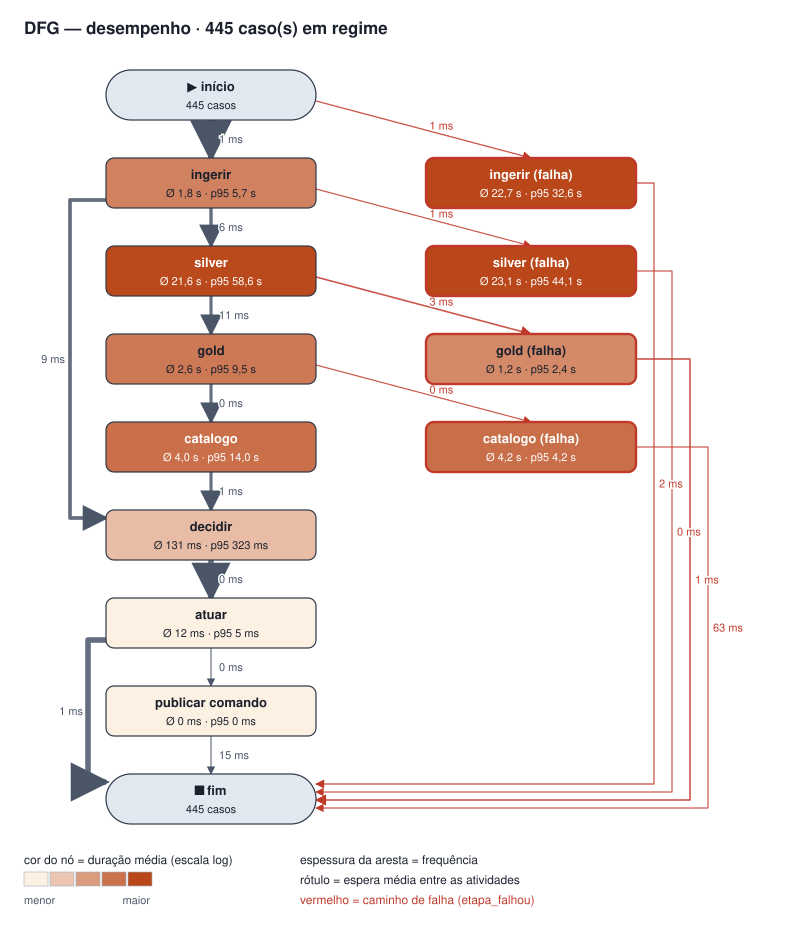
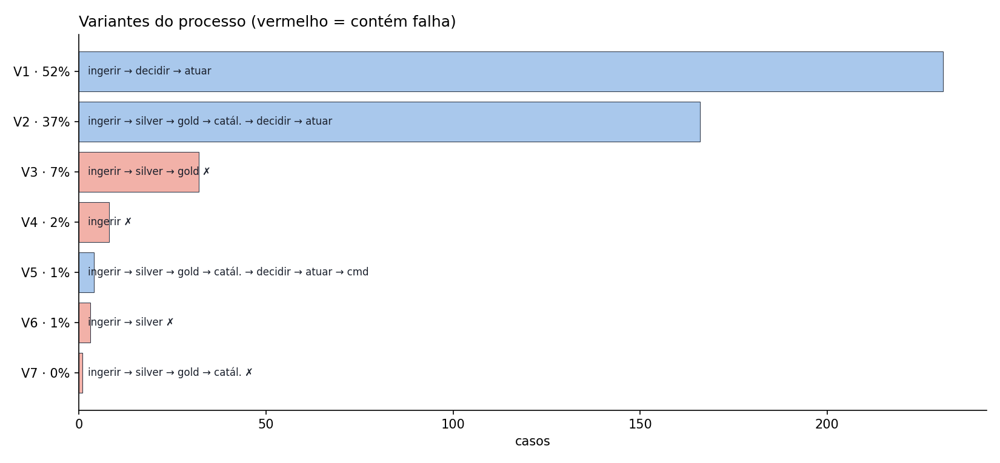
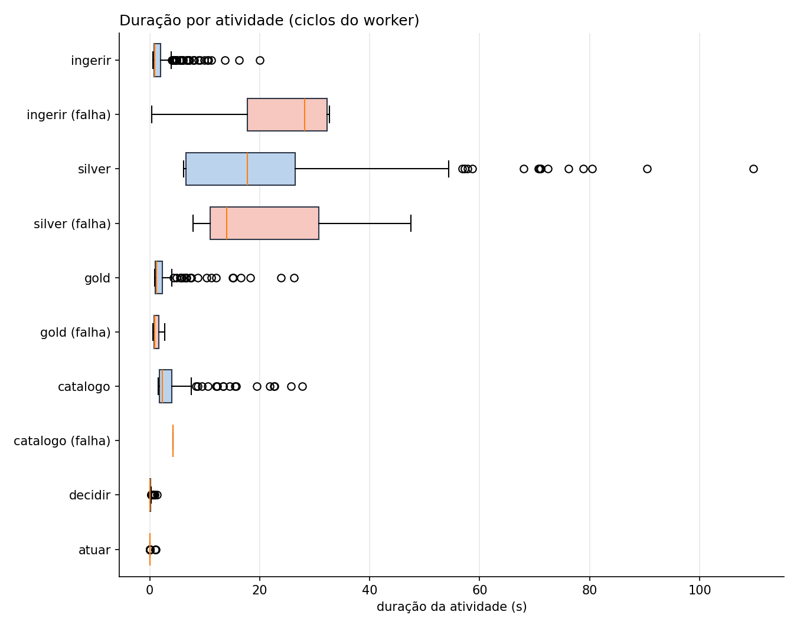
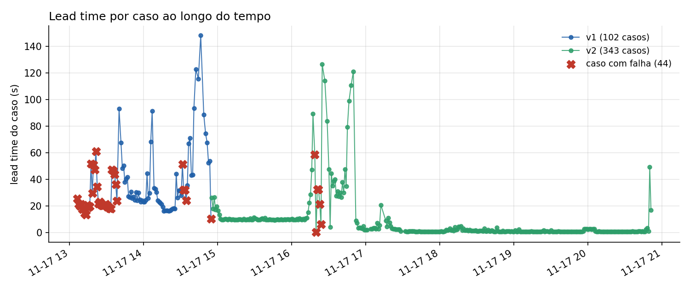

# Mineração de processos — AgroSmart (Fase 7)

Fonte: `outputs/plataforma/eventos.jsonl` · dados de 2026-11-17T13:06:17+00:00 a 2026-11-17T20:51:20+00:00 (UTC). Relatório gerado por `scripts/minerar_processos.py` — todos os números vêm do event log.

## 1. Escopo do event log

| item | valor |
|---|---|
| eventos lidos | 13733 |
| eventos sem `execucao_id` (anteriores à Fase 7, ignorados) | 18 |
| eventos de casos fora do escopo (origem ≠ worker) | 0 |
| linhas inválidas | 0 |
| casos analisados | 445 |
| casos em regime (ciclos) / carga inicial | 445 / 0 |
| casos por versão | v1: 102, v2: 343 |
| casos por status | falhou: 44, ok: 401 |
| instâncias de atividade | 1831 |


## 2. Modelagem

- **Caso** = `execucao_id` (um ciclo do worker, uma carga inicial ou um run da CLI).
- **Atividade** = etapa do pipeline; etapa que falhou vira a atividade `<etapa> (falha)` (desvio explícito no DFG e nas variantes).
- **Etapas puladas** ficam fora do fluxo (duração zero; no worker `simular`/`copiloto` são puladas sempre) e viram atributo do caso — o atalho do ciclo incremental aparece como a aresta `ingerir → decidir`.
- **Lifecycle** `start`/`complete` (`etapa_iniciada` / `etapa_concluida|etapa_falhou`); a forma intervalo (`event_log_intervalos.csv`) junta o par numa linha.
- **Atividade de domínio** `publicar comando`: os `comando_publicado` do caso viram uma instância (início = 1º comando, fim = último).
- **Recurso** = `origem`; atributos de caso: `versao_processo`, `tipo_caso`, `status`.
- Gargalos, variantes e DFG usam os casos em regime (a carga inicial roda uma vez e distorceria as médias); o event log exportado tem todos os casos.

Arquivos: `event_log.csv`, `event_log_intervalos.csv`, `event_log.xes`, `dfg_frequencia.svg`, `dfg_frequencia.png`, `dfg_desempenho.svg`, `dfg_desempenho.png`, `duracao_atividades.png`, `lead_time_casos.png`, `variantes.png`

## 3. Representação do processo (DFG)





| transição | frequência | espera média | espera p95 |
|---|---|---|---|
| ▶ início -> ingerir | 437 | 1 ms | 2 ms |
| decidir -> atuar | 401 | 0 ms | 1 ms |
| atuar -> ■ fim | 397 | 1 ms | 2 ms |
| ingerir -> decidir | 231 | 9 ms | 2 ms |
| ingerir -> silver | 203 | 6 ms | 1 ms |
| silver -> gold | 171 | 11 ms | 1 ms |
| catalogo -> decidir | 170 | 1 ms | 1 ms |
| gold -> catalogo | 170 | 0 ms | 1 ms |
| gold (falha) -> ■ fim | 32 | 1 ms | 1 ms |
| silver -> gold (falha) | 32 | 3 ms | 1 ms |
| ingerir (falha) -> ■ fim | 8 | 2 ms | 5 ms |
| ▶ início -> ingerir (falha) | 8 | 1 ms | 2 ms |
| atuar -> publicar comando | 4 | 0 ms | 0 ms |
| publicar comando -> ■ fim | 4 | 15 ms | 49 ms |
| ingerir -> silver (falha) | 3 | 1 ms | 1 ms |
| silver (falha) -> ■ fim | 3 | 0 ms | 1 ms |
| catalogo (falha) -> ■ fim | 1 | 63 ms | 63 ms |
| gold -> catalogo (falha) | 1 | 0 ms | 0 ms |


## 4. Descoberta e conformidade

Algoritmos via pm4py 2.7.23.12.

**Inductive Miner (árvore de processo):**

```
X( 'ingerir (falha)', ->( 'ingerir', X( 'silver (falha)', ->( X( tau, 'silver' ), X( 'gold (falha)', ->( X( tau, 'gold' ), X( 'catalogo (falha)', ->( X( tau, 'catalogo' ), 'decidir', 'atuar', X( tau, 'publicar comando' ) ) ) ) ) ) ) ) )
```

Rede de Petri: 10 lugares, 11 transições visíveis, 6 silenciosas, 34 arcos. BPMN: ExclusiveGateway=16, NormalEndEvent=1, StartEvent=1, Task=11.

| token replay | fitness | % casos conformes |
|---|---|---|
| modelo descoberto (IM) | 1,000 | 100,0% |
| caminho feliz (IM sobre casos OK) | 0,985 | 90,1% |

Conformidade por arestas contra o caminho feliz (casos sem falha): fitness **0,961**, 90,1% dos casos conformes.
Desvios: `silver -> gold (falha)` (32); `gold (falha) -> ■ fim` (32); `▶ início -> ingerir (falha)` (8); `ingerir (falha) -> ■ fim` (8); `ingerir -> silver (falha)` (3); `silver (falha) -> ■ fim` (3); `gold -> catalogo (falha)` (1); `catalogo (falha) -> ■ fim` (1).

**Heuristics Miner — dependências (≥ 0,5):**

| de | para | frequência | dependência |
|---|---|---|---|
| decidir | atuar | 401 | 0,998 |
| ingerir | decidir | 231 | 0,996 |
| ingerir | silver | 203 | 0,995 |
| silver | gold | 171 | 0,994 |
| catalogo | decidir | 170 | 0,994 |
| gold | catalogo | 170 | 0,994 |
| silver | gold (falha) | 32 | 0,970 |
| atuar | publicar comando | 4 | 0,800 |
| ingerir | silver (falha) | 3 | 0,750 |
| gold | catalogo (falha) | 1 | 0,500 |


## 5. Variantes



| id | variante | casos | % casos | lead time médio | desvio | versões |
|---|---|---|---|---|---|---|
| V1 | ingerir → decidir → atuar | 231 | 51,9% | 1,8 s | 2,0 s | v2:231 |
| V2 | ingerir → silver → gold → catalogo → decidir → atuar | 166 | 37,3% | 28,6 s | 27,9 s | v1:60, v2:106 |
| V3 | ingerir → silver → gold (falha) | 32 | 7,2% | 27,7 s | 12,8 s | v1:32 |
| V4 | ingerir (falha) | 8 | 1,8% | 22,8 s | 12,0 s | v1:3, v2:5 |
| V5 | ingerir → silver → gold → catalogo → decidir → atuar → publicar comando | 4 | 0,9% | 1,1 min | 17,9 s | v1:4 |
| V6 | ingerir → silver (falha) | 3 | 0,7% | 28,6 s | 17,1 s | v1:3 |
| V7 | ingerir → silver → gold → catalogo (falha) | 1 | 0,2% | 58,6 s | 0 ms | v2:1 |


## 6. Gargalos (participação no lead time)



| atividade | n | média | mediana | p95 | máx. | CV | % lead time |
|---|---|---|---|---|---|---|---|
| silver | 203 | 21,6 s | 17,8 s | 58,6 s | 1,8 min | 0,86 | 66,0% |
| ingerir | 437 | 1,8 s | 908 ms | 5,7 s | 20,0 s | 1,18 | 11,7% |
| catalogo | 170 | 4,0 s | 2,3 s | 14,0 s | 27,7 s | 1,15 | 10,3% |
| gold | 171 | 2,6 s | 1,3 s | 9,5 s | 26,2 s | 1,46 | 6,6% |
| ingerir (falha) | 8 | 22,7 s | 28,1 s | 32,6 s | 32,7 s | 0,53 | 2,7% |
| silver (falha) | 3 | 23,1 s | 14,0 s | 44,1 s | 47,5 s | 0,75 | 1,0% |
| decidir | 401 | 131 ms | 85 ms | 323 ms | 1,3 s | 0,96 | 0,8% |
| gold (falha) | 32 | 1,2 s | 943 ms | 2,4 s | 2,7 s | 0,46 | 0,6% |
| atuar | 401 | 12 ms | 1 ms | 5 ms | 1,1 s | 8,60 | 0,1% |
| catalogo (falha) | 1 | 4,2 s | 4,2 s | 4,2 s | 4,2 s | 0,00 | 0,1% |


Tempo fora das etapas (orquestração/espera): 0,1% do lead time (média 15 ms por caso).

**Maiores esperas entre atividades:**

| transição | n | média | mediana | p95 |
|---|---|---|---|---|
| catalogo (falha) -> ■ fim | 1 | 63 ms | 63 ms | 63 ms |
| publicar comando -> ■ fim | 4 | 15 ms | 1 ms | 49 ms |
| silver -> gold | 171 | 11 ms | 0 ms | 1 ms |
| ingerir -> decidir | 231 | 9 ms | 1 ms | 2 ms |
| ingerir -> silver | 203 | 6 ms | 0 ms | 1 ms |
| silver -> gold (falha) | 32 | 3 ms | 0 ms | 1 ms |
| ingerir (falha) -> ■ fim | 8 | 2 ms | 1 ms | 5 ms |
| atuar -> ■ fim | 397 | 1 ms | 0 ms | 2 ms |
| catalogo -> decidir | 170 | 1 ms | 0 ms | 1 ms |
| gold (falha) -> ■ fim | 32 | 1 ms | 1 ms | 1 ms |


## 7. Variação e lead time



Lead time: média 14,9 s, mediana 4,9 s, p95 57,6 s, máx. 2,5 min, desvio 22,6 s (CV 1,52).

Throughput: 57,4 casos/hora em 7,75 h; intervalo mediano entre inícios 60,0 s.

## 8. Falhas, MTTR e retrabalho

| etapa | execuções | falhas | taxa | erro mais frequente |
|---|---|---|---|---|
| gold | 203 | 32 | 15,8% | AttributeError: '_duckdb.DuckDBPyConnection' object has no attribute 'fetch_arrow_table' |
| ingerir | 445 | 8 | 1,8% | EndpointConnectionError: Could not connect to the endpoint URL: "http://minio:9000/agrosma |
| silver | 206 | 3 | 1,5% | etapa sem evento de conclusão (caso abortado) |
| catalogo | 171 | 1 | 0,6% | EndpointConnectionError: Could not connect to the endpoint URL: "http://minio:9000/agrosma |
| atuar | 401 | 0 | 0,0% |  |
| decidir | 401 | 0 | 0,0% |  |


Incidentes: 4 · MTTR: 11,7 min.

| início | atividade | casos afetados | recuperado por | TTR |
|---|---|---|---|---|
| 2026-11-17T13:06:42.545+00:00 | gold (falha) | 33 | ciclo-20261117T134001-3243 | 34,9 min |
| 2026-11-17T14:32:13.238+00:00 | silver (falha) | 4 | ciclo-20261117T143521-6bb7 | 3,7 min |
| 2026-11-17T14:54:41.401+00:00 | silver (falha) | 1 | ciclo-20261117T145510-fa2f | 54,9 s |
| 2026-11-17T16:19:37.707+00:00 | catalogo (falha) | 6 | ciclo-20261117T162439-f9af | 7,1 min |


Retentativas (etapa que falhou e foi reexecutada no caso seguinte): 41, 4 com sucesso.

Comandos de irrigação republicados sem mudança de payload: 2 de 4 (50,0%); por talhão: {'TLH-02': 2}.

Ciclos sem lote novo: 232 de 437 (53,1%); reprocessaram silver/gold/catálogo: 1 (1,9 min).

## 9. Antes × depois (v1 × v2)

| versão | casos | sucesso | lead time mediano (OK) | p95 (OK) | etapas/caso | % com silver/gold | gargalo |
|---|---|---|---|---|---|---|---|
| v1 | 102 | 62,7% | 30,3 s | 1,6 min | 4.79 | 97,1% | silver |
| v2 | 343 | 98,3% | 2,0 s | 35,1 s | 3.9 | 31,2% | silver |


Δ lead time mediano: -93,4% · Δ p95: -62,4% · Δ sucesso: 35.6 p.p.

## 10. Insights e oportunidades

1. **Gargalo** — `silver` concentra 66,0% do lead time (mediana 17,8 s, p95 58,6 s, máx. 1,8 min). → *Oportunidade:* reprocessar só as partições dos lotes novos e pular silver/gold/catálogo quando a ingestão não grava lote novo (ciclo incremental, v2)
2. **Concentração** — `silver` + `ingerir` somam 77,7% do lead time. → *Oportunidade:* listar só objetos novos na landing (watermark) e paralelizar os uploads
3. **Retrabalho de processamento** — 53,1% dos ciclos com ingestão OK não gravaram lote novo, e 1 deles reprocessaram silver/gold/catálogo mesmo assim (1,9 min no total). → *Oportunidade:* reprocessar só as partições dos lotes novos e pular silver/gold/catálogo quando a ingestão não grava lote novo (ciclo incremental, v2)
4. **Variação** — 7 variante(s) em 445 caso(s); a principal cobre 51,9%; lead time com CV 1,52 (desvio 22,6 s). 4 variante(s) contêm falha. → *Oportunidade:* padronizar o caminho feliz e tratar as variantes de falha abaixo.
5. **Falha em `gold`** — 32 de 203 execuções (15,8%); causa mais frequente: "AttributeError: '_duckdb.DuckDBPyConnection' object has no attribute 'fetch_arrow_table'". → *Oportunidade:* retentativa com backoff e escrita atômica das tabelas
6. **Falha em `ingerir`** — 8 de 445 execuções (1,8%); causa mais frequente: "EndpointConnectionError: Could not connect to the endpoint URL: "http://minio:9000/agrosmart-bronze"". → *Oportunidade:* health-check do MinIO antes do ciclo e retentativa com backoff dentro da etapa
7. **Falha em `silver`** — 3 de 206 execuções (1,5%); causa mais frequente: "etapa sem evento de conclusão (caso abortado)". → *Oportunidade:* health-check do lake antes do ciclo e retentativa com backoff dentro da etapa
8. **Recuperação (MTTR)** — 4 incidente(s); MTTR 11,7 min (da falha até o próximo caso OK); intervalo mediano entre ciclos 60,0 s. → *Oportunidade:* a recuperação depende do próximo ciclo: retentativa dentro do ciclo e alerta (Prometheus) na primeira falha encurtam o MTTR.
9. **Retentativas** — 41 etapa(s) com falha foram reexecutadas no caso seguinte; 4 com sucesso. → *Oportunidade:* tornar as etapas idempotentes (já são no bronze) e registrar a retentativa como tal.
10. **Retrabalho na atuação (idempotência)** — 2 de 4 comandos (50,0%) repetem o último comando do mesmo talhão sem mudar o payload (2 em ciclos consecutivos; 335 min de irrigação reenviados). → *Oportunidade:* chave de idempotência por talhão (não republicar comando igual ao vigente) ou estado retido no broker (retain) com o comando atual.
11. **Conformidade** — fitness 0,961 contra o caminho feliz; 90,1% dos casos conformes. → *Oportunidade:* os desvios são exatamente os caminhos de falha: atacar as causas acima.
12. **Throughput** — 57,4 casos/hora (51,7 OK/hora) em 7,75 h de operação. → *Oportunidade:* com o ciclo mais curto (v2), dá para reduzir o intervalo do worker e decidir mais perto do tempo real.
13. **Antes × depois (v1 → v2)** — lead time mediano dos casos OK 30,3 s → 2,0 s (-93,4%); p95 -62,4%; sucesso 62,7% → 98,3%; etapas por caso 4,79 → 3,90. → *Oportunidade:* a melhoria se paga onde não há lote novo; o próximo gargalo é o que sobra na v2 (`silver`).
